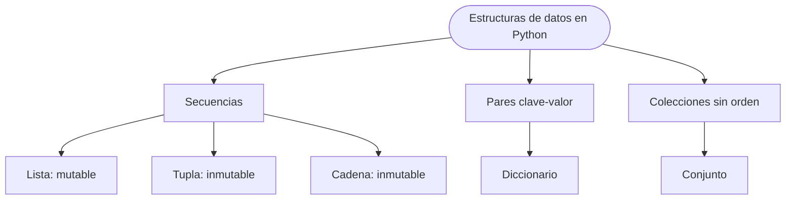

# TEMA 3: Estructuras de datos

### Bloque A. Programación Gráfica Multimedia | CDPC.1.A.1

> **Currículo LOMLOE - Andalucía** | Saberes básicos:
>
> - **CDPC.1.A.1.** Fundamentos de Programación.

---

## 1. ¿Qué es una estructura de datos?

Hasta ahora hemos guardado información en **variables simples**: una variable contiene un número, un texto o un booleano. Pero muchos problemas reales manejan **conjuntos de datos**: las notas de toda la clase, la lista de la compra, los contactos de una agenda o los píxeles de una imagen.

Una **estructura de datos** es una forma de **organizar y almacenar varios valores** bajo un mismo nombre, junto con las operaciones que permiten consultarlos, añadirlos, modificarlos o recorrerlos.

Python incorpora cuatro estructuras fundamentales:

| Estructura | Sintaxis | ¿Ordenada? | ¿Mutable? | Acceso |
|---|---|---|---|---|
| **Lista** (`list`) | `[1, 2, 3]` | Sí | Sí | Por índice |
| **Tupla** (`tuple`) | `(1, 2, 3)` | Sí | No | Por índice |
| **Diccionario** (`dict`) | `{"a": 1, "b": 2}` | Sí (desde Python 3.7) | Sí | Por clave |
| **Conjunto** (`set`) | `{1, 2, 3}` | No | Sí | Solo pertenencia |

A ellas se suman las **cadenas de texto** (`str`), que también son secuencias de caracteres, aunque inmutables.

### 1.1. Conceptos que aparecen en todas ellas

- **Elemento**: cada valor guardado.
- **Índice**: posición de un elemento en una secuencia (empieza en `0`).
- **Clave**: nombre que identifica un valor dentro de un diccionario.
- **Longitud**: número de elementos, obtenido con `len()`.
- **Mutabilidad**: capacidad de modificar la estructura después de crearla.



::: tip Idea clave
Elegir bien la estructura de datos simplifica el programa. Un diccionario resuelve en una línea una búsqueda que con listas necesitaría un bucle.
:::

---

## 2. Listas

Una **lista** es una colección **ordenada y mutable** de elementos. Es la estructura más utilizada porque sirve para casi todo: almacenar notas, nombres, coordenadas, filas de una tabla, etc.

### 2.1. Creación

```python
notas = [7.5, 8.0, 4.5, 9.25]
nombres = ["Ana", "Luis", "Marta"]
mixta = ["Ana", 17, True, 8.5]      # Python permite tipos distintos
vacia = []
otra = list("hola")                # ['h', 'o', 'l', 'a']
```

Los elementos se escriben entre **corchetes** y separados por comas. Una lista puede contener cualquier tipo de dato, incluso otras listas.

### 2.2. Acceso por índice

Cada elemento ocupa una posición numerada desde `0`. También se pueden usar **índices negativos**, que cuentan desde el final (`-1` es el último).

```python
nombres = ["Ana", "Luis", "Marta", "Eva"]

print(nombres[0])      # Ana
print(nombres[2])      # Marta
print(nombres[-1])     # Eva
print(nombres[-2])     # Marta
```

Si el índice no existe, Python lanza un error `IndexError: list index out of range`. Conviene comprobarlo con `len()` antes de acceder.

### 2.3. Slicing o rebanado

El **slicing** obtiene una **sublista** con la forma `lista[inicio:fin:paso]`. Incluye `inicio` pero **no** `fin`.

```python
notas = [7.5, 8.0, 4.5, 9.25, 6.0]

print(notas[1:4])      # [8.0, 4.5, 9.25]
print(notas[:2])       # [7.5, 8.0]
print(notas[3:])       # [9.25, 6.0]
print(notas[::2])      # [7.5, 4.5, 6.0]
print(notas[::-1])     # [6.0, 9.25, 4.5, 8.0, 7.5]  invertida
```

El slicing **crea una lista nueva**; no modifica la original.

### 2.4. Modificar, añadir y eliminar elementos

Las listas son **mutables**: podemos cambiar sus elementos después de crearlas.

```python
notas = [7.5, 8.0, 4.5]

notas[0] = 6.0          # modificar por índice
notas.append(9.0)       # añadir al final -> [6.0, 8.0, 4.5, 9.0]
notas.insert(1, 7.0)    # insertar en la posición 1
notas.remove(4.5)       # eliminar el primer 4.5 encontrado
ultima = notas.pop()    # extraer y devolver el último
del notas[0]            # eliminar por índice
notas.clear()           # vaciar la lista
```

| Método | Qué hace | Ejemplo |
|---|---|---|
| `append(x)` | Añade `x` al final | `notas.append(9)` |
| `insert(i, x)` | Inserta `x` en la posición `i` | `notas.insert(0, 5)` |
| `remove(x)` | Elimina la primera aparición de `x` | `notas.remove(4.5)` |
| `pop([i])` | Extrae y devuelve el elemento `i` (por defecto, el último) | `notas.pop()` |
| `index(x)` | Posición de la primera aparición de `x` | `notas.index(8.0)` |
| `count(x)` | Número de veces que aparece `x` | `notas.count(5)` |
| `sort()` | Ordena la lista (modifica) | `notas.sort()` |
| `reverse()` | Invierte el orden (modifica) | `notas.reverse()` |
| `copy()` | Devuelve una copia superficial | `otra = notas.copy()` |
| `extend(otra)` | Añade todos los elementos de `otra` | `notas.extend([1, 2])` |

::: warning `sort()` no devuelve una lista
`notas.sort()` ordena **en el sitio** y devuelve `None`. No escribas `notas = notas.sort()`, porque perderás la lista. Si quieres una lista nueva ordenada, usa `sorted(notas)`.
:::

### 2.5. Asignación frente a copia

Cuando asignamos una lista a otra variable, **no se copia**: ambas apuntan a la misma lista en memoria. Modificar una afecta a la otra.

```python
a = [1, 2, 3]
b = a               # b es un alias de a
b.append(4)

print(a)            # [1, 2, 3, 4]
print(b)            # [1, 2, 3, 4]

c = a.copy()        # copia independiente
c.append(5)
print(a)            # [1, 2, 3, 4]
print(c)            # [1, 2, 3, 4, 5]
```

También se puede copiar con `c = a[:]`. Para listas anidadas, `copy()` es **superficial**: las sublistas siguen compartidas.

### 2.6. Recorrer una lista

```python
nombres = ["Ana", "Luis", "Marta"]

# Recorrido directo por elementos
for nombre in nombres:
    print("Hola,", nombre)

# Recorrido por índices
for i in range(len(nombres)):
    print(i, nombres[i])

# Con enumerate: índice y elemento a la vez
for i, nombre in enumerate(nombres, start=1):
    print(i, "-", nombre)
```

### 2.7. Operadores y funciones integradas

```python
notas = [7.5, 8.0, 4.5, 9.25]

print(len(notas))             # 4
print(sum(notas))             # 29.25
print(max(notas), min(notas)) # 9.25 4.5
print(8.0 in notas)           # True
print(notas + [6.0])          # concatena
print(notas * 2)              # repite la lista
print(sorted(notas))          # copia ordenada
```

La **pertenencia** (`in`) recorre la lista elemento a elemento. En listas muy largas es lenta; si necesitas búsquedas frecuentes, un diccionario o un conjunto será mejor.

### 2.8. Listas anidadas y matrices

Una **lista de listas** permite representar una **matriz** o una tabla: cada fila es una lista.

```python
matriz = [
    [1, 2, 3],
    [4, 5, 6],
    [7, 8, 9]
]

print(matriz[0][1])       # 2  (fila 0, columna 1)
matriz[1][2] = 60         # modifica el 6

for fila in matriz:
    for valor in fila:
        print(valor, end=" ")
    print()               # salto de línea al terminar la fila
```

::: warning No crees matrices multiplicando listas
`[[0] * 3] * 3` crea **tres referencias a la misma fila**: al modificar una celda cambian las tres. La forma correcta es una comprensión:

```python
matriz = [[0] * 3 for _ in range(3)]
```
:::

### 2.9. Comprensión de listas

La **comprensión de listas** crea una lista nueva aplicando una expresión a cada elemento, con un `for` y, opcionalmente, un `if`:

```python
cuadrados = [n ** 2 for n in range(1, 6)]          # [1, 4, 9, 16, 25]
notas = [7.5, 8.0, 4.5, 9.25]
aprobados = [n for n in notas if n >= 5]           # [7.5, 8.0, 9.25]
dobles = [n * 2 for n in notas]                    # [15.0, 16.0, 9.0, 18.5]
```

Es una forma compacta y muy legible, pero si la condición se complica conviene volver al bucle tradicional.

### 2.10. Errores frecuentes

1. **Salirse del índice**: `notas[len(notas)]` siempre falla; el último índice es `len(notas) - 1`.
2. **Modificar la lista mientras se recorre**: eliminar elementos dentro de un `for` hace que se salten posiciones. Recorre una copia (`for x in lista.copy():`) o construye una lista nueva.
3. **Confundir `remove()` con `del`**: `remove(x)` busca por **valor**; `del lista[i]` elimina por **índice**.
4. **Perder el resultado de `sort()`**: devuelve `None`.
5. **Creer que `b = a` copia**: es un alias.

---

## 3. Tuplas

Una **tupla** es una colección **ordenada e inmutable**. Se escribe entre paréntesis (aunque los paréntesis pueden omitirse) y, una vez creada, **no se puede modificar**.

```python
punto = (3, 5)
colores = ("rojo", "verde", "azul")
un_elemento = (42,)        # la coma es obligatoria
otra = tuple([1, 2, 3])    # conversión desde lista

print(punto[0])            # 3
print(colores[-1])         # azul
print(len(colores))        # 3
print("verde" in colores)  # True
```

### 3.1. Inmutabilidad

```python
punto = (3, 5)
punto[0] = 7               # TypeError: 'tuple' object does not support item assignment
```

No existen `append()`, `remove()` ni `sort()`. Si necesitas modificar los datos, convierte a lista, cámbialos y vuelve a convertir:

```python
punto = (3, 5)
temporal = list(punto)
temporal[0] = 7
punto = tuple(temporal)    # (7, 5)
```

### 3.2. Desempaquetado

```python
punto = (3, 5)
x, y = punto
print(x, y)                # 3 5

nombre, edad, ciudad = ("Ana", 17, "Granada")
```

El **desempaquetado** también permite intercambiar dos variables sin una auxiliar:

```python
a, b = 1, 2
a, b = b, a
print(a, b)                # 2 1
```

### 3.3. Devolver varios valores

Una función que usa `return a, b` devuelve en realidad una **tupla**. Lo veremos con detalle en el tema de funciones:

```python
def minimo_y_maximo(lista):
    return min(lista), max(lista)

resultado = minimo_y_maximo([4, 9, 1, 7])
print(resultado)           # (1, 9)
menor, mayor = minimo_y_maximo([4, 9, 1, 7])
print(menor, mayor)        # 1 9
```

### 3.4. ¿Cuándo usar una tupla?

- Cuando los datos son **fijos** y no deben cambiar: coordenadas, fechas, configuraciones.
- Cuando queremos **proteger** la información de modificaciones accidentales.
- Cuando una función debe devolver **varios valores**.
- Como **clave de diccionario**, ya que las claves deben ser inmutables (por ejemplo, `(fila, columna)`).

---

## 4. Diccionarios

Un **diccionario** almacena **pares clave-valor**. En lugar de acceder por posición, se accede por una **clave** única. Es la estructura ideal para representar fichas, inventarios, agendas y relaciones de búsqueda.

### 4.1. Creación y acceso

```python
alumno = {
    "nombre": "Ana",
    "edad": 17,
    "notas": [7.5, 8.0, 9.0]
}

print(alumno["nombre"])        # Ana
print(alumno["notas"][0])      # 7.5

# get() evita el error si la clave no existe
print(alumno.get("telefono"))          # None
print(alumno.get("telefono", "sin datos"))  # sin datos
```

Si se accede con `alumno["telefono"]` y la clave no existe, se produce un `KeyError`.

### 4.2. Añadir, modificar y eliminar

```python
alumno["edad"] = 18                 # modificar
alumno["ciudad"] = "Granada"        # añadir una clave nueva
del alumno["notas"]                 # eliminar una clave
telefono = alumno.pop("telefono", "no existe")  # extraer con valor por defecto
alumno.clear()                      # vaciar el diccionario
```

Las **claves** deben ser de un tipo inmutable: texto, número o tupla. Los **valores** pueden ser de cualquier tipo, incluso listas u otros diccionarios.

### 4.3. Recorrer un diccionario

```python
alumno = {"nombre": "Ana", "edad": 17, "ciudad": "Granada"}

for clave in alumno:                    # recorre las claves
    print(clave)

for valor in alumno.values():           # recorre los valores
    print(valor)

for clave, valor in alumno.items():     # recorre pares
    print(clave, "->", valor)
```

| Método | Qué devuelve |
|---|---|
| `keys()` | Vista de las claves |
| `values()` | Vista de los valores |
| `items()` | Vista de pares `(clave, valor)` |
| `get(clave, defecto)` | Valor o `defecto` si no existe |
| `pop(clave, defecto)` | Elimina y devuelve el valor |
| `update(otro)` | Añade o actualiza varios pares |
| `clear()` | Vacía el diccionario |

La pertenencia `clave in diccionario` comprueba si existe la **clave** (no el valor), y es muy rápida.

### 4.4. Diccionarios anidados

```python
clase = {
    "Ana": {"edad": 17, "notas": [8, 9]},
    "Luis": {"edad": 18, "notas": [6, 7]}
}

print(clase["Ana"]["notas"][1])       # 9

for nombre, datos in clase.items():
    media = sum(datos["notas"]) / len(datos["notas"])
    print(nombre, "tiene una media de", media)
```

### 4.5. Ejemplo: contar frecuencias

Un diccionario es la forma natural de contar cuántas veces aparece cada elemento:

```python
# frecuencia.py
texto = "la casa de la playa tiene la puerta azul"
palabras = texto.split()

frecuencia = {}
for palabra in palabras:
    frecuencia[palabra] = frecuencia.get(palabra, 0) + 1

for palabra, veces in frecuencia.items():
    print(f"{palabra}: {veces}")
```

---

## 5. Conjuntos

Un **conjunto** (`set`) es una colección **sin orden y sin elementos duplicados**. Se usa para eliminar repetidos y para operaciones matemáticas de unión, intersección y diferencia.

```python
frutas = {"manzana", "pera", "manzana", "uva"}
print(frutas)                  # {'manzana', 'pera', 'uva'} (sin duplicados)

frutas.add("kiwi")
frutas.discard("pera")         # no falla si no existe
print("uva" in frutas)         # True
print(len(frutas))             # 3
```

::: warning El conjunto vacío no es `{}`
`{}` crea un **diccionario** vacío. Para un conjunto vacío se usa `set()`. Los conjuntos no admiten índices ni slicing (`frutas[0]` da error).
:::

### 5.1. Operaciones entre conjuntos

```python
a = {1, 2, 3, 4}
b = {3, 4, 5, 6}

print(a | b)     # unión:         {1, 2, 3, 4, 5, 6}
print(a & b)     # intersección:  {3, 4}
print(a - b)     # diferencia:    {1, 2}
print(a ^ b)     # diferencia simétrica: {1, 2, 5, 6}
```

### 5.2. Eliminar duplicados

```python
numeros = [3, 1, 2, 3, 1, 4, 2]
unicos = set(numeros)          # {1, 2, 3, 4}
print(list(unicos))            # el orden no está garantizado

# Si importa conservar el orden de aparición:
sin_repetir = list(dict.fromkeys(numeros))
print(sin_repetir)             # [3, 1, 2, 4]
```

---

## 6. Las cadenas también son secuencias

Un `str` es una **secuencia inmutable de caracteres**. Comparte con listas y tuplas el índice, el slicing, `len()` y el operador `in`.

```python
frase = "Python es divertido"

print(frase[0])          # P
print(frase[-1])         # o
print(frase[0:6])        # Python
print("divertido" in frase)   # True
print(frase.upper())     # PYTHON ES DIVERTIDO
print(frase.lower())     # python es divertido
print(frase.replace("divertido", "genial"))
print(frase.split())     # ['Python', 'es', 'divertido']
```

| Método | Qué hace |
|---|---|
| `upper()` / `lower()` | Mayúsculas / minúsculas |
| `strip()` | Elimina espacios al principio y al final |
| `replace(a, b)` | Sustituye `a` por `b` |
| `split(sep)` | Divide y devuelve una lista |
| `join(lista)` | Une una lista con el separador |
| `find(x)` | Posición de `x` (`-1` si no está) |
| `startswith(x)` / `endswith(x)` | Comprueba inicio o final |

```python
palabras = ["Ana", "Luis", "Marta"]
print(", ".join(palabras))     # Ana, Luis, Marta

entrada = "  rojo, verde , azul "
colores = [c.strip() for c in entrada.split(",")]
print(colores)                 # ['rojo', 'verde', 'azul']
```

No se puede modificar un carácter por índice (`frase[0] = "J"` es un error). Hay que crear una cadena nueva.

---

## 7. Pilas y colas con listas

Hay dos estructuras clásicas que se construyen sobre una lista o una cola doble:

- **Pila** (*stack*): el último en entrar es el primero en salir (**LIFO**). Se usa en deshacer, historial de navegación o llamadas a funciones.
- **Cola** (*queue*): el primero en entrar es el primero en salir (**FIFO**). Se usa en impresión, turnos o mensajes.

```python
# Pila: append() y pop() trabajan por el mismo extremo
pila = []
pila.append("página 1")
pila.append("página 2")
pila.append("página 3")
print(pila.pop())        # página 3
print(pila.pop())        # página 2

# Cola: deque evita el coste de quitar por el principio
from collections import deque

cola = deque(["Ana", "Luis"])
cola.append("Marta")     # llega al final
print(cola.popleft())    # Ana
print(cola.popleft())    # Luis
```

Con una lista normal también se puede hacer una cola con `pop(0)`, pero es menos eficiente porque desplaza todos los elementos.

---

## 8. ¿Qué estructura debo elegir?

| Necesito... | Estructura recomendada |
|---|---|
| Guardar una colección que voy a modificar | **Lista** |
| Guardar datos fijos que no deben cambiar | **Tupla** |
| Buscar un valor por un nombre o identificador | **Diccionario** |
| Evitar duplicados u operar con conjuntos | **Conjunto** |
| Guardar una tabla o matriz | **Lista de listas** |
| Recorrer y transformar texto | **Cadena** (y listas auxiliares) |
| Implementar deshacer o historial | **Pila** (lista) |
| Atender elementos por orden de llegada | **Cola** (`deque`) |

Regla práctica: si el acceso principal es **por posición**, usa una lista o tupla; si es **por nombre**, usa un diccionario; si lo importante es **la pertenencia o la unicidad**, usa un conjunto.

---

## 9. De las listas de Python a los arrays de Processing

En Processing (Java) la estructura equivalente a una lista de tamaño fijo es el **array**. Se declara indicando el tipo de sus elementos y se accede por índice, igual que en Python. La diferencia principal es que **su tamaño no cambia** después de crearlo.

```java
int[] notas = {7, 8, 5, 9};       // array literal
int[] vacias = new int[5];        // cinco ceros

println(notas[0]);                // 7
println(notas.length);            // 4 (propiedad, sin paréntesis)

for (int i = 0; i < notas.length; i++) {
  println(notas[i]);
}

// Recorrido abreviado
for (int nota : notas) {
  println(nota);
}
```

Si necesitas una colección que crezca, Processing ofrece `ArrayList`:

```java
ArrayList<String> nombres = new ArrayList<String>();
nombres.add("Ana");
nombres.add("Luis");
println(nombres.get(0));     // Ana
println(nombres.size());     // 2
nombres.remove(0);
```

::: tip Para más adelante
Estos arrays se usan continuamente en los gráficos y animaciones del **Tema 4**. Por eso conviene tener claro ahora qué es un índice, cómo se recorre una colección y cómo se accede a sus elementos.
:::

---

## 10. Buenas prácticas

1. **Elige la estructura por la operación principal**: recorrer, buscar por clave o evitar duplicados.
2. **Usa nombres en plural** para colecciones: `notas`, `alumnos`, `colores`.
3. **Evita índices mágicos**: `notas[3]` dice poco; mejor `notas[INDICE_PARCIAL]` o recorrer con un `for`.
4. **No modifiques una lista mientras la recorres**: itera sobre una copia o crea otra lista.
5. **Distingue asignación de copia**: usa `.copy()` o `[:]` cuando quieras independencia.
6. **Comprueba los casos límite**: lista vacía, un solo elemento, índice fuera de rango.
7. **Documenta la forma de las estructuras complejas**: por ejemplo, "matriz de `filas × columnas`".
8. **Prefiere `get()` en diccionarios** cuando la clave puede no existir.

---

## Ejercicios

### Ejercicio 1: estadísticas de notas

Crea una lista con las notas de una clase (al menos ocho valores). Muestra la nota media, la máxima, la mínima, la lista ordenada de mayor a menor y cuántos alumnos han aprobado. Hazlo primero con funciones integradas y después con un bucle.

::: details Ver solución {close}

**Con funciones integradas:**

```python
notas = [7.5, 8.0, 4.5, 9.25, 6.0, 3.5, 5.0, 10.0]

media = sum(notas) / len(notas)
maxima = max(notas)
minima = min(notas)
ordenadas = sorted(notas, reverse=True)
aprobados = len([nota for nota in notas if nota >= 5])

print("Media:", media)
print("Máxima:", maxima)
print("Mínima:", minima)
print("Ordenadas de mayor a menor:", ordenadas)
print("Aprobados:", aprobados)
```

**Con un bucle:**

```python
notas = [7.5, 8.0, 4.5, 9.25, 6.0, 3.5, 5.0, 10.0]

suma = 0
maxima = notas[0]
minima = notas[0]
aprobados = 0

for nota in notas:
    suma += nota

    if nota > maxima:
        maxima = nota

    if nota < minima:
        minima = nota

    if nota >= 5:
        aprobados += 1

media = suma / len(notas)

print("Media:", media)
print("Máxima:", maxima)
print("Mínima:", minima)
print("Ordenadas de mayor a menor:", sorted(notas, reverse=True))
print("Aprobados:", aprobados)
```

**Explicación:**

- `sum()` suma todos los elementos y `len()` cuenta cuántos hay; la media es la división de ambos valores.
- `max()` y `min()` devuelven el mayor y el menor elemento de la lista.
- `sorted(notas, reverse=True)` devuelve una **copia ordenada** de mayor a menor sin modificar la original.
- La comprensión `[nota for nota in notas if nota >= 5]` crea una lista solo con las notas aprobadas; `len()` cuenta cuántas son.
- En la versión con bucle, `maxima` y `minima` se inicializan con el primer elemento para poder comparar el resto.
- El acumulador `suma` y el contador `aprobados` se actualizan en cada vuelta del `for`.

:::

### Ejercicio 2: gestión de nombres

Pide nombres por teclado hasta que el usuario escriba `"fin"`. Guárdalos en una lista, elimina los duplicados conservando el orden y muestra la lista final ordenada alfabéticamente. Indica cuántos nombres se han descartado por estar repetidos.

::: details Ver solución {close}

```python
nombres = []

while True:
    nombre = input("Introduce un nombre (o 'fin' para terminar): ").strip()

    if nombre.lower() == "fin":
        break

    if nombre:
        nombres.append(nombre)

sin_duplicados = list(dict.fromkeys(nombres))
descartados = len(nombres) - len(sin_duplicados)
nombres_ordenados = sorted(sin_duplicados, key=str.lower)

print("Lista original:", nombres)
print("Sin duplicados:", sin_duplicados)
print("Ordenada alfabéticamente:", nombres_ordenados)
print("Nombres descartados por repetidos:", descartados)
```

**Explicación:**

- El bucle `while True` se repite hasta que se ejecuta `break` al escribir `"fin"`.
- `strip()` elimina los espacios que puedan quedar al principio o al final del nombre.
- `dict.fromkeys(nombres)` crea un diccionario usando los nombres como claves; al convertirlo de nuevo a lista se eliminan los duplicados y se conserva el orden de la primera aparición.
- `len(nombres) - len(sin_duplicados)` calcula cuántos nombres repetidos se han descartado.
- `sorted(..., key=str.lower)` ordena alfabéticamente sin distinguir mayúsculas de minúsculas.

:::

### Ejercicio 3: matriz 3 × 3

Crea una matriz de 3 filas y 3 columnas con números introducidos por el usuario. Muestra la matriz en forma de tabla, la suma de la diagonal principal y su traspuesta (intercambiando filas y columnas).

::: details Ver solución {close}

```python
matriz = []

for i in range(3):
    fila = []

    for j in range(3):
        valor = int(input(f"Valor [{i}][{j}]: "))
        fila.append(valor)

    matriz.append(fila)

print("\nMatriz:")
for fila in matriz:
    for valor in fila:
        print(f"{valor:4}", end="")
    print()

suma_diagonal = 0

for i in range(3):
    suma_diagonal += matriz[i][i]

print("Suma de la diagonal principal:", suma_diagonal)

traspuesta = []

for i in range(3):
    fila = []

    for j in range(3):
        fila.append(matriz[j][i])

    traspuesta.append(fila)

print("Traspuesta:")
for fila in traspuesta:
    for valor in fila:
        print(f"{valor:4}", end="")
    print()
```

**Explicación:**

- La matriz se construye como una **lista de listas**: cada vuelta del primer `for` crea una fila y la añade a la matriz.
- El segundo bucle recorre cada fila y cada valor para mostrarlos con un ancho fijo de cuatro caracteres.
- Los elementos de la diagonal principal son `matriz[0][0]`, `matriz[1][1]` y `matriz[2][2]`, es decir, aquellos cuyo índice de fila coincide con el de columna.
- La traspuesta intercambia fila y columna: el elemento de la posición `[i][j]` pasa a la posición `[j][i]`.
- `print()` sin argumentos al final de cada fila añade el salto de línea.

:::

### Ejercicio 4: agenda de contactos

Usa un diccionario donde la clave sea el nombre y el valor, el teléfono. Implementa un menú con `while` que permita añadir, buscar, eliminar y listar contactos. Al buscar uno inexistente, muestra un aviso sin que el programa falle.

::: details Ver solución {close}

```python
agenda = {}

while True:
    print("\n--- AGENDA ---")
    print("1. Añadir contacto")
    print("2. Buscar contacto")
    print("3. Eliminar contacto")
    print("4. Listar contactos")
    print("5. Salir")

    opcion = input("Elige una opción: ")

    if opcion == "1":
        nombre = input("Nombre: ").strip()
        telefono = input("Teléfono: ").strip()
        agenda[nombre] = telefono
        print("Contacto guardado.")

    elif opcion == "2":
        nombre = input("Nombre a buscar: ").strip()

        if nombre in agenda:
            print(f"{nombre}: {agenda[nombre]}")
        else:
            print("Contacto no encontrado.")

    elif opcion == "3":
        nombre = input("Nombre a eliminar: ").strip()

        if nombre in agenda:
            del agenda[nombre]
            print("Contacto eliminado.")
        else:
            print("Contacto no encontrado.")

    elif opcion == "4":
        if not agenda:
            print("La agenda está vacía.")
        else:
            for nombre, telefono in agenda.items():
                print(f"{nombre}: {telefono}")

    elif opcion == "5":
        print("Fin del programa.")
        break

    else:
        print("Opción no válida.")
```

**Explicación:**

- El diccionario `agenda` guarda cada nombre como clave y su teléfono como valor.
- Asignar `agenda[nombre] = telefono` añade el contacto o actualiza su teléfono si ya existía.
- Antes de buscar o eliminar se comprueba `nombre in agenda` para evitar un `KeyError`.
- `del agenda[nombre]` elimina el contacto de forma segura una vez comprobado que existe.
- `items()` devuelve los pares nombre-teléfono para listarlos uno por uno.
- El `while True` mantiene el menú activo hasta que se elige la opción de salir.

:::

### Ejercicio 5: frecuencia de palabras

Pide una frase, divídela con `split()`, cuenta cuántas veces aparece cada palabra (ignorando mayúsculas y signos sencillos) y muestra las palabras ordenadas de más a menos frecuentes. Utiliza un diccionario y `sorted()` con una función `lambda` como clave.

::: details Ver solución {close}

```python
frase = input("Introduce una frase: ")

frase = frase.lower()

for signo in ".,;:!?¡¿\"'()":
    frase = frase.replace(signo, "")

palabras = frase.split()
frecuencia = {}

for palabra in palabras:
    frecuencia[palabra] = frecuencia.get(palabra, 0) + 1

ordenadas = sorted(
    frecuencia.items(),
    key=lambda pareja: pareja[1],
    reverse=True
)

for palabra, veces in ordenadas:
    print(f"{palabra}: {veces}")
```

**Explicación:**

- `lower()` convierte toda la frase a minúsculas para que `"Python"` y `"python"` cuenten como la misma palabra.
- El bucle recorre una cadena de signos y los sustituye por una cadena vacía, eliminándolos.
- `split()` separa la frase por espacios y devuelve una lista de palabras.
- `frecuencia.get(palabra, 0) + 1` obtiene el contador actual (o `0` si es la primera vez) y lo incrementa.
- `frecuencia.items()` devuelve pares `(palabra, veces)`; `sorted()` los ordena usando como clave `pareja[1]`, que es la frecuencia.
- `reverse=True` coloca primero las palabras más repetidas.

:::

### Ejercicio 6: conjuntos de asignaturas

Dos listas contienen los alumnos matriculados en dos optativas. Conviértelas en conjuntos y muestra: quiénes están en ambas, quiénes están solo en la primera, quiénes están en una u otra y quiénes no se repiten. Ordena el resultado antes de mostrarlo.

::: details Ver solución {close}

```python
optica1 = ["Ana", "Luis", "Marta", "Ana", "Eva"]
optica2 = ["Luis", "Eva", "Pablo", "Luis"]

alumnos1 = set(optica1)
alumnos2 = set(optica2)

print("En ambas:", sorted(alumnos1 & alumnos2))
print("Solo en la primera:", sorted(alumnos1 - alumnos2))
print("En una u otra:", sorted(alumnos1 | alumnos2))
print("Solo en una (no se repiten):", sorted(alumnos1 ^ alumnos2))
```

**Explicación:**

- `set()` convierte cada lista en un conjunto, eliminando automáticamente los nombres duplicados.
- `&` calcula la intersección: alumnos que están en las dos optativas.
- `-` calcula la diferencia: alumnos de la primera que no están en la segunda.
- `|` calcula la unión: todos los alumnos de cualquiera de las dos optativas.
- `^` calcula la diferencia simétrica: alumnos que están solo en una de las dos, es decir, los que no se repiten.
- `sorted()` convierte el conjunto en una lista ordenada alfabéticamente para mostrar el resultado.

:::

### Ejercicio 7: pila y cola

Simula el historial de un navegador con una pila: visita tres páginas, retrocede dos veces y muestra la página actual. Después simula con `deque` una cola de atención en una oficina: llegan tres personas, se atiende a dos y se muestra quién queda esperando.

::: details Ver solución {close}

**Historial con una pila:**

```python
historial = []

historial.append("inicio")
historial.append("noticias")
historial.append("deportes")

print("Página actual:", historial[-1])

historial.pop()
print("Atrás ->", historial[-1])

historial.pop()
print("Atrás ->", historial[-1])
```

**Cola de atención con `deque`:**

```python
from collections import deque

cola = deque()

cola.append("Ana")
cola.append("Luis")
cola.append("Marta")

print("Atendiendo a", cola.popleft())
print("Atendiendo a", cola.popleft())
print("Quedan esperando:", list(cola))
```

**Explicación:**

- Una **pila** sigue el criterio LIFO: el último elemento en entrar es el primero en salir.
- `append()` añade al final y `pop()` extrae el último elemento; por eso se usan para el historial.
- `historial[-1]` muestra la página actual sin extraerla.
- Una **cola** sigue el criterio FIFO: el primero en llegar es el primero en ser atendido.
- `deque.append()` añade al final y `popleft()` extrae por el principio de forma eficiente.
- `list(cola)` convierte la cola restante en una lista para mostrar quién sigue esperando.

:::

### Ejercicio 8: array en Processing

Cuando llegues al Tema 4, crea un sketch con un array de diez números enteros y dibuja un **gráfico de barras**: la altura de cada barra será el valor correspondiente y su posición horizontal se calculará con el índice. Recorre el array con un bucle `for`.

::: details Ver solución {close}

```java
int[] valores = {3, 7, 2, 9, 5, 8, 4, 6, 1, 10};

int margen = 20;
int anchoBarra = 30;
int separacion = 10;

void setup() {
  size(500, 300);
  textAlign(CENTER);
}

void draw() {
  background(240);

  for (int i = 0; i < valores.length; i++) {
    float x = margen + i * (anchoBarra + separacion);
    float altura = valores[i] * 20;
    float y = height - margen - altura;

    fill(50, 120, 200);
    rect(x, y, anchoBarra, altura);

    fill(0);
    text(valores[i], x + anchoBarra / 2, y - 5);
  }
}
```

**Explicación:**

- `int[] valores` declara un **array** de enteros con un tamaño fijo de diez elementos.
- `valores.length` devuelve el número de elementos del array; en Java es una propiedad, sin paréntesis.
- El bucle recorre el array desde `0` hasta `length - 1`.
- La posición horizontal `x` se calcula multiplicando el índice por el ancho de cada barra más la separación.
- La altura se obtiene multiplicando el valor por una escala; la coordenada `y` se calcula desde abajo, porque en Processing el eje Y crece hacia abajo.
- `rect(x, y, ancho, alto)` dibuja cada barra y `text()` escribe su valor encima.

:::
