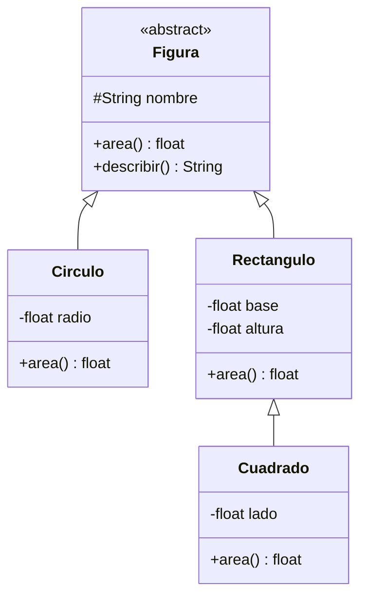
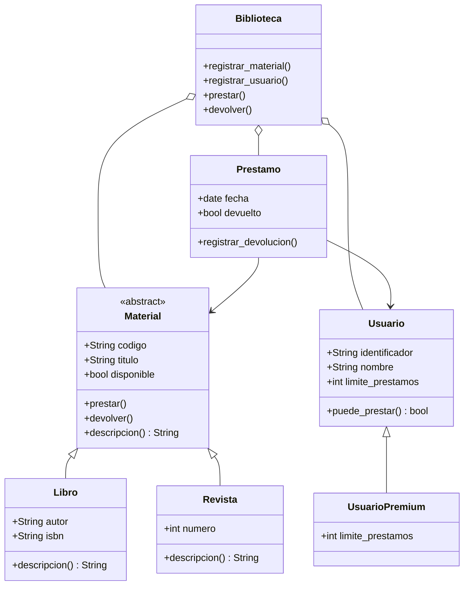

# A.2. Orientación a objetos

### Bloque A. Programación

**Referencia curricular**

-   **PRYC.2.A.2.1.** Clases, objetos y constructores. Sobrecarga,
    encapsulamiento y ocultación.
-   **PRYC.2.A.2.2.** Herencia. Subclases y superclases. Interfaces.
    Polimorfismo.

**Lenguaje de referencia:** Python 3.

Este bloque se apoya en el [Bloque A.1. Programación](tema1.md), donde se
estudian variables, estructuras de control, funciones y estructuras de
datos, y se integra en el [Bloque A.3. Ciclo de vida del software](tema3.md),
que aporta el análisis, el diseño, las pruebas, el control de versiones y
el trabajo en equipo.

La orientación a objetos no sustituye a la programación estructurada: la
organiza alrededor de **objetos** que combinan datos y comportamiento.

------------------------------------------------------------------------

# Índice

1.  Del dato al objeto
2.  Clases y objetos
3.  Constructores
4.  Atributos y métodos
5.  Sobrecarga
6.  Encapsulamiento y ocultación
7.  Herencia
8.  Interfaces y clases abstractas
9.  Polimorfismo
10. Composición y relaciones entre clases
11. Diseño orientado a objetos y UML
12. La orientación a objetos en el ciclo de vida
13. Buenas prácticas y errores frecuentes
14. Proyecto integrador
15. Ejercicios
16. Solucionario orientativo
17. Glosario
18. Relación con el currículo
19. Lista de comprobación final

------------------------------------------------------------------------

# 1. Del dato al objeto

## 1.1. Límites de la programación estructurada

En el bloque A.1 se organizan los programas con funciones y estructuras de
datos:

``` python
alumno = {
    "nombre": "Ana",
    "edad": 17,
    "notas": [8, 7, 9]
}


def calcular_media(alumno):
    return sum(alumno["notas"]) / len(alumno["notas"])
```

Este enfoque funciona bien en programas pequeños. Sin embargo, cuando el
sistema crece aparecen problemas:

-   Los datos y las funciones que los manipulan están separados.
-   Cualquier función puede modificar el diccionario sin control.
-   Es difícil garantizar que los datos sean coherentes.
-   La lógica relacionada se dispersa por el programa.
-   Reutilizar el código en otro contexto resulta complicado.

La orientación a objetos propone agrupar los datos y las operaciones que
trabajan con ellos en una misma unidad: el **objeto**.

## 1.2. ¿Qué es la orientación a objetos?

La **programación orientada a objetos** (POO) es un paradigma que organiza
el software en torno a objetos que representan entidades del problema.

Cada objeto tiene:

-   **Estado:** los datos que conoce.
-   **Comportamiento:** las operaciones que puede realizar.
-   **Identidad:** una existencia propia, distinta de otros objetos.

Por ejemplo, un objeto `Alumno` puede tener:

-   estado: nombre, edad y notas;
-   comportamiento: calcular su media, añadir una nota o presentarse;
-   identidad: es distinto de otro alumno aunque se llame igual.

## 1.3. Los cuatro pilares

| Principio | Idea principal |
| --- | --- |
| Abstracción | Modelar solo lo relevante para el problema |
| Encapsulamiento | Agrupar datos y comportamiento, controlando el acceso |
| Herencia | Reutilizar y especializar comportamiento |
| Polimorfismo | Tratar objetos distintos mediante una interfaz común |

Estos principios se desarrollan a lo largo del tema.

## 1.4. Abstracción

La **abstracción** consiste en quedarse con los aspectos importantes de una
entidad y ocultar los detalles irrelevantes.

Al conducir un coche no necesitamos conocer el funcionamiento interno del
motor: utilizamos el volante, los pedales y la palanca de cambios. Del
mismo modo, al usar una clase `CuentaBancaria` no necesitamos saber cómo
se almacena internamente el saldo; utilizamos sus métodos públicos.

Una buena abstracción:

-   utiliza nombres del dominio del problema;
-   oculta detalles de implementación;
-   ofrece una interfaz clara;
-   evita exponer información innecesaria.

## 1.5. Clase frente a objeto

Una **clase** es una plantilla o definición. Un **objeto** es una
instancia concreta de esa clase.

``` text
Clase: Alumno
Objetos: Ana, Luis, Marta
```

La clase indica qué atributos tendrán los objetos y qué métodos podrán
ejecutar. Cada objeto tiene sus propios valores.

``` python
class Alumno:
    def __init__(self, nombre, edad):
        self.nombre = nombre
        self.edad = edad


ana = Alumno("Ana", 17)
luis = Alumno("Luis", 18)

print(ana.nombre)
print(luis.nombre)
```

`ana` y `luis` son objetos distintos de la misma clase.

------------------------------------------------------------------------

# 2. Clases y objetos

## 2.1. Definición de una clase

Sintaxis básica:

``` python
class NombreDeLaClase:
    def __init__(self, parametros):
        self.atributo = valor

    def metodo(self):
        return resultado
```

Convenciones:

-   Los nombres de clase se escriben en `PascalCase`: `CuentaBancaria`.
-   Los nombres de atributos y métodos, en `snake_case`: `saldo_actual`.
-   La palabra `self` representa al objeto actual.

## 2.2. Creación de objetos

``` python
class Alumno:
    def __init__(self, nombre, edad):
        self.nombre = nombre
        self.edad = edad

    def saludar(self):
        return f"Hola, soy {self.nombre}"


ana = Alumno("Ana", 17)
print(ana.saludar())
```

`Alumno("Ana", 17)` crea un objeto y llama automáticamente al constructor.

## 2.3. El parámetro `self`

`self` es una referencia al objeto sobre el que se llama el método.

``` python
ana = Alumno("Ana", 17)
luis = Alumno("Luis", 18)

print(ana.saludar())   # Hola, soy Ana
print(luis.saludar())  # Hola, soy Luis
```

Cuando se ejecuta `ana.saludar()`, Python pasa `ana` como valor de `self`.
Por eso el método puede acceder a `self.nombre`.

No es obligatorio llamarlo `self`, pero es una convención universal en
Python y debe respetarse.

## 2.4. Atributos de instancia

Los atributos definidos con `self` pertenecen a cada objeto:

``` python
class Contador:
    def __init__(self):
        self.valor = 0

    def incrementar(self):
        self.valor += 1


c1 = Contador()
c2 = Contador()

c1.incrementar()

print(c1.valor)  # 1
print(c2.valor)  # 0
```

## 2.5. Atributos de clase

Un atributo de clase se define directamente en la clase y se comparte
entre todos los objetos:

``` python
class Alumno:
    centro = "IES Ejemplo"
    numero_alumnos = 0

    def __init__(self, nombre):
        self.nombre = nombre
        Alumno.numero_alumnos += 1


ana = Alumno("Ana")
luis = Alumno("Luis")

print(ana.centro)             # IES Ejemplo
print(Alumno.numero_alumnos)  # 2
```

Conviene usarlos para valores comunes o constantes de la clase, no para
datos que deban ser distintos en cada objeto.

## 2.6. Métodos

Un **método** es una función definida dentro de una clase.

``` python
class Rectangulo:
    def __init__(self, base, altura):
        self.base = base
        self.altura = altura

    def area(self):
        return self.base * self.altura

    def perimetro(self):
        return 2 * (self.base + self.altura)


r = Rectangulo(5, 3)

print(r.area())       # 15
print(r.perimetro())  # 16
```

## 2.7. Identidad e igualdad

-   `is` compara identidad: si dos referencias apuntan al mismo objeto.
-   `==` compara igualdad: depende de cómo se defina el método `__eq__`.

``` python
a = Alumno("Ana", 17)
b = Alumno("Ana", 17)
c = a

print(a is c)  # True
print(a is b)  # False
print(a == b)  # False, salvo que se defina __eq__
```

Se puede definir la igualdad por valor:

``` python
class Punto:
    def __init__(self, x, y):
        self.x = x
        self.y = y

    def __eq__(self, otro):
        if not isinstance(otro, Punto):
            return NotImplemented
        return self.x == otro.x and self.y == otro.y

    def __hash__(self):
        return hash((self.x, self.y))


print(Punto(1, 2) == Punto(1, 2))  # True
```

## 2.8. Representación de objetos

Los métodos especiales `__str__` y `__repr__` permiten controlar cómo se
muestra un objeto.

``` python
class Alumno:
    def __init__(self, nombre, edad):
        self.nombre = nombre
        self.edad = edad

    def __str__(self):
        return f"{self.nombre} ({self.edad} años)"

    def __repr__(self):
        return f"Alumno(nombre={self.nombre!r}, edad={self.edad!r})"


ana = Alumno("Ana", 17)

print(str(ana))   # Ana (17 años)
print(repr(ana))  # Alumno(nombre='Ana', edad=17)
```

-   `__str__` está pensado para personas usuarias.
-   `__repr__` está pensado para depuración y desarrollo.

## 2.9. Comprobar tipos

``` python
ana = Alumno("Ana", 17)

print(type(ana))
print(isinstance(ana, Alumno))
```

`isinstance()` es preferible a comparar `type()` cuando se trabaja con
herencia, porque tiene en cuenta las subclases.

------------------------------------------------------------------------

# 3. Constructores

## 3.1. El método `__init__`

En Python, el método que se ejecuta al crear un objeto es `__init__`.

``` python
class CuentaBancaria:
    def __init__(self, titular, saldo=0):
        self.titular = titular
        self.saldo = saldo


cuenta = CuentaBancaria("Ana", 100)
```

Técnicamente, `__init__` inicializa un objeto que ya ha sido creado por
`__new__`. En la práctica se le llama **constructor**.

## 3.2. Validación en el constructor

El constructor es un buen lugar para garantizar que el objeto nace en un
estado válido.

``` python
class CuentaBancaria:
    def __init__(self, titular, saldo=0):
        if not titular or not titular.strip():
            raise ValueError("El titular es obligatorio")

        if saldo < 0:
            raise ValueError("El saldo inicial no puede ser negativo")

        self.titular = titular.strip()
        self.saldo = saldo
```

Uso:

``` python
cuenta = CuentaBancaria("Ana", 100)
```

Si se intenta crear con datos inválidos:

``` python
try:
    cuenta = CuentaBancaria("", 100)
except ValueError as error:
    print("Error:", error)
```

## 3.3. Valores por defecto

``` python
class Producto:
    def __init__(self, nombre, precio, iva=0.21):
        self.nombre = nombre
        self.precio = precio
        self.iva = iva

    def precio_final(self):
        return self.precio * (1 + self.iva)


pan = Producto("Pan", 1.2)
libro = Producto("Libro", 20, 0.04)

print(round(pan.precio_final(), 2))    # 1.45
print(round(libro.precio_final(), 2))  # 20.8
```

## 3.4. Cuidado con los valores mutables por defecto

Incorrecto:

``` python
class Grupo:
    def __init__(self, alumnos=[]):
        self.alumnos = alumnos
```

El mismo objeto lista se comparte entre todas las instancias creadas sin
argumento. La forma correcta es:

``` python
class Grupo:
    def __init__(self, alumnos=None):
        self.alumnos = list(alumnos) if alumnos is not None else []
```

## 3.5. Constructores alternativos con `@classmethod`

A veces interesa crear un objeto a partir de un formato distinto.

``` python
class Fecha:
    def __init__(self, dia, mes, anio):
        self.dia = dia
        self.mes = mes
        self.anio = anio

    @classmethod
    def desde_texto(cls, texto):
        dia, mes, anio = map(int, texto.split("/"))
        return cls(dia, mes, anio)

    def __str__(self):
        return f"{self.dia:02d}/{self.mes:02d}/{self.anio}"


fecha = Fecha.desde_texto("23/10/2026")
print(fecha)
```

`cls` representa la clase. Así, el método funciona también en subclases.

## 3.6. Métodos estáticos

Un método estático no recibe ni `self` ni `cls`. Se usa para funciones
relacionadas con la clase que no necesitan acceder a sus datos.

```python
class Matematicas:
    @staticmethod
    def es_par(numero):
        return numero % 2 == 0


print(Matematicas.es_par(10))  # True
```

## 3.7. `@dataclass`

Para clases que principalmente almacenan datos, Python ofrece
`dataclasses.dataclass`, que genera el constructor y otros métodos:

``` python
from dataclasses import dataclass


@dataclass
class Punto:
    x: float
    y: float


p = Punto(3, 4)
print(p)  # Punto(x=3, y=4)
```

Es útil, pero no sustituye al diseño: sigue siendo necesario decidir qué
responsabilidades tiene la clase.

## 3.8. Destructores

Python permite definir `__del__`, pero no se debe depender de él para
liberar recursos. Para archivos, conexiones o bloqueos se utilizan
contextos (`with`) o métodos explícitos como `cerrar()`.

------------------------------------------------------------------------

# 4. Atributos y métodos

## 4.1. Tipos de métodos

| Tipo | Primer parámetro | Uso |
| --- | --- | --- |
| Método de instancia | `self` | Opera con un objeto concreto |
| Método de clase | `cls` | Opera con la clase o crea instancias |
| Método estático | Ninguno | Función auxiliar relacionada con la clase |

Ejemplo:

``` python
class Circulo:
    PI = 3.141592653589793

    def __init__(self, radio):
        self.radio = radio

    def area(self):
        return self.PI * self.radio ** 2

    @classmethod
    def desde_diametro(cls, diametro):
        return cls(diametro / 2)

    @staticmethod
    def es_radio_valido(radio):
        return radio > 0


c = Circulo.desde_diametro(10)
print(c.area())  # 78.539...
print(Circulo.es_radio_valido(5))  # True
```

## 4.2. Propiedades

Una **propiedad** permite acceder a un atributo mediante una sintaxis
similar a la de un atributo normal, pero ejecutando código.

``` python
class Persona:
    def __init__(self, nombre, edad):
        self.nombre = nombre
        self.edad = edad

    @property
    def edad(self):
        return self._edad

    @edad.setter
    def edad(self, valor):
        if valor < 0 or valor > 120:
            raise ValueError("Edad no válida")
        self._edad = valor


p = Persona("Ana", 17)
print(p.edad)  # 17

p.edad = 18
print(p.edad)  # 18
```

La propiedad permite validar sin renunciar a una interfaz sencilla.

## 4.3. Propiedades de solo lectura

Si solo se define el `getter`, la propiedad no puede modificarse
directamente:

``` python
class Circulo:
    def __init__(self, radio):
        self._radio = radio

    @property
    def radio(self):
        return self._radio

    @property
    def area(self):
        return 3.141592653589793 * self._radio ** 2


c = Circulo(5)
print(c.area)

try:
    c.area = 10
except AttributeError as error:
    print("No se puede modificar:", error)
```

## 4.4. Atributos calculados

Un atributo calculado se obtiene a partir de otros datos y no se almacena
necesariamente.

```python
class Factura:
    def __init__(self, base, iva):
        self.base = base
        self.iva = iva

    @property
    def total(self):
        return self.base * (1 + self.iva)
```

Es preferible calcularlo cuando se necesita que mantener dos valores
sincronizados manualmente.

------------------------------------------------------------------------

# 5. Sobrecarga

## 5.1. ¿Qué es la sobrecarga?

La **sobrecarga** permite que varias operaciones compartan el mismo nombre
pero se diferencien por sus parámetros o por los tipos de datos.

En lenguajes como Java o C++ puede haber varios métodos con el mismo
nombre y distinta firma:

``` java
int sumar(int a, int b) { ... }
double sumar(double a, double b) { ... }
int sumar(int a, int b, int c) { ... }
```

## 5.2. La sobrecarga en Python

Python **no permite definir varios métodos con el mismo nombre y distinta
firma**. Si se define dos veces, la segunda definición sustituye a la
primera.

Incorrecto:

``` python
class Calculadora:
    def sumar(self, a, b):
        return a + b

    def sumar(self, a, b, c):
        return a + b + c
```

Ahora `sumar(1, 2)` produce un error porque solo existe la segunda
definición.

### Alternativa 1: parámetros con valor por defecto

``` python
class Calculadora:
    def sumar(self, a, b=0, c=0):
        return a + b + c


calc = Calculadora()

print(calc.sumar(2, 3))        # 5
print(calc.sumar(2, 3, 4))     # 9
```

### Alternativa 2: argumentos variables

``` python
class Calculadora:
    def sumar(self, *numeros):
        return sum(numeros)


calc = Calculadora()

print(calc.sumar(2, 3))           # 5
print(calc.sumar(2, 3, 4, 5))     # 14
print(calc.sumar())               # 0
```

### Alternativa 3: constructores alternativos

```python
class Temperatura:
    def __init__(self, celsius):
        self.celsius = celsius

    @classmethod
    def desde_fahrenheit(cls, grados):
        return cls((grados - 32) * 5 / 9)
```

### Alternativa 4: `singledispatch`

Para funciones que deben comportarse de forma distinta según el tipo del
primer argumento:

``` python
from functools import singledispatch


@singledispatch
def describir(valor):
    return f"Valor: {valor}"


@describir.register
def _(valor: int):
    return f"Entero: {valor}"


@describir.register
def _(valor: str):
    return f"Texto: {valor}"


print(describir(10))       # Entero: 10
print(describir("hola"))   # Texto: hola
```

## 5.3. Sobrecarga de operadores

Python permite definir el comportamiento de operadores para objetos
propios mediante métodos especiales.

``` python
class Vector:
    def __init__(self, x, y):
        self.x = x
        self.y = y

    def __add__(self, otro):
        if not isinstance(otro, Vector):
            return NotImplemented
        return Vector(self.x + otro.x, self.y + otro.y)

    def __eq__(self, otro):
        if not isinstance(otro, Vector):
            return NotImplemented
        return self.x == otro.x and self.y == otro.y

    def __repr__(self):
        return f"Vector({self.x}, {self.y})"


v1 = Vector(1, 2)
v2 = Vector(3, 4)

print(v1 + v2)   # Vector(4, 6)
print(v1 == v2)  # False
```

Otros métodos especiales habituales:

| Método | Operador o función |
| --- | --- |
| `__add__` | `+` |
| `__sub__` | `-` |
| `__mul__` | `*` |
| `__truediv__` | `/` |
| `__eq__` | `==` |
| `__lt__` | `<` |
| `__len__` | `len()` |
| `__getitem__` | `objeto[indice]` |
| `__iter__` | `for elemento in objeto` |
| `__str__` | `str()` |
| `__repr__` | `repr()` |

## 5.4. Sobrecarga frente a sobrescritura

| Aspecto | Sobrecarga | Sobrescritura |
| --- | --- | --- |
| Definición | Mismo nombre con parámetros distintos | La subclase redefine un método heredado |
| Objetivo | Ofrecer varias formas de invocar | Cambiar o especializar el comportamiento |
| Herencia | No la requiere | La requiere |
| Resolución | Según la firma, en tiempo de compilación en algunos lenguajes | En tiempo de ejecución según el objeto |
| Python | No nativa; se simula | Sí, mediante herencia |

No conviene confundir ambos conceptos. La sobrecarga se refiere a varias
formas de llamar; la sobrescritura, a redefinir un comportamiento
heredado.

------------------------------------------------------------------------

# 6. Encapsulamiento y ocultación

## 6.1. Encapsulamiento

El **encapsulamiento** consiste en agrupar datos y métodos en una misma
unidad y controlar cómo se accede a ellos.

Ventajas:

-   protege la coherencia de los datos;
-   reduce las dependencias externas;
-   permite cambiar la implementación sin romper la interfaz;
-   facilita el mantenimiento y las pruebas.

## 6.2. Ocultación

La **ocultación** es la práctica de impedir o limitar el acceso directo al
estado interno de un objeto. La persona que usa la clase debe interactuar
con ella mediante métodos públicos.

En Python la ocultación es una **convención**, no una barrera absoluta.

| Nivel | Notación | Significado |
| --- | --- | --- |
| Público | `nombre` | Accesible desde cualquier lugar |
| Protegido | `_nombre` | Uso interno o por subclases; convención |
| Privado | `__nombre` | Name mangling; no es privacidad real |
| Muy privado | `_Clase__nombre` | Nombre resultante del mangling |

## 6.3. Convención con un guion bajo

``` python
class CuentaBancaria:
    def __init__(self, titular, saldo):
        self.titular = titular
        self._saldo = saldo

    def depositar(self, cantidad):
        if cantidad <= 0:
            raise ValueError("La cantidad debe ser positiva")
        self._saldo += cantidad

    def consultar_saldo(self):
        return self._saldo
```

`_saldo` indica a otras personas programadoras que no deberían modificarlo
directamente. Python no lo impide, pero la convención debe respetarse.

## 6.4. Name mangling con doble guion bajo

``` python
class CuentaBancaria:
    def __init__(self, titular, saldo):
        self.titular = titular
        self.__saldo = saldo

    def consultar_saldo(self):
        return self.__saldo


cuenta = CuentaBancaria("Ana", 100)

print(cuenta.consultar_saldo())  # 100
```

Al usar `__saldo`, Python cambia internamente el nombre a
`_CuentaBancaria__saldo`. Se puede acceder, pero hacerlo es una mala
práctica:

``` python
print(cuenta._CuentaBancaria__saldo)  # 100
print(cuenta.__saldo)                 # AttributeError
```

El **name mangling** evita colisiones accidentales en jerarquías de clases;
no proporciona seguridad.

## 6.5. Propiedades para controlar el acceso

La forma más limpia de encapsular es ofrecer propiedades y métodos
públicos:

``` python
class CuentaBancaria:
    def __init__(self, titular, saldo=0):
        self.titular = titular
        self.__saldo = 0
        if saldo:
            self.depositar(saldo)

    @property
    def saldo(self):
        return self.__saldo

    def depositar(self, cantidad):
        if cantidad <= 0:
            raise ValueError("La cantidad debe ser positiva")
        self.__saldo += cantidad

    def retirar(self, cantidad):
        if cantidad <= 0:
            raise ValueError("La cantidad debe ser positiva")
        if cantidad > self.__saldo:
            raise ValueError("Saldo insuficiente")
        self.__saldo -= cantidad
```

Uso:

``` python
cuenta = CuentaBancaria("Ana", 100)

cuenta.depositar(50)
cuenta.retirar(30)

print(cuenta.saldo)  # 120

try:
    cuenta.saldo = 1000000
except AttributeError:
    print("El saldo solo puede modificarse mediante los métodos")
```

## 6.6. Validación centralizada

El encapsulamiento permite validar en un único lugar:

```python
class Usuario:
    def __init__(self, email):
        self.email = email

    @property
    def email(self):
        return self._email

    @email.setter
    def email(self, valor):
        if "@" not in valor:
            raise ValueError("Correo no válido")
        self._email = valor
```

Así, cualquier asignación pasa por la misma validación.

## 6.7. Qué debe ser público

Como regla general:

-   públicos: los métodos que forman la interfaz de la clase;
-   protegidos: detalles que las subclases pueden necesitar;
-   privados: detalles internos que no deberían depender de otras clases.

Una clase bien encapsulada puede cambiar sus detalles internos sin que el
resto del programa se vea afectado.

## 6.8. La ocultación no es seguridad

Nunca debe utilizarse la ocultación para almacenar contraseñas, claves o
datos sensibles. La seguridad se consigue con mecanismos adecuados:
hashing, cifrado, control de accesos y gestión de secretos.

------------------------------------------------------------------------

# 7. Herencia

## 7.1. ¿Qué es la herencia?

La **herencia** permite crear una clase nueva a partir de otra,
reutilizando sus atributos y métodos.

-   **Superclase** o clase base: la clase de la que se hereda.
-   **Subclase** o clase derivada: la clase que hereda.

Se utiliza para representar relaciones **«es un»**:

-   un `Perro` es un `Animal`;
-   un `Coche` es un `Vehículo`;
-   un `UsuarioPremium` es un `Usuario`.

## 7.2. Sintaxis básica

``` python
class Animal:
    def __init__(self, nombre):
        self.nombre = nombre

    def hablar(self):
        return "..."

    def presentarse(self):
        return f"Soy {self.nombre} y digo {self.hablar()}"


class Perro(Animal):
    def hablar(self):
        return "Guau"


class Gato(Animal):
    def hablar(self):
        return "Miau"


perro = Perro("Toby")
gato = Gato("Michi")

print(perro.presentarse())  # Soy Toby y digo Guau
print(gato.presentarse())   # Soy Michi y digo Miau
```

`Perro` y `Gato` heredan `nombre` y `presentarse()` de `Animal`, pero
sobrescriben `hablar()`.

## 7.3. Sobrescritura de métodos

Una subclase puede redefinir un método de la superclase:

``` python
class Cuenta:
    def __init__(self, titular, saldo=0):
        self.titular = titular
        self.saldo = saldo

    def describir(self):
        return f"Cuenta de {self.titular}: {self.saldo} €"


class CuentaAhorro(Cuenta):
    def __init__(self, titular, saldo=0, interes=0.02):
        super().__init__(titular, saldo)
        self.interes = interes

    def describir(self):
        return (
            f"Cuenta de ahorro de {self.titular}: "
            f"{self.saldo} € al {self.interes * 100:.1f} %"
        )
```

## 7.4. `super()`

`super()` permite llamar a un método de la superclase.

``` python
class Empleado:
    def __init__(self, nombre, salario):
        self.nombre = nombre
        self.salario = salario

    def resumen(self):
        return f"{self.nombre}: {self.salario} €"


class Gerente(Empleado):
    def __init__(self, nombre, salario, departamento):
        super().__init__(nombre, salario)
        self.departamento = departamento

    def resumen(self):
        base = super().resumen()
        return f"{base} ({self.departamento})"
```

Es importante llamar a `super().__init__()` para que la superclase
inicialice correctamente sus atributos.

## 7.5. Añadir comportamiento

Una subclase no solo puede sobrescribir: también puede añadir métodos y
atributos.

``` python
class Vehiculo:
    def __init__(self, marca):
        self.marca = marca

    def moverse(self):
        return "El vehículo se mueve"


class Bicicleta(Vehiculo):
    def __init__(self, marca, marchas):
        super().__init__(marca)
        self.marchas = marchas

    def pedalear(self):
        return "Pedaleando"

    def moverse(self):
        return "La bicicleta avanza pedaleando"
```

## 7.6. Herencia múltiple

Python permite heredar de varias clases:

``` python
class Volador:
    def volar(self):
        return "Volando"


class Nadador:
    def nadar(self):
        return "Nadando"


class Pato(Volador, Nadador):
    pass


pato = Pato()

print(pato.volar())  # Volando
print(pato.nadar())  # Nadando
```

### El problema del diamante y el MRO

Si varias superclases comparten una base común, el orden de resolución de
métodos (**MRO**, Method Resolution Order) determina qué método se
ejecuta.

``` python
class A:
    def saludar(self):
        return "A"


class B(A):
    pass


class C(A):
    def saludar(self):
        return "C"


class D(B, C):
    pass


print(D().saludar())  # C
print(D.mro())
```

Python utiliza el algoritmo C3 para calcular el MRO. En la mayoría de los
programas escolares no es necesario dominarlo, pero sí conviene saber que
el orden de las superclases importa.

## 7.7. Mixins

Un **mixin** es una clase pequeña que aporta una funcionalidad concreta y
está pensada para combinarse con otras.

``` python
class Saludable:
    def saludar(self):
        return f"Hola, soy {self.nombre}"


class Persona(Saludable):
    def __init__(self, nombre):
        self.nombre = nombre


print(Persona("Ana").saludar())  # Hola, soy Ana
```

Los mixins deben tener responsabilidades pequeñas y bien definidas.

## 7.8. `isinstance` y `issubclass`

``` python
perro = Perro("Toby")

print(isinstance(perro, Perro))   # True
print(isinstance(perro, Animal))  # True
print(issubclass(Perro, Animal))  # True
```

Una subclase es también una instancia de su superclase.

## 7.9. Cuándo usar herencia

La herencia es adecuada cuando:

-   existe una relación «es un» clara;
-   la subclase puede sustituir a la superclase sin romper el programa;
-   se reutiliza comportamiento común;
-   la jerarquía no es demasiado profunda.

No es adecuada cuando:

-   solo se quiere reutilizar código;
-   la relación es «tiene un»;
-   la jerarquía cambia con frecuencia;
-   aparecen clases con métodos que no tienen sentido.

En esos casos suele ser mejor la **composición**.

## 7.10. Herencia frente a composición

| Aspecto | Herencia | Composición |
| --- | --- | --- |
| Relación | «es un» | «tiene un» |
| Acoplamiento | Fuerte | Más flexible |
| Reutilización | Por especialización | Por delegación |
| Cambios | Pueden afectar a la jerarquía | Más localizados |
| Ejemplo | `Perro` es `Animal` | `Coche` tiene `Motor` |

Regla práctica: **prefiere composición; usa herencia cuando la relación sea
realmente de especialización**.

------------------------------------------------------------------------

# 8. Interfaces y clases abstractas

## 8.1. El concepto de interfaz

Una **interfaz** define un contrato: un conjunto de operaciones que una
clase debe implementar, sin imponer cómo hacerlo.

Gracias a una interfaz, el resto del programa puede trabajar con cualquier
objeto que cumpla el contrato, sin conocer su clase concreta.

Ejemplo conceptual:

``` text
Contrato Volador:
    volar() -> texto
```

Cualquier clase que implemente `volar()` puede utilizarse donde se espere
un volador.

## 8.2. Clases abstractas con `ABC`

Python no tiene la palabra clave `interface`, pero permite definir clases
abstractas mediante el módulo `abc`.

``` python
from abc import ABC, abstractmethod


class Figura(ABC):
    def __init__(self, nombre):
        self.nombre = nombre

    @abstractmethod
    def area(self) -> float:
        """Toda figura debe calcular su área."""

    def describir(self):
        return f"{self.nombre}: {self.area():.2f}"
```

Una clase abstracta:

-   no puede instanciarse directamente;
-   puede contener métodos abstractos y métodos implementados;
-   obliga a las subclases a implementar los métodos abstractos.

``` python
class Circulo(Figura):
    def __init__(self, radio):
        super().__init__("Círculo")
        self.radio = radio

    def area(self):
        return 3.141592653589793 * self.radio ** 2


class Rectangulo(Figura):
    def __init__(self, base, altura):
        super().__init__("Rectángulo")
        self.base = base
        self.altura = altura

    def area(self):
        return self.base * self.altura
```

Uso:

``` python
figuras = [Circulo(3), Rectangulo(4, 5)]

for figura in figuras:
    print(figura.describir())
```

Intentar crear una figura genérica produce un error:

``` python
try:
    figura = Figura("Genérica")
except TypeError as error:
    print("Error:", error)
```

## 8.3. Interfaces con `Protocol`

`typing.Protocol` permite definir contratos estructurales: no importa de
qué clase hereda un objeto, sino que tenga los métodos necesarios.

``` python
from typing import Protocol


class Volador(Protocol):
    def volar(self) -> str:
        ...


def despegar(objeto: Volador):
    return objeto.volar()


class Avion:
    def volar(self):
        return "El avión despega"


class Pajaro:
    def volar(self):
        return "El pájaro vuela"


print(despegar(Avion()))
print(despegar(Pajaro()))
```

`Avion` y `Pajaro` no heredan de `Volador`, pero cumplen el contrato. Esto
se conoce como **tipado estructural** o **duck typing**.

## 8.4. Clase abstracta frente a interfaz

| Aspecto | Clase abstracta | Interfaz |
| --- | --- | --- |
| Objetivo | Compartir estado y comportamiento base | Definir un contrato |
| Implementación | Puede incluir métodos completos | Define operaciones |
| Herencia | Una sola clase base principal | Se pueden implementar varios contratos |
| Estado | Puede tener atributos | Normalmente no define estado |
| Python | `ABC` + `abstractmethod` | `ABC` o `Protocol` |
| Java | `abstract class` | `interface` |

En Java se utiliza `interface` de forma explícita. En Python se modela con
clases abstractas o protocolos según lo que necesitemos.

## 8.5. Duck typing

El **duck typing** se basa en el comportamiento, no en el tipo:

> Si camina como un pato y grazna como un pato, probablemente sea un pato.

En Python:

``` python
class Impresora:
    def imprimir(self):
        return "Imprimiendo documento"


class Pantalla:
    def imprimir(self):
        return "Mostrando documento"


def procesar(dispositivo):
    return dispositivo.imprimir()


print(procesar(Impresora()))
print(procesar(Pantalla()))
```

No es necesario que ambas clases compartan una superclase; basta con que
implementen el método esperado.

Ventaja: flexibilidad. Riesgo: los errores pueden aparecer en tiempo de
ejecución. Los protocolos y las pruebas ayudan a controlarlo.

------------------------------------------------------------------------

# 9. Polimorfismo

## 9.1. ¿Qué es el polimorfismo?

El **polimorfismo** es la capacidad de tratar objetos de clases distintas
mediante una misma interfaz, obteniendo comportamientos diferentes.

La misma llamada puede producir resultados distintos según el objeto que
la recibe.

## 9.2. Polimorfismo mediante herencia

``` python
class Animal:
    def __init__(self, nombre):
        self.nombre = nombre

    def hablar(self):
        raise NotImplementedError


class Perro(Animal):
    def hablar(self):
        return "Guau"


class Gato(Animal):
    def hablar(self):
        return "Miau"


class Vaca(Animal):
    def hablar(self):
        return "Muu"


animales = [Perro("Toby"), Gato("Michi"), Vaca("Lola")]

for animal in animales:
    print(f"{animal.nombre}: {animal.hablar()}")
```

La función no necesita saber si el animal es un perro, un gato o una vaca:
solo llama a `hablar()`.

## 9.3. Polimorfismo con clases abstractas

``` python
from abc import ABC, abstractmethod
from math import pi


class Figura(ABC):
    @abstractmethod
    def area(self) -> float:
        ...


class Circulo(Figura):
    def __init__(self, radio):
        self.radio = radio

    def area(self):
        return pi * self.radio ** 2


class Cuadrado(Figura):
    def __init__(self, lado):
        self.lado = lado

    def area(self):
        return self.lado ** 2


def area_total(figuras):
    return sum(figura.area() for figura in figuras)


figuras = [Circulo(2), Cuadrado(3)]

print(f"{area_total(figuras):.2f}")
```

## 9.4. Polimorfismo con duck typing

``` python
class TarjetaCredito:
    def pagar(self, importe):
        return f"Pagados {importe} € con tarjeta"


class Transferencia:
    def pagar(self, importe):
        return f"Transferidos {importe} €"


class Bizum:
    def pagar(self, importe):
        return f"Enviados {importe} € por Bizum"


def procesar_pago(metodo, importe):
    return metodo.pagar(importe)


metodos = [TarjetaCredito(), Transferencia(), Bizum()]

for metodo in metodos:
    print(procesar_pago(metodo, 50))
```

## 9.5. Polimorfismo y sobrecarga de operadores

La sobrecarga de operadores también es una forma de polimorfismo: el
operador `+` se comporta de manera distinta según el tipo de los objetos.

``` python
print(2 + 3)              # 5
print("a" + "b")          # ab
print([1, 2] + [3, 4])    # [1, 2, 3, 4]
print(Vector(1, 2) + Vector(3, 4))  # Vector(4, 6)
```

## 9.6. Evitar cadenas de `isinstance`

Un mal diseño:

``` python
def area(figura):
    if isinstance(figura, Circulo):
        return 3.1416 * figura.radio ** 2
    elif isinstance(figura, Cuadrado):
        return figura.lado ** 2
    elif isinstance(figura, Rectangulo):
        return figura.base * figura.altura
    else:
        raise TypeError("Figura no soportada")
```

Cada nueva figura obliga a modificar esta función. Un diseño polimórfico:

```python
class Figura(ABC):
    @abstractmethod
    def area(self):
        ...


def area(figura: Figura):
    return figura.area()
```

Ahora añadir una figura nueva no requiere tocar el código existente. Esto
se relaciona con el principio de abierto/cerrado.

## 9.7. Principio de sustitución de Liskov

El **principio de sustitución de Liskov** indica que una instancia de una
subclase debe poder sustituir a una instancia de su superclase sin romper
el programa.

Ejemplo de violación:

```python
class Ave:
    def volar(self):
        return "Volando"


class Pinguino(Ave):
    def volar(self):
        raise NotImplementedError("Los pingüinos no vuelan")
```

Si el programa espera que todas las aves vuelen, `Pinguino` no puede
sustituir a `Ave`. El problema no está en el pingüino, sino en el diseño de
la jerarquía.

Una solución es separar contratos:

```python
class Ave(ABC):
    @abstractmethod
    def desplazarse(self):
        ...


class AveVoladora(Ave):
    @abstractmethod
    def volar(self):
        ...
```

## 9.8. Polimorfismo en tiempo de ejecución

En Python, el método que se ejecuta se decide en tiempo de ejecución según
el objeto concreto:

```python
class Notificador:
    def enviar(self, mensaje):
        return f"Mensaje: {mensaje}"


class NotificadorEmail(Notificador):
    def enviar(self, mensaje):
        return f"Email: {mensaje}"


class NotificadorSMS(Notificador):
    def enviar(self, mensaje):
        return f"SMS: {mensaje}"


def avisar(notificador, mensaje):
    print(notificador.enviar(mensaje))


avisar(NotificadorEmail(), "Hola")
avisar(NotificadorSMS(), "Hola")
```

## 9.9. Ventajas del polimorfismo

-   Reduce el acoplamiento.
-   Facilita añadir nuevas clases.
-   Evita condicionales basados en tipos.
-   Mejora la legibilidad.
-   Favorece la reutilización.
-   Permite tratar colecciones heterogéneas de forma uniforme.

------------------------------------------------------------------------

# 10. Composición y relaciones entre clases

## 10.1. Tipos de relaciones

| Relación | Significado | Ejemplo |
| --- | --- | --- |
| Dependencia | Una clase utiliza otra de forma puntual | `Informe` usa `Formateador` |
| Asociación | Una clase se relaciona con otra | `Profesor` imparte `Asignatura` |
| Agregación | Una clase contiene otra, pero pueden existir por separado | `Equipo` contiene `Jugador` |
| Composición | Una clase contiene otra y su ciclo de vida está ligado | `Coche` contiene `Motor` |
| Herencia | Una clase es una especialización de otra | `Perro` es `Animal` |

## 10.2. Composición

La **composición** consiste en construir una clase a partir de otras.

``` python
class Motor:
    def __init__(self, potencia):
        self.potencia = potencia

    def arrancar(self):
        return f"Motor de {self.potencia} CV en marcha"


class Coche:
    def __init__(self, marca, potencia):
        self.marca = marca
        self.motor = Motor(potencia)

    def arrancar(self):
        return f"{self.marca}: {self.motor.arrancar()}"


coche = Coche("Seat", 110)
print(coche.arrancar())
```

`Coche` **tiene un** `Motor`. No tiene sentido decir que un coche **es un**
motor. Por tanto, la composición es más adecuada que la herencia.

## 10.3. Delegación

La **delegación** consiste en que un objeto encargue una tarea a otro.

``` python
class Impresora:
    def imprimir(self, documento):
        return f"Imprimiendo {documento}"


class Oficina:
    def __init__(self):
        self.impresora = Impresora()

    def imprimir_documento(self, documento):
        return self.impresora.imprimir(documento)
```

La clase `Oficina` no hereda de `Impresora`: utiliza una instancia.

## 10.4. Agregación

En la agregación, los objetos contenidos pueden existir fuera del
contenedor.

``` python
class Jugador:
    def __init__(self, nombre):
        self.nombre = nombre


class Equipo:
    def __init__(self, nombre):
        self.nombre = nombre
        self.jugadores = []

    def fichar(self, jugador):
        self.jugadores.append(jugador)

    def listar(self):
        return [jugador.nombre for jugador in self.jugadores]


ana = Jugador("Ana")
luis = Jugador("Luis")

equipo = Equipo("Azul")
equipo.fichar(ana)
equipo.fichar(luis)

print(equipo.listar())
```

Los jugadores siguen existiendo aunque se elimine el equipo.

## 10.5. Cuándo usar cada relación

-   Usa **herencia** para una relación «es un» real.
-   Usa **composición** para una relación «tiene un».
-   Usa **delegación** para repartir responsabilidades.
-   Evita jerarquías profundas si no aportan claridad.
-   Si dudas, empieza por composición: es más flexible.

------------------------------------------------------------------------

# 11. Diseño orientado a objetos y UML

## 11.1. Del problema a las clases

Una técnica habitual consiste en buscar sustantivos y verbos en los
requisitos:

-   Sustantivos candidatos a clases: libro, usuario, préstamo, biblioteca.
-   Verbos candidatos a métodos: prestar, devolver, buscar, registrar.

Ejemplo de requisito:

``` text
La biblioteca presta libros a los usuarios.
Un usuario puede tener varios préstamos.
Un préstamo relaciona un libro con un usuario.
```

Posibles clases:

-   `Biblioteca`
-   `Libro`
-   `Usuario`
-   `Prestamo`

## 11.2. Responsabilidades

Cada clase debe tener una responsabilidad clara.

| Clase | Responsabilidad |
| --- | --- |
| `Libro` | Representar un libro y su disponibilidad |
| `Usuario` | Representar a una persona y sus préstamos |
| `Prestamo` | Registrar la relación entre libro y usuario |
| `Biblioteca` | Coordinar materiales, usuarios y préstamos |

Una clase que hace demasiadas cosas se denomina **clase dios** y suele ser
difícil de mantener.

## 11.3. Diagramas de clases UML

UML (Unified Modeling Language) es un lenguaje de modelado. Un diagrama de
clases muestra:

-   clases;
-   atributos;
-   métodos;
-   relaciones;
-   visibilidad.

Notación habitual:

| Símbolo | Significado |
| --- | --- |
| `+` | Público |
| `-` | Privado |
| `#` | Protegido |
| `~` | Paquete |
| `--` | Asociación |
| `o--` | Agregación |
| `*--` | Composición |
| `<|--` | Herencia |
| `..>` | Dependencia |

## 11.4. Ejemplo de diagrama de clases



En el diagrama:

-   `Figura` es abstracta.
-   `Circulo` y `Rectangulo` heredan de `Figura`.
-   `Cuadrado` hereda de `Rectangulo`.
-   Los atributos son privados.
-   `area()` es polimórfico.

## 11.5. Traducir el diagrama a Python

``` python
from abc import ABC, abstractmethod
from math import pi


class Figura(ABC):
    def __init__(self, nombre):
        self._nombre = nombre

    @abstractmethod
    def area(self) -> float:
        ...

    def describir(self) -> str:
        return f"{self._nombre}: {self.area():.2f}"


class Circulo(Figura):
    def __init__(self, radio):
        super().__init__("Círculo")
        self.__radio = radio

    def area(self):
        return pi * self.__radio ** 2


class Rectangulo(Figura):
    def __init__(self, base, altura):
        super().__init__("Rectángulo")
        self.__base = base
        self.__altura = altura

    def area(self):
        return self.__base * self.__altura


class Cuadrado(Rectangulo):
    def __init__(self, lado):
        super().__init__(lado, lado)
        self._nombre = "Cuadrado"
```

## 11.6. Diagrama del proyecto de biblioteca



## 11.7. Diseño guiado por responsabilidades

Antes de escribir código, conviene responder:

1.  ¿Qué clases existen?
2.  ¿Qué datos necesita cada una?
3.  ¿Qué operaciones ofrece?
4.  ¿Qué clase debe coordinar el conjunto?
5.  ¿Qué relaciones hay entre ellas?
6.  ¿Qué casos especiales deben contemplarse?
7.  ¿Qué clases pueden probarse de forma aislada?

Este proceso conecta directamente con el análisis y el diseño del bloque
A.3.

------------------------------------------------------------------------

# 12. La orientación a objetos en el ciclo de vida

La POO no es solo una forma de escribir código: también influye en cómo se
analiza, diseña, prueba y mantiene un proyecto.

## 12.1. Requisitos

Los requisitos ayudan a identificar:

-   entidades del dominio;
-   responsabilidades;
-   relaciones;
-   reglas de negocio;
-   casos especiales.

Ejemplo:

``` text
Como usuario
quiero tomar prestado un libro
para poder leerlo durante un tiempo limitado.
```

Candidatos: `Usuario`, `Libro`, `Prestamo`, `Biblioteca`.

## 12.2. Análisis y diseño

El diseño orientado a objetos produce:

-   diagrama de clases;
-   responsabilidades;
-   contratos de interfaz;
-   decisiones sobre herencia o composición;
-   estructuras de datos;
-   estrategia de pruebas.

Aplicando el enfoque Top-Down del bloque A.3, se divide el sistema en
subsistemas y después en clases.

## 12.3. Desarrollo iterativo

Una planificación posible:

| Iteración | Objetivo | Clases implicadas |
| --- | --- | --- |
| 1 | Catálogo básico | `Material`, `Libro`, `Biblioteca` |
| 2 | Préstamos | `Prestamo`, `Usuario` |
| 3 | Tipos de usuario | `UsuarioPremium` |
| 4 | Informes | `Biblioteca`, consultas |
| 5 | Calidad | Pruebas, documentación, refactorización |

Cada iteración debe dejar el sistema funcionando.

## 12.4. IDE y refactorización

El IDE ayuda a:

-   renombrar clases y métodos de forma segura;
-   extraer métodos;
-   mover código entre clases;
-   detectar imports no utilizados;
-   navegar por la jerarquía de clases;
-   ejecutar pruebas.

La refactorización debe hacerse con pruebas que confirmen que no se rompe
el comportamiento.

## 12.5. Pruebas

Cada clase puede probarse de forma unitaria:

``` python
def test_cuenta_retirar():
    cuenta = CuentaBancaria("Ana", 100)
    cuenta.retirar(30)
    assert cuenta.saldo == 70
```

Además de las pruebas unitarias, son necesarias:

-   pruebas de integración entre clases;
-   pruebas de los contratos de las interfaces;
-   pruebas de regresión al cambiar la jerarquía;
-   pruebas de casos límite.

## 12.6. Control de versiones

Buenas prácticas:

-   una rama por funcionalidad;
-   commits pequeños y claros;
-   mensajes como `feat(biblioteca): añade préstamos`;
-   revisión mediante pull request;
-   etiquetas para versiones estables.

Ejemplo de flujo:

``` bash
git switch -c feature/prestamos
# implementar clases y pruebas
git add .
git commit -m "feat(prestamos): añade registro de préstamos"
git push -u origin feature/prestamos
```

## 12.7. Trabajo en equipo

La POO facilita el reparto si las interfaces están bien definidas:

-   una persona puede implementar `Material`;
-   otra, `Usuario`;
-   otra, `Prestamo`;
-   otra, las pruebas y la integración.

Es fundamental acordar:

-   nombres de clases y métodos;
-   contratos de las interfaces;
-   formato de los datos;
-   reglas de negocio;
-   criterios de aceptación.

## 12.8. Mantenimiento

Un buen diseño orientado a objetos facilita:

-   añadir nuevos tipos de material;
-   cambiar la persistencia;
-   incorporar nuevos métodos de pago;
-   adaptar la interfaz de usuario;
-   corregir errores sin afectar a todo el sistema.

La clave está en depender de abstracciones y no de detalles concretos.

------------------------------------------------------------------------

# 13. Buenas prácticas y errores frecuentes

## 13.1. Buenas prácticas

1.  Una clase, una responsabilidad principal.
2.  Nombres claros y del dominio del problema.
3.  Atributos privados o protegidos cuando corresponda.
4.  Métodos públicos con contratos claros.
5.  Preferir composición frente a herencia innecesaria.
6.  Evitar jerarquías profundas.
7.  Validar en constructores y propiedades.
8.  Documentar clases y métodos con docstrings.
9.  Escribir pruebas unitarias.
10. Usar anotaciones de tipo cuando aporten claridad.
11. Mantener los métodos cortos.
12. No exponer estructuras internas mutables.
13. Aplicar el principio de sustitución de Liskov.
14. Refactorizar con pruebas.
15. Revisar el código con otras personas.

## 13.2. Errores frecuentes

### Olvidar `self`

``` python
class Alumno:
    def __init__(nombre):
        self.nombre = nombre
```

Falta `self` como primer parámetro.

### No llamar a `super().__init__()`

``` python
class Gerente(Empleado):
    def __init__(self, nombre, salario, departamento):
        self.departamento = departamento
```

Los atributos de `Empleado` no se inicializan.

### Usar listas mutables como valor por defecto

``` python
def __init__(self, elementos=[]):
    self.elementos = elementos
```

Debe utilizarse `None` y crear una lista nueva.

### Confundir atributo de clase con atributo de instancia

``` python
class Contador:
    valor = 0

    def incrementar(self):
        self.valor += 1
```

Aquí se crea un atributo de instancia al incrementar; el atributo de clase
no cambia. Si se desea un contador compartido, hay que usar
`Contador.valor += 1` o un método de clase.

### Exponer una lista interna

``` python
class Grupo:
    def __init__(self):
        self.alumnos = []

    def obtener_alumnos(self):
        return self.alumnos
```

Cualquiera puede modificar la lista. Mejor devolver una copia:

```python
def obtener_alumnos(self):
    return list(self.alumnos)
```

### Abusar de la herencia

```python
class Coche(ArrayList):
    ...
```

Un coche no es una lista. La relación correcta sería de composición.

### Violar Liskov

Una subclase no debe lanzar errores inesperados ni cambiar radicalmente el
comportamiento prometido por la superclase.

### Clases dios

Una clase con decenas de métodos y responsabilidades distintas es difícil
de entender, probar y mantener.

### Depender de detalles internos

``` python
print(cuenta._CuentaBancaria__saldo)
```

Rompe el encapsulamiento y hace frágil el programa.

## 13.3. Principios SOLID

| Principio | Idea |
| --- | --- |
| S | Responsabilidad única |
| O | Abierto a extensión, cerrado a modificación |
| L | Sustitución de Liskov |
| I | Segregación de interfaces |
| D | Inversión de dependencias |

No es necesario aplicarlos de forma dogmática en todos los ejercicios, pero
ayudan a evaluar un diseño.

------------------------------------------------------------------------

# 14. Proyecto integrador

## 14.1. Enunciado

Desarrollar una aplicación de consola para gestionar una biblioteca.

Requisitos funcionales:

1.  Registrar libros y revistas.
2.  Registrar usuarios estándar y premium.
3.  Prestar materiales disponibles.
4.  Devolver materiales.
5.  Consultar el catálogo.
6.  Consultar los préstamos activos.
7.  Impedir préstamos cuando se alcanza el límite.

Requisitos no funcionales:

-   diseño orientado a objetos;
-   encapsulamiento de datos;
-   uso de herencia y polimorfismo;
-   pruebas automatizadas;
-   control de versiones;
-   documentación.

## 14.2. Historias de usuario

``` text
Como bibliotecario
quiero registrar libros y revistas
para que formen parte del catálogo.

Como usuario
quiero tomar prestado un material disponible
para consultarlo durante un tiempo.

Como usuario premium
quiero poder tener más préstamos simultáneos
para disponer de más material.
```

## 14.3. Diseño de clases

-   `Material`: clase abstracta con código, título y disponibilidad.
-   `Libro`: material con autor e ISBN.
-   `Revista`: material con número.
-   `Usuario`: usuario con límite de préstamos.
-   `UsuarioPremium`: usuario con límite ampliado.
-   `Prestamo`: relación entre material y usuario.
-   `Biblioteca`: coordinación del sistema.

## 14.4. Implementación

### `material.py`

``` python
from abc import ABC, abstractmethod


class Material(ABC):
    def __init__(self, codigo, titulo):
        if not codigo or not titulo:
            raise ValueError("Código y título son obligatorios")

        self.codigo = codigo
        self.titulo = titulo
        self._disponible = True

    @property
    def disponible(self):
        return self._disponible

    def prestar(self):
        if not self._disponible:
            raise ValueError(f"'{self.titulo}' no está disponible")
        self._disponible = False

    def devolver(self):
        if self._disponible:
            raise ValueError(f"'{self.titulo}' ya está disponible")
        self._disponible = True

    @abstractmethod
    def descripcion(self):
        ...

    def __str__(self):
        return f"{self.codigo} - {self.titulo}"


class Libro(Material):
    def __init__(self, codigo, titulo, autor, isbn=""):
        super().__init__(codigo, titulo)
        self.autor = autor
        self.isbn = isbn

    def descripcion(self):
        return f"Libro: {self.titulo} ({self.autor})"


class Revista(Material):
    def __init__(self, codigo, titulo, numero):
        super().__init__(codigo, titulo)
        self.numero = numero

    def descripcion(self):
        return f"Revista: {self.titulo}, nº {self.numero}"
```

### `usuario.py`

``` python
class Usuario:
    def __init__(self, identificador, nombre):
        if not identificador or not nombre:
            raise ValueError("Identificador y nombre son obligatorios")

        self.identificador = identificador
        self.nombre = nombre
        self._prestamos = []

    @property
    def prestamos(self):
        return list(self._prestamos)

    @property
    def limite_prestamos(self):
        return 3

    def puede_prestar(self):
        return len(self._prestamos) < self.limite_prestamos

    def anadir_prestamo(self, prestamo):
        if not self.puede_prestar():
            raise ValueError("Límite de préstamos alcanzado")
        self._prestamos.append(prestamo)

    def quitar_prestamo(self, prestamo):
        if prestamo in self._prestamos:
            self._prestamos.remove(prestamo)

    def __str__(self):
        return f"{self.nombre} ({self.identificador})"


class UsuarioPremium(Usuario):
    @property
    def limite_prestamos(self):
        return 10
```

### `prestamo.py`

``` python
from datetime import date


class Prestamo:
    def __init__(self, material, usuario, fecha=None):
        self.material = material
        self.usuario = usuario
        self.fecha = fecha or date.today()
        self.devuelto = False

    def registrar_devolucion(self):
        if self.devuelto:
            raise ValueError("El préstamo ya fue devuelto")

        self.devuelto = True
        self.material.devolver()
        self.usuario.quitar_prestamo(self)

    def __str__(self):
        estado = "devuelto" if self.devuelto else "activo"
        return (
            f"{self.material.titulo} -> "
            f"{self.usuario.nombre} ({estado})"
        )
```

### `biblioteca.py`

``` python
from prestamo import Prestamo


class Biblioteca:
    def __init__(self, nombre):
        self.nombre = nombre
        self._materiales = {}
        self._usuarios = {}
        self._prestamos = []

    def registrar_material(self, material):
        if material.codigo in self._materiales:
            raise ValueError("Código de material duplicado")
        self._materiales[material.codigo] = material

    def registrar_usuario(self, usuario):
        if usuario.identificador in self._usuarios:
            raise ValueError("Identificador de usuario duplicado")
        self._usuarios[usuario.identificador] = usuario

    def prestar(self, codigo, id_usuario):
        material = self._materiales.get(codigo)
        usuario = self._usuarios.get(id_usuario)

        if material is None:
            raise ValueError("Material no encontrado")

        if usuario is None:
            raise ValueError("Usuario no encontrado")

        if not usuario.puede_prestar():
            raise ValueError("Límite de préstamos alcanzado")

        material.prestar()

        prestamo = Prestamo(material, usuario)
        usuario.anadir_prestamo(prestamo)
        self._prestamos.append(prestamo)

        return prestamo

    def devolver(self, codigo, id_usuario):
        for prestamo in self._prestamos:
            if (
                prestamo.material.codigo == codigo
                and prestamo.usuario.identificador == id_usuario
                and not prestamo.devuelto
            ):
                prestamo.registrar_devolucion()
                return

        raise ValueError("Préstamo no encontrado")

    def catalogo(self):
        for material in self._materiales.values():
            estado = "disponible" if material.disponible else "prestado"
            print(f"{material.descripcion()} [{estado}]")

    def prestamos_activos(self):
        return [
            prestamo
            for prestamo in self._prestamos
            if not prestamo.devuelto
        ]
```

### `main.py`

``` python
from biblioteca import Biblioteca
from material import Libro, Revista
from usuario import Usuario, UsuarioPremium


def main():
    biblioteca = Biblioteca("Biblioteca Escolar")

    biblioteca.registrar_material(
        Libro("L001", "El Quijote", "Miguel de Cervantes", "978-84-...")
    )
    biblioteca.registrar_material(
        Revista("R001", "National Geographic", 245)
    )

    biblioteca.registrar_usuario(Usuario("U001", "Ana"))
    biblioteca.registrar_usuario(UsuarioPremium("U002", "Luis"))

    prestamo = biblioteca.prestar("L001", "U001")
    print("Préstamo:", prestamo)

    biblioteca.prestar("R001", "U002")

    print("\nCatálogo:")
    biblioteca.catalogo()

    print("\nPréstamos activos:")
    for prestamo in biblioteca.prestamos_activos():
        print("-", prestamo)

    biblioteca.devolver("L001", "U001")
    print("\nTras la devolución:")
    biblioteca.catalogo()


if __name__ == "__main__":
    main()
```

## 14.5. Pruebas

### `test_biblioteca.py`

``` python
import pytest

from biblioteca import Biblioteca
from material import Libro, Revista
from usuario import Usuario, UsuarioPremium


def crear_biblioteca():
    biblioteca = Biblioteca("Test")
    biblioteca.registrar_material(Libro("L1", "Libro 1", "Autor"))
    biblioteca.registrar_material(Libro("L2", "Libro 2", "Autor"))
    biblioteca.registrar_material(Libro("L3", "Libro 3", "Autor"))
    biblioteca.registrar_material(Libro("L4", "Libro 4", "Autor"))
    biblioteca.registrar_material(Revista("R1", "Revista", 1))
    biblioteca.registrar_usuario(Usuario("U1", "Ana"))
    biblioteca.registrar_usuario(UsuarioPremium("U2", "Luis"))
    return biblioteca


def test_prestar_material():
    biblioteca = crear_biblioteca()
    prestamo = biblioteca.prestar("L1", "U1")

    assert prestamo.devuelto is False
    assert biblioteca.prestamos_activos() == [prestamo]


def test_no_prestar_material_ocupado():
    biblioteca = crear_biblioteca()
    biblioteca.prestar("L1", "U1")

    with pytest.raises(ValueError):
        biblioteca.prestar("L1", "U2")


def test_devolver_material():
    biblioteca = crear_biblioteca()
    biblioteca.prestar("L1", "U1")
    biblioteca.devolver("L1", "U1")

    assert biblioteca.prestamos_activos() == []


def test_limite_usuario_estandar():
    biblioteca = crear_biblioteca()

    biblioteca.prestar("L1", "U1")
    biblioteca.prestar("L2", "U1")
    biblioteca.prestar("L3", "U1")

    with pytest.raises(ValueError):
        biblioteca.prestar("L4", "U1")


def test_premium_tiene_mas_limite():
    usuario = UsuarioPremium("U9", "Marta")

    assert usuario.limite_prestamos == 10
```

## 14.6. Organización del repositorio

``` text
biblioteca/
├── src/
│   ├── material.py
│   ├── usuario.py
│   ├── prestamo.py
│   ├── biblioteca.py
│   └── main.py
├── tests/
│   └── test_biblioteca.py
├── README.md
├── requirements.txt
└── .gitignore
```

## 14.7. Iteraciones y reparto del trabajo

| Iteración | Contenido | Rama |
| --- | --- | --- |
| 1 | `Material`, `Libro`, `Revista` | `feature/materiales` |
| 2 | `Usuario`, `UsuarioPremium` | `feature/usuarios` |
| 3 | `Prestamo`, `Biblioteca` | `feature/prestamos` |
| 4 | Pruebas y documentación | `feature/pruebas` |
| 5 | Revisión y entrega | `main` |

Reparto posible para cuatro personas:

-   Persona A: materiales y jerarquía.
-   Persona B: usuarios y encapsulamiento.
-   Persona C: préstamos y biblioteca.
-   Persona D: pruebas, README y revisión.

## 14.8. Mejoras propuestas

-   Añadir fechas de devolución y retrasos.
-   Incorporar multas.
-   Añadir reservas.
-   Guardar el catálogo en JSON.
-   Crear una interfaz gráfica.
-   Convertir la aplicación en una API web.
-   Añadir más tipos de material.
-   Mejorar la cobertura de pruebas.

------------------------------------------------------------------------

# 15. Ejercicios

## Nivel 1. Clases y objetos

### Ejercicio 1

Crea una clase `Alumno` con nombre, edad y nota media. Añade un método que
devuelva si está aprobado.

### Ejercicio 2

Crea una clase `Rectangulo` con base y altura. Implementa métodos para
calcular el área y el perímetro.

### Ejercicio 3

Crea una clase `Cuenta` con titular y saldo. Añade métodos `depositar` y
`retirar`, controlando que no se retire más de lo disponible.

### Ejercicio 4

Crea una clase `Coche` con marca, modelo y velocidad. Añade métodos
`acelerar` y `frenar`, evitando velocidades negativas.

### Ejercicio 5

Explica la diferencia entre clase y objeto con un ejemplo propio.

## Nivel 2. Constructores y métodos

### Ejercicio 6

Crea una clase `Producto` cuyo constructor valide que el precio no sea
negativo.

### Ejercicio 7

Crea una clase `Fecha` con un constructor alternativo
`desde_texto("23/10/2026")`.

### Ejercicio 8

Implementa una clase `Temperatura` con un método de clase
`desde_fahrenheit`.

### Ejercicio 9

Explica por qué no se debe usar una lista como valor por defecto en un
constructor.

### Ejercicio 10

Implementa `__str__` y `__repr__` para una clase `Libro`.

## Nivel 3. Sobrecarga

### Ejercicio 11

Explica por qué el siguiente código no funciona en Python:

``` python
class Calculadora:
    def sumar(self, a, b):
        return a + b

    def sumar(self, a, b, c):
        return a + b + c
```

### Ejercicio 12

Implementa una calculadora que permita sumar dos o tres números usando
parámetros por defecto.

### Ejercicio 13

Implementa una función que sume cualquier cantidad de números usando
`*args`.

### Ejercicio 14

Implementa una clase `Vector` con sobrecarga de `+`, `==` y `repr`.

### Ejercicio 15

Explica la diferencia entre sobrecarga y sobrescritura.

## Nivel 4. Encapsulamiento

### Ejercicio 16

Crea una clase `CuentaBancaria` con saldo privado y métodos para
consultar, depositar y retirar.

### Ejercicio 17

Añade una propiedad `email` a una clase `Usuario` que valide que contiene
`@`.

### Ejercicio 18

Explica la diferencia entre `_atributo` y `__atributo` en Python.

### Ejercicio 19

¿Por qué el name mangling no proporciona seguridad? Razona la respuesta.

### Ejercicio 20

Modifica una clase para que devuelva una copia de su lista interna en
lugar de la lista original.

## Nivel 5. Herencia

### Ejercicio 21

Crea una jerarquía `Animal`, `Perro`, `Gato` y `Vaca`, con un método
`hablar()` sobrescrito.

### Ejercicio 22

Crea una clase `Empleado` y una subclase `Gerente`. Utiliza `super()` para
inicializar los datos comunes.

### Ejercicio 23

Explica qué es el MRO y por qué importa en la herencia múltiple.

### Ejercicio 24

Implementa una jerarquía `Vehiculo`, `Coche` y `Bicicleta`. Añade métodos
propios de cada subclase.

### Ejercicio 25

Explica cuándo es preferible la composición frente a la herencia.

## Nivel 6. Interfaces y polimorfismo

### Ejercicio 26

Crea una clase abstracta `Figura` con un método abstracto `area()`.
Implementa `Circulo`, `Rectangulo` y `Triangulo`.

### Ejercicio 27

Crea un protocolo `Notificable` con un método `notificar()` e implementa
dos clases que lo cumplan.

### Ejercicio 28

Explica qué es el duck typing y pon un ejemplo.

### Ejercicio 29

Escribe una función que reciba una lista de figuras y calcule el área
total sin utilizar `isinstance`.

### Ejercicio 30

Explica el principio de sustitución de Liskov y busca un ejemplo de
violación.

### Ejercicio 31

Implementa un sistema de pagos con tarjeta, transferencia y Bizum,
utilizando polimorfismo.

## Nivel 7. Diseño y proyecto

### Ejercicio 32

Diseña las clases de un sistema de gestión de tareas. Incluye atributos,
métodos y relaciones.

### Ejercicio 33

Dibuja un diagrama UML para una jerarquía de figuras geométricas.

### Ejercicio 34

Diseña un sistema de reservas de aulas con las clases `Aula`,
`Reserva`, `Profesor` y `Centro`.

### Ejercicio 35

Identifica posibles clases en el siguiente requisito: «Una tienda vende
productos a clientes y emite facturas».

### Ejercicio 36

Aplica el ciclo de vida del bloque A.3 a un proyecto de biblioteca:
requisitos, diseño, implementación, pruebas y control de versiones.

### Ejercicio 37

Explica cómo se relacionan la herencia y el polimorfismo con el principio
de abierto/cerrado.

### Ejercicio 38

Escribe pruebas unitarias para una clase `CuentaBancaria`.

### Ejercicio 39

Propón una rama de Git y un mensaje de commit para añadir la clase
`UsuarioPremium`.

### Ejercicio 40

Explica cómo repartirías el proyecto de biblioteca entre cuatro personas
sin que se bloqueen entre sí.

------------------------------------------------------------------------

# 16. Solucionario orientativo

## Solución 1

``` python
class Alumno:
    def __init__(self, nombre, edad, nota_media):
        self.nombre = nombre
        self.edad = edad
        self.nota_media = nota_media

    def esta_aprobado(self):
        return self.nota_media >= 5
```

## Solución 2

``` python
class Rectangulo:
    def __init__(self, base, altura):
        self.base = base
        self.altura = altura

    def area(self):
        return self.base * self.altura

    def perimetro(self):
        return 2 * (self.base + self.altura)
```

## Solución 6

``` python
class Producto:
    def __init__(self, nombre, precio):
        if precio < 0:
            raise ValueError("El precio no puede ser negativo")
        self.nombre = nombre
        self.precio = precio
```

## Solución 12

``` python
class Calculadora:
    def sumar(self, a, b=0, c=0):
        return a + b + c
```

## Solución 16

``` python
class CuentaBancaria:
    def __init__(self, titular, saldo=0):
        self.titular = titular
        self.__saldo = saldo

    @property
    def saldo(self):
        return self.__saldo

    def depositar(self, cantidad):
        if cantidad <= 0:
            raise ValueError("Cantidad no válida")
        self.__saldo += cantidad

    def retirar(self, cantidad):
        if cantidad <= 0:
            raise ValueError("Cantidad no válida")
        if cantidad > self.__saldo:
            raise ValueError("Saldo insuficiente")
        self.__saldo -= cantidad
```

## Solución 21

``` python
class Animal:
    def __init__(self, nombre):
        self.nombre = nombre

    def hablar(self):
        return "..."


class Perro(Animal):
    def hablar(self):
        return "Guau"


class Gato(Animal):
    def hablar(self):
        return "Miau"


class Vaca(Animal):
    def hablar(self):
        return "Muu"
```

## Solución 26

``` python
from abc import ABC, abstractmethod


class Figura(ABC):
    @abstractmethod
    def area(self):
        ...


class Circulo(Figura):
    def __init__(self, radio):
        self.radio = radio

    def area(self):
        return 3.141592653589793 * self.radio ** 2


class Rectangulo(Figura):
    def __init__(self, base, altura):
        self.base = base
        self.altura = altura

    def area(self):
        return self.base * self.altura


class Triangulo(Figura):
    def __init__(self, base, altura):
        self.base = base
        self.altura = altura

    def area(self):
        return self.base * self.altura / 2
```

## Solución 29

``` python
def area_total(figuras):
    return sum(figura.area() for figura in figuras)
```

## Solución 38

``` python
import pytest


def test_depositar():
    cuenta = CuentaBancaria("Ana", 100)
    cuenta.depositar(50)
    assert cuenta.saldo == 150


def test_retirar_saldo_insuficiente():
    cuenta = CuentaBancaria("Ana", 100)

    with pytest.raises(ValueError):
        cuenta.retirar(200)
```

------------------------------------------------------------------------

# 17. Glosario

**Abstracción:** selección de los aspectos relevantes de una entidad,
ocultando los detalles innecesarios.

**Agregación:** relación en la que un objeto contiene a otros que pueden
existir de forma independiente.

**Atributo:** dato que almacena un objeto.

**Clase:** plantilla que define atributos y métodos de un tipo de objeto.

**Clase abstracta:** clase que no puede instanciarse y que puede contener
métodos abstractos.

**Composición:** relación en la que un objeto contiene a otros y su ciclo
de vida está ligado.

**Constructor:** método que inicializa un objeto al crearlo.

**Duck typing:** enfoque que se basa en el comportamiento del objeto y no
en su tipo declarado.

**Encapsulamiento:** agrupación de datos y comportamiento con control de
acceso.

**Herencia:** mecanismo por el que una clase reutiliza y especializa a
otra.

**Instancia:** objeto concreto creado a partir de una clase.

**Interfaz:** contrato que define las operaciones que debe ofrecer una
clase.

**Método:** función definida dentro de una clase.

**MRO:** orden de resolución de métodos en la herencia múltiple.

**Name mangling:** transformación interna del nombre de un atributo que
empieza por dos guiones bajos.

**Objeto:** instancia con estado, comportamiento e identidad.

**Ocultación:** restricción del acceso directo al estado interno.

**Polimorfismo:** capacidad de tratar objetos distintos mediante una
interfaz común.

**Propiedad:** atributo controlado mediante métodos `getter` y `setter`.

**Protocolo:** contrato estructural que define métodos esperados.

**Sobrecarga:** varias formas de invocar una operación con el mismo
nombre.

**Sobrescritura:** redefinición de un método heredado en una subclase.

**Subclase:** clase que hereda de otra.

**Superclase:** clase de la que se hereda.

**UML:** lenguaje de modelado utilizado para representar el diseño del
software.

------------------------------------------------------------------------

# 18. Relación con el currículo

| Saber básico | Contenido del documento |
| --- | --- |
| PRYC.2.A.2.1 | Clases, objetos, constructores, `__init__`, validación, sobrecarga, encapsulamiento, propiedades y ocultación |
| PRYC.2.A.2.2 | Herencia, subclases, superclases, `super()`, MRO, interfaces, clases abstractas, protocolos y polimorfismo |

Este bloque se relaciona con el criterio de evaluación 1.1 y con el
desarrollo de aplicaciones del criterio 1.2. Además, se apoya en el bloque
A.1 para los fundamentos del lenguaje y en el bloque A.3 para el análisis,
el diseño, las pruebas, el control de versiones y el trabajo en equipo.

## Conexión con el bloque A.1

| Bloque A.1 | Uso en orientación a objetos |
| --- | --- |
| Variables y tipos | Atributos de los objetos |
| Funciones | Métodos y constructores |
| Condicionales | Validaciones y reglas de negocio |
| Bucles | Recorrido de colecciones de objetos |
| Listas y diccionarios | Estado interno de las clases |
| Módulos | Organización del proyecto |

## Conexión con el bloque A.3

| Bloque A.3 | Uso en orientación a objetos |
| --- | --- |
| Análisis | Identificación de clases y responsabilidades |
| Diseño | Diagramas UML y contratos |
| Desarrollo iterativo | Construcción progresiva de clases |
| IDE | Refactorización y depuración |
| Pruebas | Pruebas unitarias por clase |
| Control de versiones | Ramas por funcionalidad |
| Trabajo en equipo | Reparto por clases e interfaces |

------------------------------------------------------------------------

# 19. Lista de comprobación final

## Diseño

-   [ ] Las clases representan entidades del problema.
-   [ ] Cada clase tiene una responsabilidad clara.
-   [ ] Se ha decidido correctamente entre herencia y composición.
-   [ ] Las relaciones están representadas en un diagrama UML.
-   [ ] Los contratos de las interfaces están definidos.

## Implementación

-   [ ] Los constructores validan los datos.
-   [ ] Los atributos internos están protegidos.
-   [ ] Se utilizan propiedades cuando aportan valor.
-   [ ] No se abusa de la herencia.
-   [ ] Se aplica polimorfismo en lugar de cadenas de `isinstance`.
-   [ ] Las clases y métodos tienen nombres claros.
-   [ ] El código está documentado.

## Calidad

-   [ ] Existen pruebas unitarias.
-   [ ] Se han probado casos límite.
-   [ ] Se ha comprobado la sustitución de Liskov.
-   [ ] No hay dependencias innecesarias entre clases.
-   [ ] El proyecto pasa el linter y el formateador.
-   [ ] El repositorio tiene commits claros.
-   [ ] El `README.md` explica instalación y uso.

## Equipo

-   [ ] Las tareas están repartidas.
-   [ ] Las interfaces se acordaron antes de implementar.
-   [ ] Se revisan las pull requests.
-   [ ] Las decisiones de diseño están documentadas.
-   [ ] Se ha realizado una retrospectiva.

------------------------------------------------------------------------

## Fin del bloque

**Programación y Computación --- 2.º de Bachillerato**

**Bloque A.2. Orientación a objetos · Python 3**
