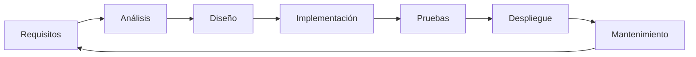
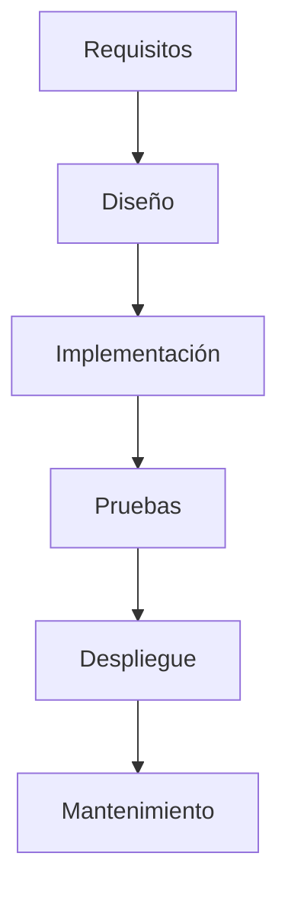
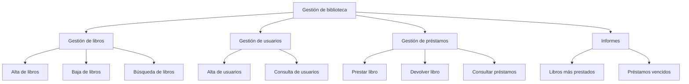
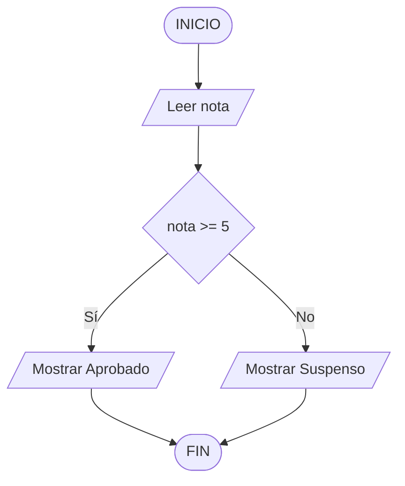
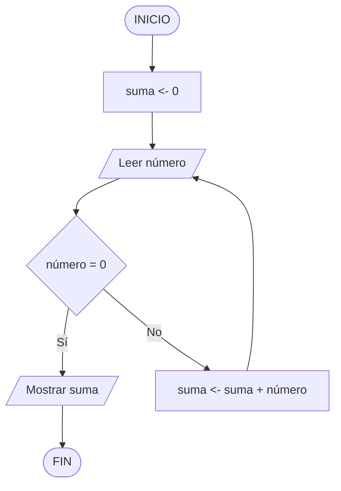
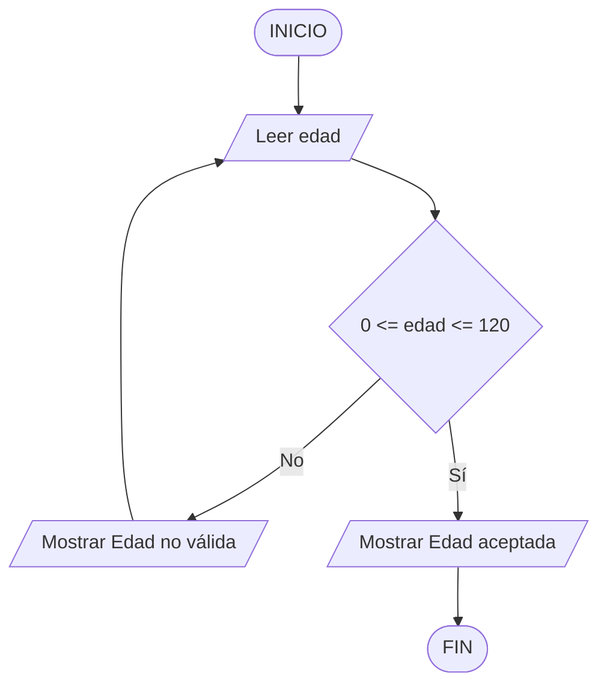
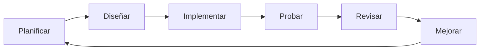
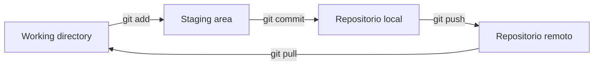
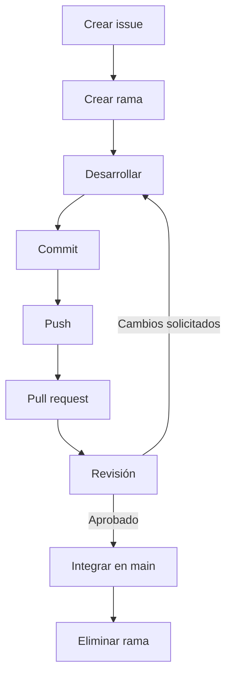
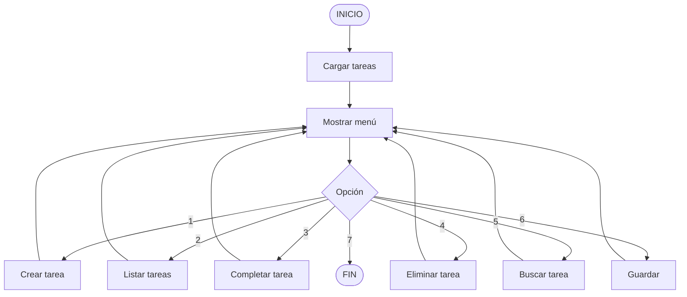

# A.3. Ciclo de vida del software

### Bloque A. Programación

**Referencia curricular**

-   **PRYC.2.A.3.1.** Metodologías de desarrollo de software.
-   **PRYC.2.A.3.2.** Enfoque descendente, fragmentación de problemas y
    algoritmos.
-   **PRYC.2.A.3.3.** Pseudocódigo y diagramas de flujo.
-   **PRYC.2.A.3.4.** Desarrollo iterativo.
-   **PRYC.2.A.3.5.** Entornos de desarrollo integrado.
-   **PRYC.2.A.3.6.** Análisis, diseño, programación y pruebas.
    Depuración.
-   **PRYC.2.A.3.7.** Control de versiones.
-   **PRYC.2.A.3.8.** Trabajo en equipo.

**Lenguaje de referencia:** Python 3.

Este bloque complementa el [Bloque A.1. Programación](tema1.md): allí se
estudian los elementos del lenguaje y las estructuras de control; aquí se
estudia el proceso completo que permite convertir una idea en un producto
de software mantenible y verificable.

------------------------------------------------------------------------

# Índice

1.  Del programa al producto software
2.  El ciclo de vida del software
3.  Metodologías de desarrollo de software
4.  Enfoque Top-Down, fragmentación de problemas y algoritmos
5.  Pseudocódigo y diagramas de flujo
6.  Desarrollo iterativo
7.  Entornos de desarrollo integrado
8.  Análisis, diseño, programación y pruebas. Depuración
9.  Control de versiones
10. Trabajo en equipo
11. Proyecto integrador
12. Ejercicios
13. Glosario
14. Relación con el currículo
15. Lista de comprobación final

------------------------------------------------------------------------

# 1. Del programa al producto software

Un **programa** es un conjunto de instrucciones que un ordenador puede
ejecutar. Un **producto software**, en cambio, es un sistema que se
planifica, se diseña, se implementa, se prueba, se distribuye y se
mantiene durante un tiempo.

La diferencia es importante:

-   Un programa escolar puede resolver un ejercicio concreto.
-   Un producto software debe seguir funcionando cuando cambian los datos,
    el entorno, los requisitos o las personas que lo utilizan.

Por eso, desarrollar software no consiste únicamente en escribir código.
Implica tomar decisiones antes, durante y después de la programación.

## 1.1. ¿Qué caracteriza al software de calidad?

Un software de calidad debería ser, en la medida de lo posible:

-   **Correcto:** hace lo que se espera de él.
-   **Fiable:** funciona de forma estable y predecible.
-   **Mantenible:** puede modificarse sin romper otras partes.
-   **Legible:** otras personas pueden entenderlo.
-   **Eficiente:** utiliza los recursos de forma razonable.
-   **Seguro:** protege los datos y evita accesos no autorizados.
-   **Usable:** resulta cómodo para la persona que lo utiliza.
-   **Portable:** puede ejecutarse en distintos entornos con poco esfuerzo.

La calidad no se añade al final. Se construye durante todo el proceso.

## 1.2. El coste de los errores

Cuanto más tarde se descubre un error, más caro resulta corregirlo.

| Momento en que se detecta | Coste aproximado |
| --- | --- |
| Requisitos | Bajo |
| Diseño | Moderado |
| Programación | Alto |
| Pruebas | Muy alto |
| Producción | Crítico |

Un error de requisitos puede obligar a rehacer el diseño, el código, las
pruebas y la documentación. Por eso conviene dedicar tiempo a comprender
el problema antes de escribir la primera línea de código.

------------------------------------------------------------------------

# 2. El ciclo de vida del software

El **ciclo de vida del software** es el conjunto de fases por las que
pasa una aplicación desde que se concibe hasta que se retira.

## 2.1. Fases principales



### Requisitos

Se identifican las necesidades de las personas usuarias y del sistema.
Se responde a la pregunta: **¿qué debe hacer el software?**

Los requisitos pueden ser:

-   **Funcionales:** describen una función concreta. Por ejemplo, «el
    sistema debe permitir registrar un alumno».
-   **No funcionales:** describen una cualidad. Por ejemplo, «el sistema
    debe responder en menos de dos segundos».

### Análisis

Se estudian los requisitos, se detectan contradicciones, se delimita el
alcance y se construye una primera representación del problema.

Se responde a: **¿qué información se necesita y qué reglas se aplican?**

### Diseño

Se decide cómo se va a construir la solución:

-   arquitectura general;
-   módulos y responsabilidades;
-   estructuras de datos;
-   algoritmos;
-   interfaces de usuario;
-   tecnología que se va a utilizar.

Se responde a: **¿cómo se va a resolver?**

### Implementación o programación

Se escribe el código siguiendo el diseño. Incluye:

-   codificación de módulos;
-   documentación del código;
-   pruebas unitarias;
-   revisión entre compañeros.

### Pruebas

Se comprueba que el software funciona conforme a los requisitos y que no
falla en situaciones adversas.

### Despliegue

Se pone el software a disposición de las personas usuarias. Puede
implicar instalación, configuración, migración de datos o publicación en
un servidor.

### Mantenimiento

Se corrigen errores, se actualizan dependencias, se mejoran prestaciones
y se añaden nuevas funcionalidades.

El mantenimiento suele ser la fase más larga y costosa del ciclo de vida.

## 2.2. Modelos de ciclo de vida

Un **modelo de ciclo de vida** organiza las fases anteriores de una forma
determinada. Los modelos más habituales son:

-   modelo en cascada;
-   modelo incremental;
-   modelo en espiral;
-   modelo de prototipos;
-   modelos ágiles.

Cada modelo tiene ventajas e inconvenientes. No existe uno universalmente
mejor: la elección depende del proyecto, del equipo, del cliente y del
riesgo.

------------------------------------------------------------------------

# 3. Metodologías de desarrollo de software

Una **metodología** es un conjunto de principios, prácticas, roles y
herramientas que organizan el trabajo de un equipo de desarrollo.

## 3.1. Metodologías predictivas: el modelo en cascada

El modelo en cascada organiza el proyecto en fases consecutivas. Cada
fase comienza cuando termina la anterior.



**Ventajas**

-   Estructura sencilla y fácil de explicar.
-   Documentación detallada en cada fase.
-   Útil cuando los requisitos son estables y bien conocidos.

**Inconvenientes**

-   Los cambios son costosos.
-   El cliente no ve el producto hasta etapas avanzadas.
-   Los errores de requisitos se arrastran durante todo el proyecto.

## 3.2. Modelo incremental

El producto se construye por incrementos. Cada incremento añade una parte
funcional que puede probarse y utilizarse.

Por ejemplo, un gestor de tareas podría construirse así:

1.  Incremento 1: crear y listar tareas.
2.  Incremento 2: marcar tareas como completadas.
3.  Incremento 3: establecer prioridades.
4.  Incremento 4: guardar los datos en un archivo.
5.  Incremento 5: búsqueda y filtros.

**Ventajas**

-   Se obtiene valor antes.
-   Es más fácil incorporar cambios.
-   Permite validar cada parte con las personas usuarias.

**Inconvenientes**

-   Requiere una buena planificación de las partes.
-   La arquitectura debe soportar los incrementos futuros.

## 3.3. Modelo en espiral

El modelo en espiral combina el desarrollo iterativo con la gestión de
riesgos. Cada vuelta de la espiral incluye:

1.  Determinar objetivos.
2.  Identificar y reducir riesgos.
3.  Desarrollar y validar.
4.  Planificar la siguiente iteración.

Es apropiado para proyectos grandes, complejos o con incertidumbre
tecnológica.

## 3.4. Modelo de prototipos

Se construye una versión preliminar, rápida y simplificada, para que las
personas usuarias puedan probarla y aportar opiniones antes de desarrollar
el producto definitivo.

Un prototipo puede ser:

-   **Desechable:** sirve para aprender y se descarta.
-   **Evolutivo:** se convierte en la base del producto final.

Es útil cuando los requisitos no están claros.

## 3.5. Metodologías ágiles

Las metodologías ágiles priorizan:

-   las personas y sus interacciones;
-   el software funcionando;
-   la colaboración con el cliente;
-   la respuesta ante el cambio.

El manifiesto ágil no elimina la documentación ni la planificación; las
sitúa en un plano distinto: se documenta lo necesario y se planifica de
forma adaptativa.

### Scrum

Scrum es un marco de trabajo ágil especialmente extendido.

**Roles**

| Rol | Responsabilidad principal |
| --- | --- |
| Product Owner | Define y prioriza el valor del producto |
| Scrum Master | Facilita el proceso y elimina obstáculos |
| Equipo de desarrollo | Construye el incremento |

**Artefactos**

-   **Product Backlog:** lista priorizada de todo lo que podría
    necesitarse.
-   **Sprint Backlog:** tareas seleccionadas para una iteración.
-   **Incremento:** resultado terminado y potencialmente utilizable al
    final del sprint.

**Eventos**

-   Planificación del sprint.
-   Reunión diaria.
-   Revisión del sprint.
-   Retrospectiva.

Un **sprint** suele durar entre una y cuatro semanas.

### Kanban

Kanban organiza el trabajo visualmente en un tablero con columnas:

```text
Pendiente | En curso | En revisión | Terminado
```

Su regla principal es limitar el trabajo en curso (**WIP**, work in
progress). Así se evita empezar demasiadas tareas a la vez.

### Programación extrema (XP)

XP propone prácticas como:

-   desarrollo guiado por pruebas (TDD);
-   programación por parejas;
-   integración continua;
-   refactorización;
-   entregas frecuentes;
-   ritmo sostenible.

## 3.6. Comparativa de metodologías

| Criterio | Cascada | Incremental | Espiral | Ágil |
| --- | --- | --- | --- | --- |
| Requisitos estables | Muy adecuado | Adecuado | Poco adecuado | Poco adecuado |
| Cambios frecuentes | Poco adecuado | Adecuado | Adecuado | Muy adecuado |
| Riesgo alto | Poco adecuado | Adecuado | Muy adecuado | Adecuado |
| Entregas tempranas | No | Sí | Sí | Sí |
| Documentación | Extensa | Media | Media | Ligera |
| Participación del cliente | Baja | Media | Alta | Alta |

## 3.7. ¿Qué metodología elegir?

Algunas preguntas que ayudan a decidir:

1.  ¿Los requisitos están claros y son estables?
2.  ¿El cliente puede participar durante el desarrollo?
3.  ¿El riesgo técnico es alto?
4.  ¿Necesitamos una entrega urgente?
5.  ¿Cuántas personas forman el equipo?
6.  ¿Existen restricciones legales o de documentación?

En un proyecto escolar pequeño, lo importante no es aplicar una
metodología con todo su rigor, sino adoptar sus buenas prácticas:
planificar, dividir, iterar, probar y revisar.

## 3.8. Metodología adaptada al aula

Una propuesta sencilla para trabajar por equipos:

1.  Definir el objetivo del producto.
2.  Escribir una lista de historias de usuario.
3.  Priorizar las historias.
4.  Planificar una iteración de una o dos semanas.
5.  Repartir tareas y registrar su estado en un tablero.
6.  Desarrollar en ramas independientes.
7.  Revisar el código de los compañeros.
8.  Integrar los cambios en la rama principal.
9.  Probar el incremento.
10. Celebrar una revisión y una retrospectiva.

------------------------------------------------------------------------

# 4. Enfoque Top-Down, fragmentación de problemas y algoritmos

## 4.1. ¿Qué es el enfoque Top-Down?

El enfoque **Top-Down** (descendente) consiste en empezar por el problema
general y dividirlo en subproblemas cada vez más pequeños hasta llegar a
tareas que puedan resolverse de forma sencilla.

También se conoce como:

-   descomposición;
-   refinamiento sucesivo;
-   diseño descendente;
-   divide y vencerás.

La idea central es: **si un problema es demasiado grande, divídelo en
problemas más pequeños**.

## 4.2. Ejemplo de descomposición

Supongamos que debemos construir un sistema para gestionar los préstamos
de una biblioteca.



Cada subproblema puede dividirse a su vez. Por ejemplo, «prestar libro»
incluye:

1.  Comprobar que el libro existe.
2.  Comprobar que está disponible.
3.  Comprobar que el usuario está registrado.
4.  Registrar la fecha de préstamo.
5.  Actualizar el estado del libro.

Finalmente, cada paso se convierte en una función o en un pequeño bloque
de código.

## 4.3. Refinamiento sucesivo

El refinamiento sucesivo consiste en describir primero la solución en
lenguaje natural y, después, ir concretando los detalles.

Nivel 1:

```text
Gestionar un préstamo.
```

Nivel 2:

```text
1. Validar libro.
2. Validar usuario.
3. Registrar préstamo.
4. Actualizar disponibilidad.
```

Nivel 3:

```text
1.1. Buscar el libro por ISBN.
1.2. Si no existe, mostrar error.
1.3. Si está prestado, mostrar error.
2.1. Buscar el usuario por identificador.
2.2. Si no existe, mostrar error.
3.1. Crear un registro con libro, usuario y fecha.
4.1. Marcar el libro como no disponible.
```

Cada nivel añade precisión sin perder la visión general.

## 4.4. Ventajas de la fragmentación

-   Reduce la complejidad.
-   Permite trabajar en paralelo.
-   Facilita las pruebas.
-   Mejora la legibilidad.
-   Favorece la reutilización.
-   Permite localizar mejor los errores.

## 4.5. Modularidad, cohesión y acoplamiento

Al dividir un programa conviene buscar un buen diseño de módulos.

-   **Cohesión:** grado en que las responsabilidades de un módulo están
    relacionadas entre sí. Una cohesión alta es deseable.
-   **Acoplamiento:** grado de dependencia entre módulos. Un acoplamiento
    bajo es deseable.

Un módulo debe tener una responsabilidad clara. Por ejemplo:

```text
bien:   calcular_media(notas)
mal:    calcular_media_y_guardar_archivo_y_enviar_correo(notas)
```

## 4.6. ¿Qué es un algoritmo?

Un **algoritmo** es una secuencia finita, ordenada y no ambigua de pasos
que permite resolver un problema.

Propiedades:

-   **Finita:** debe terminar.
-   **Precisa:** cada paso debe estar bien definido.
-   **Ordenada:** los pasos tienen una secuencia lógica.
-   **Entrada:** puede recibir cero o más datos.
-   **Salida:** produce uno o más resultados.
-   **Eficaz:** cada paso debe poder ejecutarse.

## 4.7. Representación de algoritmos

Un algoritmo puede expresarse mediante:

-   lenguaje natural;
-   pseudocódigo;
-   diagramas de flujo;
-   un lenguaje de programación.

Antes de programar conviene representarlo de la forma más clara posible.

## 4.8. Ejemplo: calcular la media de una lista de notas

**Análisis**

-   Entrada: lista de notas.
-   Proceso: sumar las notas y dividir entre el número de notas.
-   Salida: media.
-   Caso especial: lista vacía.

**Algoritmo en lenguaje natural**

```text
1. Si la lista está vacía, devolver 0.
2. Inicializar la suma a 0.
3. Recorrer cada nota.
4. Sumar la nota a la suma.
5. Dividir la suma entre el número de notas.
6. Devolver el resultado.
```

**Implementación en Python**

``` python
def calcular_media(notas):
    if not notas:
        return 0

    suma = 0

    for nota in notas:
        suma += nota

    return suma / len(notas)
```

## 4.9. Bottom-Up como complemento

El enfoque **Bottom-Up** (ascendente) parte de componentes pequeños y los
combina para construir sistemas mayores.

En la práctica se suelen combinar ambos:

-   Top-Down para comprender y dividir el problema.
-   Bottom-Up para construir y probar las piezas.

## 4.10. Errores frecuentes al descomponer

-   Crear demasiados niveles de detalle innecesarios.
-   Dividir por conveniencia del código y no por responsabilidad.
-   Duplicar lógica en varios módulos.
-   Crear módulos con muchas dependencias.
-   Olvidar los casos especiales.
-   Diseñar funciones que hacen demasiadas cosas.

------------------------------------------------------------------------

# 5. Pseudocódigo y diagramas de flujo

## 5.1. ¿Qué es el pseudocódigo?

El **pseudocódigo** es una representación intermedia entre el lenguaje
natural y el lenguaje de programación. No está pensado para ejecutarse
directamente, sino para expresar la lógica de forma clara.

Ventajas:

-   Es independiente del lenguaje.
-   Ayuda a pensar antes de programar.
-   Facilita la comunicación entre personas.
-   Permite detectar errores de lógica.

## 5.2. Convenciones habituales

No existe un único estándar, pero conviene ser coherente.

| Elemento | Notación habitual |
| --- | --- |
| Inicio y fin | `INICIO`, `FIN` |
| Asignación | `variable <- valor` |
| Lectura | `LEER variable` |
| Escritura | `ESCRIBIR expresión` |
| Condición | `SI ... ENTONCES ... FIN_SI` |
| Condición doble | `SI ... ENTONCES ... SINO ... FIN_SI` |
| Bucle mientras | `MIENTRAS ... HACER ... FIN_MIENTRAS` |
| Bucle para | `PARA i <- 1 HASTA n HACER ... FIN_PARA` |
| Función | `FUNCIÓN nombre(...) ... FIN_FUNCIÓN` |

## 5.3. Ejemplo 1: media de notas

```text
ALGORITMO media_notas
VARIABLES
    notas: lista de reales
    suma: real
    media: real
    i: entero

INICIO
    suma <- 0

    SI longitud(notas) = 0 ENTONCES
        ESCRIBIR "No hay notas"
    SINO
        PARA i <- 1 HASTA longitud(notas) HACER
            suma <- suma + notas[i]
        FIN_PARA

        media <- suma / longitud(notas)
        ESCRIBIR "Media: ", media
    FIN_SI
FIN
```

## 5.4. Ejemplo 2: comprobar si un número es primo

```text
ALGORITMO es_primo
ENTRADA: n
SALIDA: verdadero o falso

INICIO
    SI n < 2 ENTONCES
        DEVOLVER falso
    FIN_SI

    divisor <- 2

    MIENTRAS divisor * divisor <= n HACER
        SI n MOD divisor = 0 ENTONCES
            DEVOLVER falso
        FIN_SI

        divisor <- divisor + 1
    FIN_MIENTRAS

    DEVOLVER verdadero
FIN
```

## 5.5. Ejemplo 3: menú de una aplicación

```text
ALGORITMO menu_principal

INICIO
    REPETIR
        ESCRIBIR "1. Añadir"
        ESCRIBIR "2. Listar"
        ESCRIBIR "3. Salir"
        LEER opcion

        SEGÚN opcion HACER
            1: añadir_elemento()
            2: listar_elementos()
            3: ESCRIBIR "Fin"
            OTRO: ESCRIBIR "Opción no válida"
        FIN_SEGÚN
    HASTA QUE opcion = 3
FIN
```

## 5.6. ¿Qué es un diagrama de flujo?

Un **diagrama de flujo** representa gráficamente un algoritmo mediante
símbolos conectados por flechas.

| Símbolo | Forma | Significado |
| --- | --- | --- |
| Terminal | Óvalo | Inicio o fin |
| Proceso | Rectángulo | Operación o asignación |
| Entrada/Salida | Paralelogramo | Leer o escribir datos |
| Decisión | Rombo | Condición con dos o más caminos |
| Subproceso | Rectángulo con doble línea | Llamada a otro proceso |
| Conector | Círculo | Unión de caminos |
| Documento | Forma ondulada | Entrada o salida de archivo |

## 5.7. Ejemplo de diagrama de flujo

Algoritmo que lee una nota y muestra si está aprobada:



## 5.8. Ejemplo de diagrama con bucle

Leer números hasta que se introduzca cero y mostrar la suma:



## 5.9. Ejemplo de diagrama con validación



## 5.10. Pseudocódigo frente a diagrama de flujo

| Aspecto | Pseudocódigo | Diagrama de flujo |
| --- | --- | --- |
| Facilidad de escritura | Alta | Media |
| Visualización de la lógica | Media | Alta |
| Algoritmos largos | Adecuado | Puede volverse complejo |
| Detección de caminos | Media | Alta |
| Conversión a código | Sencilla | Sencilla |

En la práctica, ambos pueden combinarse: un diagrama general y
pseudocódigo para los detalles.

## 5.11. Errores frecuentes

-   Utilizar una decisión sin indicar todas las salidas.
-   Olvidar actualizar la variable de control de un bucle.
-   No contemplar el caso de lista vacía o división entre cero.
-   Mezclar niveles de abstracción: detalle de código dentro de un
    diagrama general.
-   Dibujar líneas que se cruzan innecesariamente.
-   Usar nombres poco descriptivos.

------------------------------------------------------------------------

# 6. Desarrollo iterativo

## 6.1. ¿Qué es una iteración?

Una **iteración** es un ciclo completo y corto de trabajo en el que se
planifica, se diseña, se implementa, se prueba y se revisa una parte del
producto.

El **desarrollo iterativo** construye el software mediante repeticiones
sucesivas. Cada repetición mejora o amplía la versión anterior.

No debe confundirse con las estructuras iterativas del lenguaje (bucles):
aquí la iteración es una unidad de gestión del proyecto.

## 6.2. Iteración frente a incremento

-   **Iteración:** repetición del ciclo de trabajo.
-   **Incremento:** parte funcional que se añade al producto.

Una iteración puede producir un incremento. También puede producir una
mejora interna, como una refactorización o una corrección.

## 6.3. El ciclo de una iteración



## 6.4. Producto mínimo viable

El **producto mínimo viable** (MVP, minimum viable product) es la versión
más pequeña que permite validar la idea principal con personas usuarias
reales.

No significa «producto de mala calidad». Significa «producto limitado,
pero funcional y probado».

Ejemplo para un gestor de tareas:

-   Crear tareas.
-   Listar tareas.
-   Marcar tareas como completadas.

Todo lo demás puede esperar a iteraciones posteriores.

## 6.5. Ejemplo de planificación iterativa

| Iteración | Objetivo | Entregable |
| --- | --- | --- |
| 1 | Gestión básica | Crear, listar y completar tareas |
| 2 | Persistencia | Guardar y cargar desde archivo |
| 3 | Organización | Prioridades y fechas límite |
| 4 | Búsqueda | Filtros por estado y texto |
| 5 | Calidad | Pruebas, validación y documentación |

Cada iteración debe terminar con una versión que pueda ejecutarse.

## 6.6. Ventajas del desarrollo iterativo

-   Permite obtener retroalimentación pronto.
-   Reduce el riesgo de construir algo que no se necesita.
-   Facilita la incorporación de cambios.
-   Permite priorizar lo más valioso.
-   Mejora la motivación del equipo al ver resultados.
-   Facilita las pruebas continuas.

## 6.7. Riesgos

-   Iterar sin una visión general puede producir un producto incoherente.
-   Los cambios continuos pueden romper funcionalidades anteriores.
-   Sin pruebas automatizadas, cada iteración es más arriesgada.
-   Sin control de versiones, es difícil volver atrás.
-   Sin documentación mínima, el equipo pierde el contexto.

## 6.8. Buenas prácticas

1.  Mantener una lista priorizada de requisitos.
2.  Definir un objetivo claro para cada iteración.
3.  Terminar cada iteración con código funcional.
4.  Escribir pruebas para lo nuevo y para lo que se modifica.
5.  Revisar el código antes de integrarlo.
6.  Hacer entregas pequeñas y frecuentes.
7.  Refactorizar cuando sea necesario.
8.  Recoger opiniones de las personas usuarias.
9.  Documentar las decisiones importantes.
10. Ajustar la planificación según lo aprendido.

------------------------------------------------------------------------

# 7. Entornos de desarrollo integrado

## 7.1. ¿Qué es un IDE?

Un **IDE** (Integrated Development Environment, entorno de desarrollo
integrado) es una aplicación que reúne herramientas para escribir,
ejecutar y depurar programas.

Funciones habituales:

-   editor de código;
-   resaltado de sintaxis;
-   autocompletado;
-   detección de errores;
-   ejecución de programas;
-   depurador;
-   terminal integrada;
-   control de versiones;
-   gestión de proyectos;
-   refactorización;
-   ejecución de pruebas.

## 7.2. Ejemplos de IDE y editores

| Herramienta | Uso principal |
| --- | --- |
| Visual Studio Code | Editor extensible, muy usado en Python y web |
| PyCharm | IDE específico para Python |
| Thonny | IDE sencillo para aprendizaje |
| IDLE | Editor incluido con Python |
| IntelliJ IDEA | IDE para Java y otros lenguajes |
| Eclipse | IDE extensible para Java y otros lenguajes |

## 7.3. Componentes de un IDE

### Editor

Permite escribir código con ayuda:

-   numeración de líneas;
-   colores según el tipo de elemento;
-   indentación automática;
-   cierre de paréntesis;
-   búsqueda y sustitución;
-   múltiples cursores.

### Autocompletado

Sugiere nombres de variables, funciones, métodos y módulos. Reduce errores
tipográficos y acelera la escritura.

### Linter

Analiza el código y advierte de posibles problemas:

-   variables no utilizadas;
-   imports innecesarios;
-   líneas demasiado largas;
-   malas prácticas;
-   posibles errores.

En Python son habituales `ruff`, `flake8` y `pylint`.

### Formateador

Reorganiza el código para que siga un estilo uniforme. En Python se usan
`black` y `ruff format`.

### Depurador

Permite ejecutar el programa paso a paso, inspeccionar variables y
detener la ejecución en puntos concretos.

### Terminal integrada

Permite ejecutar comandos sin salir del entorno: `python`, `pip`, `git`,
pruebas, etc.

### Control de versiones

Muchos IDE integran Git y permiten:

-   ver cambios;
-   hacer commits;
-   crear ramas;
-   resolver conflictos;
-   sincronizar con un repositorio remoto.

## 7.4. Configurar Visual Studio Code para Python

Pasos orientativos:

1.  Instalar Python 3.
2.  Instalar Visual Studio Code.
3.  Instalar la extensión oficial de Python.
4.  Abrir la carpeta del proyecto.
5.  Seleccionar el intérprete de Python.
6.  Crear un archivo `main.py`.
7.  Ejecutar el programa.

Comandos útiles en la terminal:

``` bash
python3 --version
python3 -m venv .venv
source .venv/bin/activate
python -m pip install --upgrade pip
```

En Windows, la activación del entorno virtual puede ser:

``` bash
.venv\Scripts\activate
```

## 7.5. Entornos virtuales

Un **entorno virtual** es un espacio aislado con sus propias dependencias.
Evita que distintos proyectos compartan versiones incompatibles de
librerías.

Ejemplo de estructura:

```text
proyecto/
├── .venv/
├── src/
│   └── main.py
├── tests/
│   └── test_main.py
├── requirements.txt
├── README.md
└── .gitignore
```

El archivo `requirements.txt` registra las dependencias:

``` text
pytest==8.3.0
requests==2.32.0
```

Instalación:

``` bash
python -m pip install -r requirements.txt
```

## 7.6. Atajos de teclado frecuentes

| Acción | VS Code (Windows/Linux) | VS Code (macOS) |
| --- | --- | --- |
| Ejecutar | `Ctrl + F5` | `Cmd + F5` |
| Depurar | `F5` | `F5` |
| Alternar punto de ruptura | `F9` | `F9` |
| Paso a paso por encima | `F10` | `F10` |
| Entrar en función | `F11` | `F11` |
| Salir de función | `Shift + F11` | `Shift + F11` |
| Abrir terminal | `` Ctrl + ` `` | `` Cmd + ` `` |
| Buscar | `Ctrl + F` | `Cmd + F` |
| Buscar en archivos | `Ctrl + Shift + F` | `Cmd + Shift + F` |
| Comentar línea | `Ctrl + /` | `Cmd + /` |

## 7.7. Buen uso del IDE

-   No depender exclusivamente del autocompletado.
-   Leer y entender los avisos del linter.
-   Configurar el formateador al guardar.
-   Usar el depurador en lugar de llenar el código de `print`.
-   Mantener el proyecto organizado en carpetas.
-   No subir `.venv` ni archivos de configuración personal al
    repositorio.
-   Ejecutar las pruebas desde el propio IDE.

------------------------------------------------------------------------

# 8. Análisis, diseño, programación y pruebas. Depuración

## 8.1. Análisis de requisitos

El análisis busca comprender el problema antes de resolverlo.

Preguntas clave:

-   ¿Quién utilizará el sistema?
-   ¿Qué necesita hacer?
-   ¿Qué datos entran y qué datos salen?
-   ¿Qué restricciones existen?
-   ¿Qué casos especiales deben contemplarse?

### Historias de usuario

Una historia de usuario es una descripción breve de una necesidad desde el
punto de vista de la persona usuaria.

Formato habitual:

```text
Como [tipo de usuario]
quiero [acción]
para [beneficio].
```

Ejemplo:

```text
Como bibliotecario
quiero registrar el préstamo de un libro
para controlar qué ejemplares están disponibles.
```

### Criterios de aceptación

Los criterios de aceptación concretan cuándo una historia se considera
terminada.

```text
Dado un libro disponible y un usuario registrado,
cuando se registra el préstamo,
entonces el libro queda marcado como prestado
y se guarda la fecha de devolución.
```

## 8.2. Diseño

El diseño transforma los requisitos en una solución técnica.

Incluye:

-   arquitectura general;
-   módulos y funciones;
-   estructuras de datos;
-   algoritmos;
-   interfaces;
-   manejo de errores.

### Diseño de datos

Antes de programar conviene decidir cómo se representará la información.

Ejemplo de una tarea:

``` python
tarea = {
    "id": 1,
    "titulo": "Estudiar pseudocódigo",
    "completada": False,
    "prioridad": "alta"
}
```

### Diseño de funciones

```text
crear_tarea(titulo, prioridad)
listar_tareas(tareas)
buscar_tarea(tareas, id)
completar_tarea(tareas, id)
guardar_tareas(tareas, ruta)
cargar_tareas(ruta)
```

Cada función debe tener una responsabilidad clara.

## 8.3. Programación

Durante la programación conviene aplicar buenas prácticas:

-   nombres descriptivos;
-   funciones cortas;
-   una responsabilidad por función;
-   constantes para valores significativos;
-   validación de entradas;
-   manejo de errores;
-   comentarios útiles;
-   docstrings;
-   estilo uniforme.

Ejemplo de función documentada:

``` python
def calcular_media(notas):
    """Devuelve la media de una lista de notas.

    Si la lista está vacía, devuelve 0.
    """
    if not notas:
        return 0

    return sum(notas) / len(notas)
```

## 8.4. Pruebas

Probar no consiste en ejecutar el programa una vez y comprobar que «va».
Consiste en comprobar de forma sistemática que cumple los requisitos.

### Tipos de pruebas

| Tipo | Objetivo |
| --- | --- |
| Unitarias | Comprobar una función o módulo aislado |
| De integración | Comprobar la interacción entre módulos |
| De sistema | Comprobar el sistema completo |
| De aceptación | Comprobar que cumple los requisitos del cliente |
| De regresión | Comprobar que un cambio no rompe lo anterior |
| De rendimiento | Medir tiempos y consumo de recursos |
| De seguridad | Detectar vulnerabilidades |

### Enfoques

-   **Caja negra:** se prueba el comportamiento sin conocer la
    implementación.
-   **Caja blanca:** se diseñan pruebas a partir del código y de sus
    caminos.

### Casos de prueba

Un caso de prueba debe indicar:

-   datos de entrada;
-   condiciones previas;
-   resultado esperado;
-   resultado obtenido.

Ejemplo para una función que clasifica una nota:

| Entrada | Resultado esperado |
| --- | --- |
| 0 | Insuficiente |
| 4.9 | Insuficiente |
| 5 | Aprobado |
| 6.9 | Aprobado |
| 7 | Notable |
| 8.9 | Notable |
| 9 | Sobresaliente |
| 10 | Sobresaliente |
| -1 | Error |
| 11 | Error |

Los valores **frontera** son especialmente importantes: 0, 5, 7, 9 y 10.

### Pruebas unitarias en Python

Con `unittest`:

``` python
import unittest
from main import calcular_media


class TestCalcularMedia(unittest.TestCase):
    def test_lista_normal(self):
        self.assertEqual(calcular_media([6, 8, 10]), 8)

    def test_lista_vacia(self):
        self.assertEqual(calcular_media([]), 0)

    def test_un_elemento(self):
        self.assertEqual(calcular_media([7]), 7)


if __name__ == "__main__":
    unittest.main()
```

Con `pytest`:

``` python
import pytest
from main import calcular_media


def test_media_normal():
    assert calcular_media([6, 8, 10]) == 8


def test_media_lista_vacia():
    assert calcular_media([]) == 0


@pytest.mark.parametrize(
    "notas, esperado",
    [
        ([5], 5),
        ([0, 10], 5),
        ([4, 6, 8], 6),
    ],
)
def test_varios_casos(notas, esperado):
    assert calcular_media(notas) == esperado
```

Ejecución:

``` bash
python -m unittest
pytest
pytest --cov=src
```

### Desarrollo guiado por pruebas

El ciclo TDD (Test Driven Development) es:

1.  Escribir una prueba que falle.
2.  Escribir el código mínimo para que pase.
3.  Refactorizar manteniendo las pruebas en verde.

Ventajas:

-   obliga a pensar en el comportamiento;
-   proporciona una red de seguridad;
-   facilita los cambios;
-   documenta el uso esperado.

## 8.5. Depuración

Depurar es el proceso de localizar, comprender y corregir errores.

### Tipos de errores

| Tipo | Descripción | Ejemplo |
| --- | --- | --- |
| Sintaxis | El código no respeta las reglas del lenguaje | Falta `:` en un `if` |
| Ejecución | El programa falla mientras se ejecuta | División entre cero |
| Lógico | El programa funciona, pero el resultado es incorrecto | Fórmula mal aplicada |

### Proceso sistemático de depuración

1.  **Reproducir** el error de forma consistente.
2.  **Observar** el mensaje y la traza de error.
3.  **Aislar** la parte del código que lo provoca.
4.  **Formular una hipótesis** sobre la causa.
5.  **Comprobar** la hipótesis con pruebas o inspección.
6.  **Corregir** el código.
7.  **Volver a probar** el caso y los casos relacionados.
8.  **Añadir una prueba de regresión** si es posible.

### Lectura de una traza de error

``` text
Traceback (most recent call last):
  File "main.py", line 12, in <module>
    resultado = dividir(10, 0)
  File "main.py", line 7, in dividir
    return a / b
ZeroDivisionError: division by zero
```

La traza indica:

-   el tipo de error: `ZeroDivisionError`;
-   el mensaje: `division by zero`;
-   la línea exacta donde se produce;
-   la secuencia de llamadas que llevó hasta allí.

### Herramientas de depuración

-   **Puntos de ruptura:** detienen la ejecución en una línea.
-   **Paso a paso:** ejecuta una línea cada vez.
-   **Entrar en función:** permite inspeccionar una llamada.
-   **Inspección de variables:** muestra sus valores actuales.
-   **Pila de llamadas:** indica cómo se llegó a la función actual.
-   **Depuración condicional:** se detiene solo si se cumple una
    condición.

### Depuración con `print`

Es una técnica sencilla y útil:

``` python
def dividir(a, b):
    print(f"DEBUG a={a}, b={b}")

    if b == 0:
        return None

    return a / b
```

Debe retirarse o sustituirse por un sistema de registro cuando el
programa esté terminado.

### Registro con `logging`

``` python
import logging

logging.basicConfig(
    level=logging.DEBUG,
    format="%(levelname)s: %(message)s"
)


def dividir(a, b):
    logging.debug("Dividiendo %s entre %s", a, b)

    if b == 0:
        logging.error("Intento de división entre cero")
        return None

    return a / b
```

### Depuración con `pdb`

``` bash
python -m pdb main.py
```

Órdenes básicas:

| Orden | Acción |
| --- | --- |
| `l` | Mostrar código |
| `n` | Ejecutar línea siguiente |
| `s` | Entrar en función |
| `c` | Continuar |
| `p variable` | Mostrar valor |
| `q` | Salir |

### Ejemplo de error lógico

Código incorrecto:

``` python
def calcular_total(precio, cantidad):
    return precio + cantidad
```

Prueba:

``` python
assert calcular_total(10, 3) == 30
```

La prueba falla. El error es lógico: debería ser una multiplicación.

Corrección:

``` python
def calcular_total(precio, cantidad):
    return precio * cantidad
```

Y se añade una prueba de regresión.

## 8.6. Prevención de errores

-   Validar las entradas.
-   Comprobar casos límite.
-   Usar nombres claros.
-   Evitar duplicar código.
-   Dividir en funciones pequeñas.
-   Manejar excepciones previstas.
-   Escribir pruebas.
-   Revisar el código entre compañeros.
-   No ignorar los avisos del linter.
-   Documentar las decisiones complejas.

------------------------------------------------------------------------

# 9. Control de versiones

## 9.1. ¿Qué es el control de versiones?

El **control de versiones** es un sistema que registra los cambios
realizados en los archivos de un proyecto a lo largo del tiempo.

Permite:

-   saber qué cambió;
-   saber quién lo cambió;
-   volver a una versión anterior;
-   trabajar en paralelo;
-   integrar cambios;
-   recuperar código perdido.

## 9.2. Git

**Git** es un sistema de control de versiones distribuido. Cada persona
tiene una copia completa del historial del proyecto.

Conceptos básicos:

| Concepto | Significado |
| --- | --- |
| Repositorio | Almacén del proyecto y su historial |
| Working directory | Archivos con los que se trabaja |
| Staging area | Zona de preparación de cambios |
| Commit | Instantánea registrada del proyecto |
| Rama | Línea independiente de desarrollo |
| Remoto | Repositorio alojado en un servidor |
| Merge | Integración de ramas |
| Conflicto | Cambios incompatibles que requieren resolución manual |

## 9.3. Flujo básico con Git



Comandos esenciales:

``` bash
git init
git status
git add archivo.py
git add .
git commit -m "Añade validación de notas"
git log --oneline
git diff
git branch
git switch -c feature/validacion
git switch main
git merge feature/validacion
git remote add origin https://github.com/usuario/proyecto.git
git push -u origin main
git pull
```

## 9.4. Ejemplo de historial

``` text
a1b2c3d Añade pruebas para calcular_media
d4e5f6a Corrige división entre cero
7g8h9i0 Implementa cálculo de media
j1k2l3m Crea estructura inicial del proyecto
```

Cada commit debe ser pequeño y tener un mensaje claro.

## 9.5. Ramas

Una **rama** permite desarrollar una funcionalidad sin afectar a la rama
principal.

``` bash
git switch -c feature/prioridades
# trabajar
git add .
git commit -m "Añade prioridad a las tareas"
git push -u origin feature/prioridades
```

Después se abre una **pull request** para revisar e integrar los cambios.

### Estrategias habituales

-   **Git Flow:** ramas `main`, `develop`, `feature/*`, `release/*` y
    `hotfix/*`.
-   **Trunk-based:** ramas cortas que se integran frecuentemente en
    `main`.
-   **GitHub Flow:** una rama por cambio, pull request y despliegue
    continuo.

En el aula suele ser suficiente con:

``` text
main        -> versión estable
feature/*   -> nuevas funcionalidades
fix/*       -> correcciones
```

## 9.6. Conflictos

Un conflicto ocurre cuando dos ramas modifican la misma parte de un
archivo.

Ejemplo:

``` text
<<<<<<< HEAD
nota = float(input("Nota: "))
=======
nota = int(input("Nota: "))
>>>>>>> feature/validacion
```

Para resolverlo:

1.  Abrir el archivo afectado.
2.  Comprender ambos cambios.
3.  Elegir o combinar la solución correcta.
4.  Eliminar los marcadores.
5.  Probar el código.
6.  Añadir el archivo y confirmar.

``` bash
git add archivo.py
git commit -m "Resuelve conflicto en la lectura de notas"
```

## 9.7. Archivos que no deben versionarse

El archivo `.gitignore` indica qué archivos o carpetas deben ignorarse.

Ejemplo para Python:

``` text
.venv/
__pycache__/
*.pyc
.env
.pytest_cache/
.coverage
htmlcov/
*.log
.DS_Store
```

## 9.8. Buenas prácticas

-   Hacer commits pequeños y frecuentes.
-   Escribir mensajes claros.
-   No versionar contraseñas ni claves.
-   No versionar entornos virtuales.
-   Revisar los cambios antes de confirmar.
-   Mantener `main` estable.
-   Actualizar la rama antes de abrir una pull request.
-   Usar ramas con nombres descriptivos.
-   Etiquetar las versiones importantes.

### Mensajes de commit

Formato recomendado:

``` text
tipo(alcance): descripción breve
```

Tipos habituales:

| Tipo | Uso |
| --- | --- |
| `feat` | Nueva funcionalidad |
| `fix` | Corrección de error |
| `docs` | Documentación |
| `test` | Pruebas |
| `refactor` | Reestructuración sin cambiar comportamiento |
| `style` | Formato, sin cambios de lógica |
| `chore` | Tareas de mantenimiento |

Ejemplos:

``` text
feat(tareas): añade filtro por prioridad
fix(media): evita división entre cero
test(media): añade casos límite
docs(readme): explica la instalación
```

## 9.9. Etiquetas y versiones

Las etiquetas permiten marcar versiones concretas:

``` bash
git tag -a v1.0.0 -m "Primera versión estable"
git push origin v1.0.0
```

El **versionado semántico** utiliza el formato `MAYOR.MENOR.PARCHE`:

-   **MAYOR:** cambios incompatibles.
-   **MENOR:** nuevas funcionalidades compatibles.
-   **PARCHE:** correcciones compatibles.

Ejemplo: `1.4.2`.

## 9.10. Recuperar cambios

| Situación | Comando |
| --- | --- |
| Ver cambios | `git diff` |
| Descartar cambios locales | `git restore archivo.py` |
| Quitar del staging | `git restore --staged archivo.py` |
| Ver historial | `git log --oneline --graph` |
| Revertir un commit | `git revert <commit>` |
| Guardar temporalmente | `git stash` |
| Recuperar del stash | `git stash pop` |

`git revert` crea un nuevo commit que deshace otro. Es más seguro que
`git reset` cuando el historial ya se ha compartido.

------------------------------------------------------------------------

# 10. Trabajo en equipo

## 10.1. Por qué importa el trabajo en equipo

El desarrollo de software real se realiza en equipos. Un buen equipo no
solo necesita personas con conocimientos técnicos, sino también:

-   comunicación clara;
-   organización;
-   reparto de responsabilidades;
-   respeto;
-   revisión mutua;
-   resolución de conflictos.

## 10.2. Roles en un equipo

En un equipo pequeño pueden asignarse estos roles:

| Rol | Responsabilidad |
| --- | --- |
| Coordinación | Organiza tareas, plazos y prioridades |
| Desarrollo | Implementa funcionalidades |
| Pruebas | Diseña y ejecuta pruebas |
| Documentación | Mantiene README, guías y cambios |
| Revisión | Revisa el código antes de integrarlo |

En Scrum, los roles son Product Owner, Scrum Master y equipo de
desarrollo. En el aula pueden adaptarse.

## 10.3. Comunicación

Buenas prácticas:

-   Utilizar un canal común para las decisiones.
-   Registrar las tareas en un tablero o en issues.
-   Hacer reuniones breves y con objetivo.
-   Documentar lo acordado.
-   Avisar de bloqueos cuanto antes.
-   Dar retroalimentación concreta y respetuosa.

## 10.4. Tablero de trabajo

``` text
| Pendiente | En curso | En revisión | Terminado |
|-----------|----------|-------------|-----------|
| Tarea A   | Tarea C  | Tarea B     | Tarea D   |
| Tarea E   |          |             |           |
```

Conviene limitar cuántas tareas están «en curso» a la vez.

## 10.5. Flujo de trabajo colaborativo con Git



Pasos:

1.  Describir la tarea en un issue.
2.  Crear una rama desde `main`.
3.  Desarrollar y probar.
4.  Hacer commits claros.
5.  Subir la rama.
6.  Abrir una pull request.
7.  Revisar entre compañeros.
8.  Corregir si es necesario.
9.  Integrar.
10. Eliminar la rama.

## 10.6. Revisión de código

La revisión de código no es una crítica personal. Es una práctica para
mejorar la calidad y compartir conocimiento.

Lista de comprobación para revisar:

-   ¿El código resuelve el problema?
-   ¿Los nombres son claros?
-   ¿Las funciones tienen una responsabilidad única?
-   ¿Se contemplan casos límite?
-   ¿Hay pruebas?
-   ¿Se manejan los errores?
-   ¿Hay duplicación evitable?
-   ¿Se respeta el estilo del proyecto?
-   ¿Se han añadido datos sensibles?
-   ¿La documentación está actualizada?

Comentarios útiles:

``` text
¿Podrías extraer esta validación a una función para reutilizarla?
Esta comparación falla cuando la lista está vacía.
Aquí convendría usar una constante en lugar de un número mágico.
```

Comentarios poco útiles:

``` text
Esto está mal.
No me gusta.
Cámbialo.
```

## 10.7. Convenciones de equipo

Es recomendable acordar:

-   estilo de código (por ejemplo, PEP 8);
-   formateador y linter;
-   estructura de carpetas;
-   nombres de ramas;
-   formato de commits;
-   plantilla de pull request;
-   criterios de aceptación;
-   forma de documentar.

Ejemplo de estructura común:

``` text
proyecto/
├── src/
│   ├── main.py
│   ├── tareas.py
│   └── archivos.py
├── tests/
│   ├── test_tareas.py
│   └── test_archivos.py
├── docs/
├── README.md
├── requirements.txt
├── .gitignore
└── pyproject.toml
```

## 10.8. Documentación del proyecto

Un `README.md` mínimo debería incluir:

1.  Nombre y descripción.
2.  Funcionalidades.
3.  Requisitos.
4.  Instalación.
5.  Uso.
6.  Estructura del proyecto.
7.  Pruebas.
8.  Autores.
9.  Licencia.

Ejemplo:

``` markdown
# Gestor de tareas

Aplicación de consola para gestionar tareas personales.

## Requisitos

- Python 3.11 o superior

## Instalación

    python -m venv .venv
    source .venv/bin/activate
    pip install -r requirements.txt

## Uso

    python src/main.py

## Pruebas

    pytest
```

## 10.9. Resolución de conflictos

Cuando aparezca un desacuerdo:

1.  Escuchar todas las posturas.
2.  Centrarse en el problema, no en las personas.
3.  Aportar argumentos técnicos.
4.  Buscar alternativas.
5.  Decidir y documentar la decisión.
6.  Si es necesario, consultar al docente o al responsable.

## 10.10. Habilidades sociales

-   Empatía.
-   Escucha activa.
-   Asertividad.
-   Puntualidad.
-   Responsabilidad.
-   Flexibilidad.
-   Capacidad de pedir ayuda.
-   Capacidad de dar y recibir críticas constructivas.

------------------------------------------------------------------------

# 11. Proyecto integrador

## 11.1. Enunciado

Desarrollar una aplicación de consola para **gestionar tareas
personales**. El proyecto debe aplicar el ciclo de vida completo y las
herramientas del bloque.

Requisitos funcionales:

1.  Crear tareas con título y prioridad.
2.  Listar tareas.
3.  Marcar tareas como completadas.
4.  Eliminar tareas.
5.  Guardar las tareas en un archivo.
6.  Cargar las tareas al iniciar.
7.  Buscar tareas por texto.

Requisitos no funcionales:

-   código legible y documentado;
-   pruebas automatizadas;
-   control de versiones;
-   manejo de errores de entrada;
-   README con instrucciones.

## 11.2. Fase 1: requisitos

Historias de usuario:

``` text
Como usuario
quiero crear una tarea con prioridad
para organizar mi trabajo.

Como usuario
quiero marcar una tarea como completada
para saber qué he terminado.

Como usuario
quiero guardar mis tareas
para recuperarlas la próxima vez.
```

Criterios de aceptación:

-   No se permiten títulos vacíos.
-   La prioridad solo puede ser baja, media o alta.
-   Al marcar una tarea como completada, su estado cambia.
-   Los datos se conservan entre ejecuciones.

## 11.3. Fase 2: análisis y diseño

### Estructura de datos

``` python
tarea = {
    "id": 1,
    "titulo": "Estudiar Git",
    "prioridad": "alta",
    "completada": False
}
```

### Módulos

``` text
main.py        -> punto de entrada y menú
tareas.py      -> lógica de tareas
archivos.py    -> guardar y cargar
test_tareas.py -> pruebas
```

### Funciones

``` text
crear_tarea(titulo, prioridad)
listar_tareas(tareas)
buscar_tareas(tareas, texto)
completar_tarea(tareas, id)
eliminar_tarea(tareas, id)
guardar_tareas(tareas, ruta)
cargar_tareas(ruta)
mostrar_menu()
```

### Diagrama de flujo general



## 11.4. Fase 3: implementación orientativa

`tareas.py`:

``` python
def crear_tarea(tareas, titulo, prioridad="media"):
    if not titulo.strip():
        raise ValueError("El título no puede estar vacío")

    if prioridad not in {"baja", "media", "alta"}:
        raise ValueError("Prioridad no válida")

    nuevo_id = max((t["id"] for t in tareas), default=0) + 1

    tarea = {
        "id": nuevo_id,
        "titulo": titulo.strip(),
        "prioridad": prioridad,
        "completada": False
    }

    tareas.append(tarea)
    return tarea


def listar_tareas(tareas):
    if not tareas:
        print("No hay tareas.")
        return

    for tarea in tareas:
        estado = "hecha" if tarea["completada"] else "pendiente"
        print(
            f"[{tarea['id']}] {tarea['titulo']} "
            f"({tarea['prioridad']}, {estado})"
        )


def buscar_tareas(tareas, texto):
    texto = texto.lower()
    return [
        t for t in tareas
        if texto in t["titulo"].lower()
    ]


def completar_tarea(tareas, id_tarea):
    for tarea in tareas:
        if tarea["id"] == id_tarea:
            tarea["completada"] = True
            return True

    return False


def eliminar_tarea(tareas, id_tarea):
    for indice, tarea in enumerate(tareas):
        if tarea["id"] == id_tarea:
            del tareas[indice]
            return True

    return False
```

`archivos.py`:

``` python
import json


def guardar_tareas(tareas, ruta="tareas.json"):
    with open(ruta, "w", encoding="utf-8") as archivo:
        json.dump(tareas, archivo, ensure_ascii=False, indent=2)


def cargar_tareas(ruta="tareas.json"):
    try:
        with open(ruta, "r", encoding="utf-8") as archivo:
            return json.load(archivo)
    except FileNotFoundError:
        return []
    except json.JSONDecodeError:
        print("El archivo de tareas está dañado.")
        return []
```

`main.py`:

``` python
from tareas import (
    crear_tarea,
    listar_tareas,
    buscar_tareas,
    completar_tarea,
    eliminar_tarea,
)
from archivos import guardar_tareas, cargar_tareas


def mostrar_menu():
    print("\n--- GESTOR DE TAREAS ---")
    print("1. Crear tarea")
    print("2. Listar tareas")
    print("3. Completar tarea")
    print("4. Eliminar tarea")
    print("5. Buscar tarea")
    print("6. Guardar")
    print("7. Salir")


def pedir_entero(mensaje):
    try:
        return int(input(mensaje))
    except ValueError:
        return None


def main():
    tareas = cargar_tareas()

    while True:
        mostrar_menu()
        opcion = input("Opción: ").strip()

        if opcion == "1":
            titulo = input("Título: ")
            prioridad = input("Prioridad (baja/media/alta): ")

            try:
                crear_tarea(tareas, titulo, prioridad)
                print("Tarea creada.")
            except ValueError as error:
                print("Error:", error)

        elif opcion == "2":
            listar_tareas(tareas)

        elif opcion == "3":
            id_tarea = pedir_entero("ID: ")

            if id_tarea is not None and completar_tarea(tareas, id_tarea):
                print("Tarea completada.")
            else:
                print("No se encontró la tarea.")

        elif opcion == "4":
            id_tarea = pedir_entero("ID: ")

            if id_tarea is not None and eliminar_tarea(tareas, id_tarea):
                print("Tarea eliminada.")
            else:
                print("No se encontró la tarea.")

        elif opcion == "5":
            texto = input("Buscar: ")
            resultados = buscar_tareas(tareas, texto)

            if resultados:
                listar_tareas(resultados)
            else:
                print("Sin resultados.")

        elif opcion == "6":
            guardar_tareas(tareas)
            print("Tareas guardadas.")

        elif opcion == "7":
            guardar_tareas(tareas)
            print("Fin del programa.")
            break

        else:
            print("Opción no válida.")


if __name__ == "__main__":
    main()
```

## 11.5. Fase 4: pruebas

`test_tareas.py`:

``` python
import pytest
from tareas import (
    crear_tarea,
    buscar_tareas,
    completar_tarea,
    eliminar_tarea,
)


def test_crear_tarea():
    tareas = []
    tarea = crear_tarea(tareas, "Estudiar Git", "alta")

    assert tarea["id"] == 1
    assert tarea["titulo"] == "Estudiar Git"
    assert tarea["completada"] is False
    assert len(tareas) == 1


def test_crear_tarea_titulo_vacio():
    with pytest.raises(ValueError):
        crear_tarea([], "   ")


def test_crear_tarea_prioridad_invalida():
    with pytest.raises(ValueError):
        crear_tarea([], "Tarea", "urgente")


def test_completar_tarea():
    tareas = []
    tarea = crear_tarea(tareas, "Tarea")

    assert completar_tarea(tareas, tarea["id"]) is True
    assert tareas[0]["completada"] is True


def test_completar_tarea_inexistente():
    assert completar_tarea([], 99) is False


def test_buscar_tarea():
    tareas = []
    crear_tarea(tareas, "Estudiar Git")
    crear_tarea(tareas, "Hacer ejercicio")

    resultados = buscar_tareas(tareas, "git")
    assert len(resultados) == 1


def test_eliminar_tarea():
    tareas = []
    tarea = crear_tarea(tareas, "Temporal")

    assert eliminar_tarea(tareas, tarea["id"]) is True
    assert tareas == []
```

## 11.6. Fase 5: control de versiones y trabajo en equipo

Reparto orientativo para cuatro personas:

| Persona | Rama | Responsabilidad |
| --- | --- | --- |
| A | `feature/tareas` | Lógica de tareas |
| B | `feature/archivos` | Persistencia |
| C | `feature/menu` | Menú y entrada de datos |
| D | `feature/pruebas` | Pruebas y documentación |

Flujo:

``` bash
git switch -c feature/tareas
git add src/tareas.py tests/test_tareas.py
git commit -m "feat(tareas): implementa creación y listado"
git push -u origin feature/tareas
```

Después se abre una pull request, se revisa y se integra.

## 11.7. Fase 6: mantenimiento y mejoras

Posibles mejoras:

-   fechas límite;
-   ordenación por prioridad;
-   filtros por estado;
-   estadísticas;
-   exportación a CSV;
-   interfaz gráfica;
-   aplicación web;
-   base de datos.

Cada mejora debe pasar por el mismo ciclo: requisito, diseño,
implementación, prueba, revisión y documentación.

------------------------------------------------------------------------

# 12. Ejercicios

## Nivel 1. Conceptos y ciclo de vida

### Ejercicio 1

Explica con tus palabras la diferencia entre programa y producto
software.

### Ejercicio 2

Enumera las fases del ciclo de vida del software y describe brevemente
qué se hace en cada una.

### Ejercicio 3

Indica si los siguientes requisitos son funcionales o no funcionales:

1.  El sistema debe permitir registrar usuarios.
2.  La aplicación debe cargar en menos de dos segundos.
3.  El sistema debe enviar un correo de confirmación.
4.  La interfaz debe ser accesible desde teclado.
5.  El sistema debe guardar los datos en formato JSON.

### Ejercicio 4

Compara el modelo en cascada y un modelo ágil. Indica dos ventajas y dos
inconvenientes de cada uno.

### Ejercicio 5

¿En qué situaciones elegirías un modelo en espiral? Justifica la
respuesta.

## Nivel 2. Metodologías y desarrollo iterativo

### Ejercicio 6

Describe los roles de Scrum y explica qué responsabilidad tiene cada uno.

### Ejercicio 7

Diseña un tablero Kanban con las columnas que utilizarías para un
proyecto escolar. Indica al menos cinco tareas.

### Ejercicio 8

Divide en tres iteraciones el desarrollo de una aplicación de gestión de
préstamos de libros. Indica el objetivo y el entregable de cada
iteración.

### Ejercicio 9

¿Qué es un MVP? Propón un MVP para una aplicación de recetas de cocina.

### Ejercicio 10

Explica por qué el desarrollo iterativo necesita pruebas y control de
versiones.

## Nivel 3. Top-Down y algoritmos

### Ejercicio 11

Descompón en subproblemas el cálculo de la nómina de un empleado. Dibuja
un diagrama de árbol.

### Ejercicio 12

Descompón en funciones el siguiente problema: «gestionar las notas de
varios estudiantes y mostrar un informe».

### Ejercicio 13

Escribe el algoritmo, en lenguaje natural, para comprobar si una palabra
es un palíndromo.

### Ejercicio 14

Diseña un algoritmo que calcule el máximo común divisor de dos números.

### Ejercicio 15

Explica la diferencia entre cohesión y acoplamiento. Pon un ejemplo de
cada concepto.

## Nivel 4. Pseudocódigo y diagramas de flujo

### Ejercicio 16

Escribe en pseudocódigo un algoritmo que lea una nota y muestre su
calificación cualitativa.

### Ejercicio 17

Dibuja el diagrama de flujo del ejercicio anterior.

### Ejercicio 18

Escribe en pseudocódigo un algoritmo que sume números hasta que se
introduzca un número negativo.

### Ejercicio 19

Dibuja un diagrama de flujo que valide una contraseña con al menos ocho
caracteres.

### Ejercicio 20

Convierte a Python el siguiente pseudocódigo:

``` text
INICIO
    LEER n
    factorial <- 1
    PARA i <- 1 HASTA n HACER
        factorial <- factorial * i
    FIN_PARA
    ESCRIBIR factorial
FIN
```

## Nivel 5. IDE y depuración

### Ejercicio 21

Enumera cinco funciones de un IDE y explica para qué sirve cada una.

### Ejercicio 22

¿Qué diferencia hay entre un linter y un formateador?

### Ejercicio 23

Crea un entorno virtual para un proyecto Python e instala `pytest`.
Escribe los comandos necesarios.

### Ejercicio 24

Localiza y corrige los errores del siguiente código:

``` python
def media(notas):
    suma = 0
    for nota in notas:
        suma += nota
    return suma / len(notas)

print(media([]))
```

### Ejercicio 25

Explica qué información proporciona una traza de error de Python.

## Nivel 6. Pruebas

### Ejercicio 26

Diseña casos de prueba para una función que determine si un año es
bisiesto. Incluye casos límite.

### Ejercicio 27

Escribe pruebas unitarias con `pytest` para una función
`es_mayor_de_edad(edad)`.

### Ejercicio 28

¿Qué es una prueba de regresión? ¿Por qué es importante?

### Ejercicio 29

Aplica el ciclo TDD para implementar una función que calcule el precio
final con IVA.

### Ejercicio 30

Explica la diferencia entre prueba de caja negra y prueba de caja blanca.

## Nivel 7. Control de versiones

### Ejercicio 31

Explica qué es un commit y qué diferencia hay entre el directorio de
trabajo y el staging area.

### Ejercicio 32

Escribe los comandos para:

1.  Inicializar un repositorio.
2.  Añadir todos los archivos.
3.  Crear un commit.
4.  Crear una rama.
5.  Cambiar a esa rama.
6.  Subirla a un remoto.

### Ejercicio 33

¿Qué es un conflicto de fusión? Describe los pasos para resolverlo.

### Ejercicio 34

Crea un archivo `.gitignore` para un proyecto Python que utilice
entornos virtuales, pruebas y archivos de configuración local.

### Ejercicio 35

Escribe tres mensajes de commit siguiendo el formato
`tipo(alcance): descripción`.

## Nivel 8. Trabajo en equipo

### Ejercicio 36

Describe el flujo de trabajo desde que se crea un issue hasta que se
integra una funcionalidad en `main`.

### Ejercicio 37

Elabora una lista de comprobación para revisar una pull request.

### Ejercicio 38

¿Cómo resolverías un desacuerdo entre dos compañeros sobre el diseño de
una función?

### Ejercicio 39

Redacta el `README.md` de un proyecto escolar con las secciones mínimas.

### Ejercicio 40

Propón un reparto de tareas para un equipo de cuatro personas que debe
desarrollar un gestor de tareas en dos semanas.

------------------------------------------------------------------------

# 13. Glosario

**Ágil:** conjunto de metodologías que priorizan entregas frecuentes,
colaboración y adaptación al cambio.

**Algoritmo:** secuencia finita y ordenada de pasos para resolver un
problema.

**Acoplamiento:** grado de dependencia entre módulos.

**Backlog:** lista priorizada de tareas o requisitos.

**Bug:** error en el software.

**Cohesión:** grado de relación entre las responsabilidades de un módulo.

**Commit:** registro de un conjunto de cambios en el historial de Git.

**Control de versiones:** sistema que registra la evolución de los
archivos de un proyecto.

**Depuración:** proceso de localizar y corregir errores.

**Desarrollo iterativo:** construcción del software mediante ciclos
cortos de planificación, diseño, implementación y prueba.

**Diagrama de flujo:** representación gráfica de un algoritmo mediante
símbolos.

**Entorno virtual:** espacio aislado con dependencias propias de un
proyecto.

**Historia de usuario:** descripción breve de una necesidad desde el
punto de vista de la persona usuaria.

**IDE:** entorno de desarrollo integrado.

**Incremento:** parte funcional que se añade al producto en una
iteración.

**Kanban:** método visual de gestión del trabajo con límite de tareas en
curso.

**Linter:** herramienta que analiza el código y advierte de posibles
problemas.

**Metodología:** conjunto de principios, prácticas y herramientas que
organizan el desarrollo.

**MVP:** producto mínimo viable.

**Pseudocódigo:** representación intermedia entre el lenguaje natural y
el código.

**Pull request:** solicitud de revisión e integración de cambios.

**Refactorización:** mejora de la estructura del código sin cambiar su
comportamiento.

**Regresión:** error que aparece en una funcionalidad que antes
funcionaba.

**Repositorio:** almacén del proyecto y su historial de versiones.

**Requisito:** necesidad que el software debe satisfacer.

**Scrum:** marco ágil basado en sprints, roles y artefactos.

**Sprint:** iteración corta de trabajo en Scrum.

**TDD:** desarrollo guiado por pruebas.

**Top-Down:** enfoque descendente que divide el problema en subproblemas.

**Traza de error:** información que muestra dónde y cómo se produjo un
error.

**Prueba unitaria:** prueba que comprueba una unidad aislada de código.

**Versionado semántico:** esquema de numeración `MAYOR.MENOR.PARCHE`.

------------------------------------------------------------------------

# 14. Relación con el currículo

| Saber básico | Contenido del documento |
| --- | --- |
| PRYC.2.A.3.1 | Metodologías predictivas y ágiles; Scrum, Kanban y XP; comparativa y criterios de elección |
| PRYC.2.A.3.2 | Enfoque Top-Down, refinamiento sucesivo, descomposición, modularidad, cohesión, acoplamiento y algoritmos |
| PRYC.2.A.3.3 | Pseudocódigo, convenciones, ejemplos y diagramas de flujo con símbolos |
| PRYC.2.A.3.4 | Iteraciones, incrementos, MVP, ciclo iterativo, planificación y buenas prácticas |
| PRYC.2.A.3.5 | Funciones del IDE, ejemplos, configuración de VS Code, entornos virtuales y atajos |
| PRYC.2.A.3.6 | Requisitos, historias de usuario, análisis, diseño, programación, pruebas, TDD y depuración |
| PRYC.2.A.3.7 | Git, repositorios, commits, ramas, fusiones, conflictos, remotos, `.gitignore` y buenas prácticas |
| PRYC.2.A.3.8 | Roles, comunicación, tablero, flujo con Git, revisión de código, documentación y resolución de conflictos |

Este bloque se relaciona con los criterios de evaluación 1.1, 1.2 y 1.3,
especialmente con la identificación de las fases del ciclo de vida, el
trabajo colaborativo, el uso de IDE, depuradores y control de versiones.

------------------------------------------------------------------------

# 15. Lista de comprobación final

Antes de entregar un proyecto, comprueba:

## Requisitos y diseño

-   [ ] Los requisitos están escritos y priorizados.
-   [ ] Se han identificado entradas, procesos y salidas.
-   [ ] El problema se ha dividido en módulos.
-   [ ] Existe un diseño de datos.
-   [ ] Se han contemplado casos especiales.

## Código

-   [ ] Los nombres son descriptivos.
-   [ ] Las funciones tienen una única responsabilidad.
-   [ ] El código está indentado y formateado.
-   [ ] Se validan las entradas.
-   [ ] Se manejan los errores previstos.
-   [ ] No hay código duplicado innecesario.
-   [ ] La documentación del código es útil.

## Pruebas

-   [ ] Hay pruebas unitarias.
-   [ ] Se han probado casos normales y límite.
-   [ ] Las pruebas pasan correctamente.
-   [ ] Se ha comprobado que no hay regresiones.
-   [ ] Se han corregido los errores detectados.

## Herramientas

-   [ ] El proyecto se ejecuta desde el IDE.
-   [ ] Se ha utilizado el depurador al menos una vez.
-   [ ] El proyecto usa un entorno virtual.
-   [ ] Las dependencias están registradas.
-   [ ] El repositorio tiene commits claros.
-   [ ] `.gitignore` excluye archivos innecesarios.
-   [ ] El `README.md` explica instalación y uso.

## Equipo

-   [ ] Las tareas están registradas.
-   [ ] El reparto es conocido por todos.
-   [ ] Se han revisado los cambios de los compañeros.
-   [ ] Las decisiones importantes están documentadas.
-   [ ] Se ha realizado una retrospectiva.

------------------------------------------------------------------------

## Fin del bloque

**Programación y Computación --- 2.º de Bachillerato**

**Bloque A.3. Ciclo de vida del software · Python 3**
