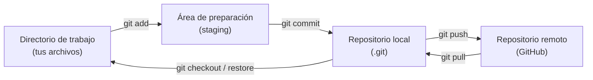

# Manual de introducción a Git y GitHub

Este manual explica, desde cero y sin dar nada por supuesto, cómo guardar el historial de un proyecto con **Git**, cómo crear un repositorio en **GitHub** y cómo mantener ambos sincronizados mediante **SSH**.

Está pensado para alumnos que nunca han usado un control de versiones. Todos los conceptos se explican antes de ejecutar los comandos, de modo que cada paso tenga un significado claro.

---

## Índice

1. [Qué es Git y qué es GitHub](#_1-que-es-git-y-que-es-github)
2. [Conceptos fundamentales](#_2-conceptos-fundamentales)
3. [Instalación](#_3-instalacion)
4. [Configuración inicial](#_4-configuracion-inicial)
5. [Crear un repositorio local](#_5-crear-un-repositorio-local)
6. [El ciclo básico de trabajo](#_6-el-ciclo-basico-de-trabajo)
7. [Ignorar archivos con .gitignore](#_7-ignorar-archivos-con-gitignore)
8. [Crear el repositorio en GitHub](#_8-crear-el-repositorio-en-github)
9. [HTTPS frente a SSH](#_9-https-frente-a-ssh)
10. [Claves SSH de GitHub](#_10-claves-ssh-de-github)
11. [Conectar el repositorio local con GitHub](#_11-conectar-el-repositorio-local-con-github)
12. [Flujo de trabajo diario](#_12-flujo-de-trabajo-diario)
13. [Ramas (branches)](#_13-ramas-branches)
14. [Deshacer cambios](#_14-deshacer-cambios)
15. [Resolver conflictos](#_15-resolver-conflictos)
16. [Etiquetas y versiones](#_16-etiquetas-y-versiones)
17. [Buenas prácticas](#_17-buenas-practicas)
18. [Ejercicio práctico completo](#_18-ejercicio-practico-completo)
19. [Solución de problemas frecuentes](#_19-solucion-de-problemas-frecuentes)
20. [Chuleta de comandos](#_20-chuleta-de-comandos)
21. [Glosario](#_21-glosario)

---

## 1. Qué es Git y qué es GitHub

### 1.1. El problema que resuelve Git

Imagina que tienes una carpeta con el proyecto de clase:

```text
proyecto/
├── index.html
├── estilos.css
└── script.js
```

Si quieres guardar una versión anterior, lo habitual sería crear copias:

```text
proyecto/
├── index.html
├── index_antiguo.html
├── index_antiguo_2.html
├── index_DEFINITIVO.html
└── index_DEFINITIVO_bueno.html
```

Este sistema tiene varios problemas:

- No sabemos **qué cambió** entre una copia y otra.
- No sabemos **cuándo** ni **quién** hizo cada cambio.
- No podemos volver atrás de forma ordenada.
- Si varias personas trabajan, es fácil sobrescribir el trabajo de otra.
- No hay una copia de seguridad fuera del ordenador.

**Git** resuelve estos problemas. Es un **sistema de control de versiones**: guarda la historia completa del proyecto y permite consultar, recuperar o comparar cualquier momento del pasado.

### 1.2. Git no es GitHub

Esta es la confusión más habitual. No son lo mismo:

| Git | GitHub |
|-----|--------|
| Programa que se instala en el ordenador. | Servicio web en la nube. |
| Guarda el historial **localmente**. | Aloja una copia del repositorio **en Internet**. |
| Funciona sin conexión. | Necesita conexión para sincronizar. |
| Es software libre. | Es una empresa (Microsoft). |
| Se usa desde la terminal o un programa gráfico. | Se usa desde el navegador. |

Dicho de forma sencilla:

- **Git** es el motor que registra los cambios.
- **GitHub** es el lugar donde publicamos una copia de ese registro para tener una copia de seguridad y trabajar en equipo.

También existen alternativas a GitHub, como GitLab o Bitbucket, pero los conceptos son los mismos.

### 1.3. Repositorio local y repositorio remoto



- **Repositorio local**: la carpeta de tu ordenador que contiene el proyecto y una carpeta oculta `.git` con todo el historial.
- **Repositorio remoto**: la copia alojada en GitHub.
- **Sincronizar**: poner de acuerdo ambos repositorios. Se hace con `git push` (subir) y `git pull` (bajar).

---

## 2. Conceptos fundamentales

Antes de escribir comandos conviene tener claros estos términos.

### 2.1. Repositorio

Un **repositorio** es un proyecto gestionado por Git. No es solo una carpeta: incluye el historial de todos los cambios.

Al ejecutar `git init`, Git crea una carpeta oculta llamada `.git`. Esa carpeta contiene el historial. **No se debe borrar ni modificar a mano.**

### 2.2. Directorio de trabajo

Es la carpeta normal donde editas tus archivos: el `index.html`, el `script.js`, etc. Git observa lo que haces en ella, pero no guarda nada automáticamente.

### 2.3. Área de preparación (staging area)

Es una zona intermedia entre los archivos que has modificado y el próximo commit.

- `git add` **prepara** cambios.
- `git commit` **guarda** lo preparado.

Piensa en el staging como una caja donde colocas exactamente lo que quieres incluir en la próxima fotografía del proyecto.

### 2.4. Commit

Un **commit** es una fotografía del proyecto en un momento concreto. Guarda:

- Los cambios realizados.
- El autor y la fecha.
- Un mensaje descriptivo.
- Un identificador único (hash), por ejemplo `a1b2c3d`.

Los commits son **inmutables**: no se modifican, se añaden nuevos. El historial es una cadena de commits.

### 2.5. Rama (branch)

Una **rama** es una línea de desarrollo independiente. Permite trabajar en una idea nueva sin afectar a la versión principal.

- La rama principal suele llamarse `main` (antes se llamaba `master`).
- Puedes crear una rama, hacer cambios y, cuando estén listos, fusionarla (`merge`) con `main`.

### 2.6. Remoto, `origin` y `main`

- **Remoto**: un repositorio alojado en otro lugar (GitHub).
- **`origin`**: nombre convencional que se le da al remoto principal. Es solo un alias; podría llamarse de otra forma, pero `origin` es el estándar.
- **`main`**: nombre de la rama principal del proyecto.
- **`origin/main`**: la copia de la rama `main` que está en el remoto. No es una rama local, es una referencia para comparar.

### 2.7. HEAD y upstream

- **HEAD** indica en qué commit estás situado actualmente. Normalmente apunta a la última confirmación de la rama activa.
- **Upstream** (o rama de seguimiento) es la rama remota asociada a tu rama local. Cuando se configura, puedes usar `git push` y `git pull` sin indicar el remoto ni la rama.

### 2.8. Estados de un archivo

Un archivo puede estar en varios estados:

| Estado | Significado |
|--------|-------------|
| Sin seguimiento (*untracked*) | Git lo ve, pero nunca lo ha guardado. |
| Modificado (*modified*) | Ya estaba guardado y ha cambiado desde el último commit. |
| Preparado (*staged*) | Sus cambios están listos para el próximo commit. |
| Confirmado (*committed*) | Sus cambios ya están guardados en el historial. |
| Ignorado (*ignored*) | Está excluido mediante `.gitignore`. |

---

## 3. Instalación

### 3.1. Windows

1. Descarga **Git for Windows** desde <https://git-scm.com/download/win>.
2. Ejecuta el instalador y acepta las opciones por defecto.
3. Abre **Git Bash** (viene incluido) o **PowerShell**.

Git Bash es lo más recomendable en Windows para este manual, porque permite usar los mismos comandos que en Linux o macOS.

### 3.2. macOS

Comprueba si ya está instalado:

```bash
git --version
```

Si no aparece una versión, instala las herramientas de desarrollo de Apple:

```bash
xcode-select --install
```

También puedes instalarlo con Homebrew:

```bash
brew install git
```

### 3.3. Ubuntu / Debian

```bash
sudo apt update
sudo apt install git
```

### 3.4. Comprobar la instalación

En cualquier sistema:

```bash
git --version
```

Salida esperada (la versión puede variar):

```text
git version 2.43.0
```

---

## 4. Configuración inicial

Git necesita saber **quién eres** para asociar cada commit a una persona. Esta configuración se hace una sola vez por ordenador.

### 4.1. Nombre y correo

```bash
git config --global user.name "Nombre Apellido"
git config --global user.email "tu-correo@ejemplo.com"
```

::: warning Importante
Usa el **mismo correo** con el que te registres en GitHub. Así GitHub podrá asociar tus commits a tu cuenta y mostrar tu foto y tu perfil. No es obligatorio, pero evita confusiones.
:::

El nombre puede ir entre comillas si contiene espacios o tildes.

### 4.2. Rama inicial

Configura `main` como nombre de la rama principal para que todos los repositorios nuevos la usen:

```bash
git config --global init.defaultBranch main
```

### 4.3. Editor de texto

Cuando Git necesite que escribas un mensaje largo (por ejemplo, al fusionar ramas), abrirá un editor. Puedes configurar uno sencillo:

```bash
# Opción 1: nano (sencillo en Linux/macOS)
git config --global core.editor "nano"

# Opción 2: VS Code
git config --global core.editor "code --wait"
```

### 4.4. Comprobar la configuración

```bash
git config --global --list
```

Deberías ver al menos:

```text
user.name=Nombre Apellido
user.email=tu-correo@ejemplo.com
init.defaultbranch=main
```

### 4.5. ¿Dónde se guarda esta configuración?

En el archivo `~/.gitconfig` (Linux y macOS) o `C:\Users\TU_USUARIO\.gitconfig` (Windows).

Puedes verlo con:

```bash
git config --global --list --show-origin
```

---

## 5. Crear un repositorio local

Vamos a crear un proyecto de ejemplo desde cero.

### 5.1. Crear la carpeta y entrar en ella

```bash
mkdir mi-proyecto
cd mi-proyecto
```

### 5.2. Inicializar el repositorio

```bash
git init
```

Salida esperada:

```text
Initialized empty Git repository in /ruta/mi-proyecto/.git/
```

Comprueba que se ha creado la carpeta oculta:

```bash
ls -la
```

Verás algo parecido a:

```text
drwxr-xr-x   .git
```

En Windows con Git Bash también funciona `ls -la`. En PowerShell puedes usar `dir -Force`.

### 5.3. Crear un archivo

```bash
echo "# Mi proyecto" > README.md
```

En Windows PowerShell, si no usas Git Bash:

```powershell
"# Mi proyecto" | Out-File -Encoding utf8 README.md
```

### 5.4. Ver el estado

```bash
git status
```

Salida esperada:

```text
On branch main

No commits yet

Untracked files:
  (use "git add <file>..." to include in what will be committed)
        README.md

nothing added to commit but untracked files present
```

Interpretación:

- `On branch main`: estás en la rama principal.
- `No commits yet`: todavía no hay ninguna fotografía guardada.
- `Untracked files`: Git ve `README.md`, pero no lo está siguiendo.

### 5.5. Preparar y confirmar el primer commit

```bash
git add README.md
git commit -m "Añade README inicial"
```

Salida esperada:

```text
[main (root-commit) a1b2c3d] Añade README inicial
 1 file changed, 1 insertion(+)
 create mode 100644 README.md
```

Ya tienes tu primer commit.

### 5.6. Consultar el historial

```bash
git log
```

Salida esperada:

```text
commit a1b2c3d4e5f6... (HEAD -> main)
Author: Nombre Apellido <tu-correo@ejemplo.com>
Date:   Tue Oct 27 10:00:00 2026 +0100

    Añade README inicial
```

Para una versión resumida:

```bash
git log --oneline
```

```text
a1b2c3d (HEAD -> main) Añade README inicial
```

---

## 6. El ciclo básico de trabajo

Este es el ciclo que repetirás constantemente:

```text
editar archivos → git status → git diff → git add → git commit → git push
```

### 6.1. `git status`

Muestra qué archivos han cambiado, cuáles están preparados y en qué rama estás. **Úsalo con frecuencia.** No modifica nada.

```bash
git status
```

Versión corta:

```bash
git status -s
```

Códigos habituales:

| Código | Significado |
|--------|-------------|
| `??` | Archivo sin seguimiento. |
| `M` | Archivo modificado. |
| `A` | Archivo añadido al staging. |
| `D` | Archivo eliminado. |
| `MM` | Modificado en el staging y vuelto a modificar después. |

### 6.2. `git diff`

Muestra **exactamente** qué líneas han cambiado y todavía no están preparadas:

```bash
git diff
```

Para ver lo que ya está preparado:

```bash
git diff --staged
```

### 6.3. `git add`

Prepara cambios para el próximo commit.

```bash
# Un archivo concreto
git add README.md

# Varios archivos
git add index.html estilos.css

# Todos los cambios y archivos nuevos de la carpeta actual
git add .

# Toda la carpeta del proyecto
git add -A
```

::: tip
`git add .` es cómodo, pero revisa antes con `git status` que no estás añadiendo archivos que no quieres (por ejemplo, contraseñas o carpetas de dependencias).
:::

### 6.4. `git commit`

Guarda lo preparado en el historial:

```bash
git commit -m "Mensaje claro y en presente"
```

Buenos mensajes:

```text
Añade formulario de contacto
Corrige error al calcular el total
Actualiza instrucciones de instalación
```

Malos mensajes:

```text
cambios
arreglos
asdf
lo de antes
```

Si olvidas `-m`, Git abrirá el editor configurado.

### 6.5. `git log`

```bash
git log                  # historial completo
git log --oneline        # una línea por commit
git log --oneline --graph --all   # ramas de forma gráfica
```

Puedes salir del historial con la tecla `q`.

### 6.6. Regla de oro

Un commit debe representar **un cambio lógico completo**. No hagas un commit por cada archivo ni uno gigante con todo el trabajo de la semana.

---

## 7. Ignorar archivos con .gitignore

No todo debe guardarse en Git. Algunos archivos son temporales, personales o contienen secretos.

### 7.1. Crear `.gitignore`

En la raíz del proyecto:

```bash
nano .gitignore
```

Contenido de ejemplo:

```text
# Dependencias
node_modules/
venv/
__pycache__/

# Archivos de entorno y secretos
.env
*.key
*.pem

# Archivos generados
dist/
build/
*.log

# Sistema operativo
.DS_Store
Thumbs.db

# Editores
.vscode/
.idea/
```

### 7.2. Cómo funciona

Cada línea es un patrón:

- `archivo.txt` ignora ese archivo.
- `*.log` ignora todos los archivos con extensión `.log`.
- `carpeta/` ignora una carpeta completa.
- `!importante.log` hace una excepción (no ignorar).
- `#` inicia un comentario.

### 7.3. Importante: `.gitignore` no afecta a archivos ya rastreados

Si un archivo ya estaba en un commit, añadirlo a `.gitignore` no lo elimina del historial. Hay que dejar de rastrearlo:

```bash
git rm --cached archivo-secreto.txt
git commit -m "Deja de rastrear archivo-secreto.txt"
```

::: danger Nunca subas secretos
Si subes una contraseña, una clave privada o un token a GitHub, considéralo comprometido. Bórralo del historial y **cambia la contraseña o el token inmediatamente**. GitHub avisa a algunos proveedores, pero no es infalible.
:::

---

## 8. Crear el repositorio en GitHub

### 8.1. Crear una cuenta

1. Entra en <https://github.com>.
2. Pulsa **Sign up**.
3. Elige un nombre de usuario, un correo y una contraseña.
4. Verifica el correo.

El nombre de usuario formará parte de las direcciones de tus repositorios.

### 8.2. Crear el repositorio remoto

1. Pulsa el botón **+** de la esquina superior derecha y elige **New repository**.
2. Rellena:
   - **Repository name**: por ejemplo, `mi-proyecto`.
   - **Description**: opcional.
   - **Visibility**: `Public` (visible para todos) o `Private` (solo tú y quienes invites).
3. **Muy importante para este manual**: deja **sin marcar** las opciones `Add a README file`, `Add .gitignore` y `Choose a license`.
4. Pulsa **Create repository**.

::: tip ¿Por qué dejar el repositorio vacío?
Si GitHub crea un README, el repositorio remoto ya tendrá un commit que tu repositorio local no tiene. Al intentar subir el tuyo, Git puede rechazar la operación por historiales no relacionados. Crearlo vacío evita ese problema en el primer envío.

Si ya lo has creado con README, no pasa nada: al final del manual se explica cómo resolverlo.
:::

### 8.3. Copiar la dirección SSH

Tras crear el repositorio, GitHub muestra una pantalla con instrucciones. Asegúrate de que está seleccionada la pestaña **SSH**, no **HTTPS**.

La dirección tiene esta forma:

```text
git@github.com:TU_USUARIO/mi-proyecto.git
```

Guárdala, la necesitarás en el paso 11.

---

## 9. HTTPS frente a SSH

Git puede comunicarse con GitHub de dos formas:

| | HTTPS | SSH |
|---|-------|-----|
| Dirección | `https://github.com/usuario/repo.git` | `git@github.com:usuario/repo.git` |
| Autenticación | Token personal (PAT) | Clave SSH |
| Contraseña de GitHub | **No funciona** | No se usa |
| Configuración inicial | Crear y guardar un token | Crear una clave una sola vez |
| Comodidad diaria | Hay que gestionar el token | No pide nada tras configurarlo |
| Puertos | 443 (casi nunca bloqueado) | 22 (puede estar bloqueado) |

### 9.1. Por qué la contraseña no funciona por HTTPS

GitHub eliminó la autenticación con contraseña por HTTPS. Si intentas hacer `git push` y te pide contraseña, no sirve la de tu cuenta. Necesitas un **Personal Access Token (PAT)**.

### 9.2. Recomendación

Para este manual usaremos **SSH**, porque:

- Se configura una vez.
- No hay que renovar tokens.
- Es el método habitual en entornos profesionales.
- Evita el error clásico de introducir la contraseña de GitHub y recibir un rechazo.

Si en algún momento ves un error como:

```text
remote: Support for password authentication was removed
```

significa que el remoto está configurado por HTTPS. Se cambia a SSH con:

```bash
git remote set-url origin git@github.com:TU_USUARIO/mi-proyecto.git
```

---

## 10. Claves SSH de GitHub

### 10.1. Qué es una clave SSH

Una **clave SSH** es un par de archivos:

- **Clave privada**: se queda en tu ordenador y **no se comparte nunca**.
- **Clave pública**: se entrega a GitHub.

Funcionan como un candado y su llave:

- GitHub guarda tu clave pública (el candado).
- Tu ordenador tiene la clave privada (la llave).
- Cuando conectas, GitHub comprueba que ambas encajan. Si encajan, te da acceso sin pedir contraseña.

La clave pública puede conocerse sin riesgo. La privada no.

### 10.2. Dónde se guardan

En Linux y macOS:

```text
~/.ssh/id_ed25519        ← clave privada
~/.ssh/id_ed25519.pub    ← clave pública
```

En Windows:

```text
C:\Users\TU_USUARIO\.ssh\id_ed25519
C:\Users\TU_USUARIO\.ssh\id_ed25519.pub
```

### 10.3. Comprobar si ya tienes claves

```bash
ls -la ~/.ssh
```

Si ves `id_ed25519` e `id_ed25519.pub`, ya tienes una clave. Puedes usarla o crear otra. Si no ves nada, créala.

### 10.4. Generar una clave nueva

```bash
ssh-keygen -t ed25519 -C "tu-correo@ejemplo.com"
```

- `-t ed25519`: tipo de clave moderna, más segura y corta que RSA.
- `-C`: comentario, normalmente el correo. Sirve para identificarla en GitHub.

El comando preguntará:

```text
Generating public/private ed25519 key pair.
Enter file in which to save the key (/home/usuario/.ssh/id_ed25519):
```

Pulsa **Enter** para aceptar la ruta por defecto.

Después:

```text
Enter passphrase (empty for no passphrase):
```

Aquí puedes escribir una **frase de contraseña**:

- **Con passphrase**: más segura. Si alguien copia tu clave privada, no podrá usarla sin la frase. Tendrás que introducirla al usarla (o guardarla en el agente SSH).
- **Sin passphrase**: más cómoda, pero menos segura.

Para un ordenador personal, una passphrase es recomendable. Para un aula con ordenadores compartidos, consulta con el profesor.

Salida esperada:

```text
Your identification has been saved in /home/usuario/.ssh/id_ed25519
Your public key has been saved in /home/usuario/.ssh/id_ed25519.pub
The key fingerprint is:
SHA256:xxxxxxxxxxxxxxxxxxxxxxxxxxxxxxxxxxxxxxxxxxx tu-correo@ejemplo.com
```

### 10.5. Alternativa con RSA

Si tu sistema es antiguo y no admite Ed25519:

```bash
ssh-keygen -t rsa -b 4096 -C "tu-correo@ejemplo.com"
```

El archivo se llamará `id_rsa` e `id_rsa.pub`.

### 10.6. Permisos correctos (Linux y macOS)

SSH es estricto con los permisos. Si son demasiado abiertos, rechazará la clave:

```bash
chmod 700 ~/.ssh
chmod 600 ~/.ssh/id_ed25519
chmod 644 ~/.ssh/id_ed25519.pub
```

### 10.7. Añadir la clave al agente SSH

El **agente SSH** guarda la clave privada desbloqueada durante la sesión, para no escribir la passphrase en cada operación.

**macOS:**

```bash
eval "$(ssh-agent -s)"
ssh-add --apple-use-keychain ~/.ssh/id_ed25519
```

En versiones antiguas de macOS:

```bash
ssh-add -K ~/.ssh/id_ed25519
```

**Linux:**

```bash
eval "$(ssh-agent -s)"
ssh-add ~/.ssh/id_ed25519
```

**Windows (PowerShell como administrador, una sola vez):**

```powershell
Get-Service ssh-agent | Set-Service -StartupType Automatic
Start-Service ssh-agent
ssh-add $env:USERPROFILE\.ssh\id_ed25519
```

Si el comando `ssh-add` no existe en Windows, instala el cliente OpenSSH:

```powershell
Add-WindowsCapability -Online -Name OpenSSH.Client~~~~0.0.1.0
```

### 10.8. Copiar la clave pública

**macOS:**

```bash
pbcopy < ~/.ssh/id_ed25519.pub
```

**Linux con X11:**

```bash
xclip -selection clipboard < ~/.ssh/id_ed25519.pub
```

**Linux sin entorno gráfico o cualquier sistema:**

```bash
cat ~/.ssh/id_ed25519.pub
```

Copia manualmente toda la línea, que empieza por `ssh-ed25519` y termina con tu correo.

**Windows (PowerShell):**

```powershell
Get-Content $env:USERPROFILE\.ssh\id_ed25519.pub | Set-Clipboard
```

### 10.9. Registrar la clave en GitHub

1. Entra en GitHub.
2. Pulsa tu foto de perfil → **Settings**.
3. En el menú lateral, entra en **SSH and GPG keys**.
4. Pulsa **New SSH key**.
5. **Title**: un nombre reconocible, por ejemplo `Portátil clase` o `Mac personal`.
6. **Key type**: `Authentication Key`.
7. **Key**: pega la clave pública completa.
8. Pulsa **Add SSH key**.

::: danger No pegues la clave privada
La clave privada es el archivo **sin** `.pub`. Nunca la copies en GitHub, en un chat, en un correo ni en un repositorio. GitHub solo necesita la pública.
:::

### 10.10. Probar la conexión

```bash
ssh -T git@github.com
```

La primera vez preguntará si confías en el servidor:

```text
The authenticity of host 'github.com (140.82.121.4)' can't be established.
ED25519 key fingerprint is SHA256:+DiY3wvvV6TuJJhbpZisF/zLDA0zPMSvHdkr4UvCOqU.
Are you sure you want to continue connecting (yes/no/[fingerprint])?
```

Escribe `yes` y pulsa Enter (escribe la palabra completa, no solo `y`).

Si todo está bien, verás:

```text
Hi TU_USUARIO! You've successfully authenticated, but GitHub does not provide shell access.
```

Ese mensaje es correcto. No es un error. Significa que la autenticación ha funcionado, pero GitHub no permite abrir una terminal remota.

::: tip El código de salida 1 es normal
`ssh -T git@github.com` puede devolver un código de salida 1 porque GitHub cierra la conexión después de identificarte. Lo importante es el mensaje `successfully authenticated`.
:::

### 10.11. Archivo de configuración SSH (opcional pero recomendado)

Si tienes varias claves o quieres fijar cuál usar para GitHub, crea o edita `~/.ssh/config`:

```text
Host github.com
    HostName github.com
    User git
    IdentityFile ~/.ssh/id_ed25519
    IdentitiesOnly yes
```

Después ajusta permisos:

```bash
chmod 600 ~/.ssh/config
```

Esto evita que SSH pruebe claves equivocadas y acelera la conexión.

### 10.12. Si el puerto 22 está bloqueado

Algunas redes de centros educativos o empresas bloquean el puerto 22. GitHub ofrece SSH sobre el puerto 443. Añade esto a `~/.ssh/config`:

```text
Host github.com
    HostName ssh.github.com
    Port 443
    User git
    IdentityFile ~/.ssh/id_ed25519
```

Prueba de nuevo:

```bash
ssh -T git@github.com
```

---

## 11. Conectar el repositorio local con GitHub

Ahora unimos el repositorio local del paso 5 con el repositorio vacío creado en GitHub.

### 11.1. Añadir el remoto

Dentro de la carpeta del proyecto:

```bash
git remote add origin git@github.com:TU_USUARIO/mi-proyecto.git
```

- `origin` es el alias del remoto.
- La dirección debe ser la que copiaste de GitHub en la pestaña SSH.

### 11.2. Comprobar el remoto

```bash
git remote -v
```

Salida esperada:

```text
origin  git@github.com:TU_USUARIO/mi-proyecto.git (fetch)
origin  git@github.com:TU_USUARIO/mi-proyecto.git (push)
```

`fetch` es para descargar y `push` para subir. Normalmente son la misma dirección.

### 11.3. Asegurar el nombre de la rama

```bash
git branch -M main
```

- `-M` renombra la rama actual a `main` aunque ya exista otra con ese nombre.
- Si tu rama ya se llama `main`, el comando no hace daño.

Comprueba:

```bash
git branch
```

Salida esperada:

```text
* main
```

El asterisco indica la rama activa.

### 11.4. Primer push

```bash
git push -u origin main
```

Significado:

- `push`: subir commits.
- `origin`: al remoto llamado `origin`.
- `main`: la rama `main`.
- `-u`: guardar la relación entre la rama local y la remota (configurar upstream).

Salida esperada:

```text
Enumerating objects: 3, done.
Counting objects: 100% (3/3), done.
Writing objects: 100% (3/3), 250 bytes | 250.00 KiB/s, done.
Total 3 (delta 0), reused 0 (delta 0), pack-reused 0
To github.com:TU_USUARIO/mi-proyecto.git
 * [new branch]      main -> main
branch 'main' set up to track 'origin/main'.
```

A partir de ahora, dentro de esa rama, basta con:

```bash
git push
git pull
```

porque Git ya sabe a dónde ir.

### 11.5. Comprobar en GitHub

Recarga la página del repositorio. Deberías ver `README.md` y el mensaje del commit.

### 11.6. Si creaste el repositorio con README

Si en GitHub marcaste `Add a README file`, el remoto tiene un commit que tu local no tiene. Al hacer push verás:

```text
! [rejected]        main -> main (fetch first)
error: failed to push some refs to 'github.com:TU_USUARIO/mi-proyecto.git'
hint: Updates were rejected because the remote contains work that you do not have locally.
```

Tienes dos opciones.

**Opción A (recomendada si acabas de empezar):** descargar primero el README remoto y fusionarlo.

```bash
git pull origin main --allow-unrelated-histories
```

Git abrirá un editor para el mensaje de fusión. Guarda y cierra (en `nano`: `Ctrl+O`, Enter, `Ctrl+X`). Después:

```bash
git push -u origin main
```

**Opción B (más limpia):** borrar el repositorio en GitHub y crearlo vacío, o clonar el remoto y copiar dentro tus archivos.

### 11.7. Clonar un repositorio existente

Si el repositorio ya existe en GitHub y quieres una copia en otro ordenador:

```bash
git clone git@github.com:TU_USUARIO/mi-proyecto.git
cd mi-proyecto
```

`git clone` hace automáticamente:

- Descarga el historial completo.
- Crea la carpeta del proyecto.
- Configura `origin`.
- Configura la rama local `main` siguiendo a `origin/main`.

No es necesario ejecutar `git init`, `git remote add` ni `git push -u` después de clonar.

---

## 12. Flujo de trabajo diario

### 12.1. Antes de empezar a trabajar

Si trabajas en varios ordenadores o con más personas, descarga los cambios más recientes:

```bash
git pull
```

### 12.2. Mientras trabajas

Edita tus archivos con normalidad. Cuando quieras guardar un avance:

```bash
git status
git diff
git add .
git commit -m "Descripción del cambio"
```

### 12.3. Al terminar la sesión

```bash
git push
```

### 12.4. Resumen visual

```text
git pull            ← traer cambios remotos
   ↓
editar archivos
   ↓
git status          ← revisar qué ha cambiado
git diff            ← revisar las líneas exactas
git add .           ← preparar
git commit -m "..." ← guardar en local
git push            ← subir a GitHub
```

### 12.5. `fetch` frente a `pull`

| Comando | Qué hace |
|---------|----------|
| `git fetch` | Descarga los cambios remotos, pero **no** los fusiona con tu trabajo. |
| `git pull` | Equivale a `git fetch` + `git merge`. Descarga y fusiona. |
| `git pull --rebase` | Descarga y reaplica tus commits encima, sin crear commit de fusión. |

Si quieres revisar antes de fusionar:

```bash
git fetch
git log HEAD..origin/main --oneline
git merge origin/main
```

### 12.6. Ver el estado de sincronización

```bash
git status
```

Mensajes habituales:

```text
Your branch is up to date with 'origin/main'.
```

Todo sincronizado.

```text
Your branch is ahead of 'origin/main' by 2 commits.
```

Tienes 2 commits locales sin subir. Haz `git push`.

```text
Your branch is behind 'origin/main' by 1 commit.
```

El remoto tiene un commit que tú no tienes. Haz `git pull`.

```text
Your branch and 'origin/main' have diverged.
```

Ambos tienen commits distintos. Necesitas `git pull` y resolver posibles conflictos.

---

## 13. Ramas (branches)

### 13.1. Para qué sirven

Una rama permite trabajar en una funcionalidad o corrección sin tocar `main`. Si el experimento sale mal, se descarta la rama y `main` permanece intacto.

### 13.2. Crear y cambiar de rama

```bash
git switch -c feature-contacto
```

- `-c`: crea la rama.
- `feature-contacto`: nombre de la nueva rama.

Equivalente con el comando antiguo:

```bash
git checkout -b feature-contacto
```

### 13.3. Ver ramas

```bash
git branch          # ramas locales
git branch -a       # locales y remotas
```

La rama activa aparece con `*`.

### 13.4. Cambiar de rama

```bash
git switch main
git switch feature-contacto
```

Equivalente antiguo:

```bash
git checkout main
```

### 13.5. Hacer commits en la rama

```bash
git add .
git commit -m "Añade formulario de contacto"
```

### 13.6. Subir la rama a GitHub

```bash
git push -u origin feature-contacto
```

La rama aparecerá en GitHub. Allí puedes abrir una **Pull Request** para pedir que se fusione con `main`.

### 13.7. Fusionar en local

Primero cambia a la rama destino:

```bash
git switch main
```

Después fusiona:

```bash
git merge feature-contacto
```

Si no hay conflictos, Git crea un commit de fusión (o avanza `main` si es una fusión rápida). Luego:

```bash
git push
```

### 13.8. Borrar una rama

Local, una vez fusionada:

```bash
git branch -d feature-contacto
```

Remota:

```bash
git push origin --delete feature-contacto
```

Si Git avisa de que no está fusionada y estás seguro de borrarla:

```bash
git branch -D feature-contacto
```

::: warning
`-D` fuerza el borrado y puede perder commits no fusionados. Úsalo solo si sabes que no necesitas esa rama.
:::

### 13.9. Flujo con Pull Request

En proyectos reales es habitual:

1. Crear una rama.
2. Hacer commits y subirla.
3. Abrir una Pull Request en GitHub.
4. Revisar los cambios.
5. Fusionar desde GitHub.
6. Actualizar tu `main` local:

```bash
git switch main
git pull
```

---

## 14. Deshacer cambios

### 14.1. Descartar cambios no guardados en un archivo

```bash
git restore archivo.txt
```

Esto devuelve el archivo a como estaba en el último commit. **Se pierden los cambios no guardados.**

Equivalente antiguo:

```bash
git checkout -- archivo.txt
```

### 14.2. Quitar un archivo del staging

```bash
git restore --staged archivo.txt
```

El archivo deja de estar preparado, pero **conserva** sus cambios.

Equivalente antiguo:

```bash
git reset HEAD archivo.txt
```

### 14.3. Corregir el mensaje del último commit

```bash
git commit --amend -m "Mensaje corregido"
```

Si además quieres incluir cambios que olvidaste:

```bash
git add archivo-olvidado.txt
git commit --amend --no-edit
```

::: warning
No uses `--amend` si el commit ya está subido a un repositorio compartido. Cambia el historial y obliga a los demás a resincronizar.
:::

### 14.4. Deshacer el último commit

**Conservando los cambios en staging:**

```bash
git reset --soft HEAD~1
```

**Conservando los cambios en el directorio de trabajo (sin staging):**

```bash
git reset HEAD~1
```

**Borrando también los cambios:**

```bash
git reset --hard HEAD~1
```

::: danger `--hard` es destructivo
`git reset --hard` elimina cambios de forma irreversible. Comprueba dos veces el commit al que vas a volver. Nunca lo uses sobre commits ya publicados en una rama compartida.
:::

### 14.5. Deshacer un commit ya publicado

La forma segura es crear un commit nuevo que invierta los cambios:

```bash
git revert a1b2c3d
```

Git abrirá un editor con un mensaje propuesto. Guárdalo y después:

```bash
git push
```

`git revert` no borra historia: añade un commit que deshace otro. Es lo correcto en repositorios compartidos.

### 14.6. Recuperar un commit “perdido”

Aunque hagas un `reset --hard`, Git conserva los commits en el reflog durante un tiempo:

```bash
git reflog
git switch -c recuperado a1b2c3d
```

### 14.7. Guardar cambios temporalmente con stash

Si necesitas cambiar de rama pero no quieres hacer commit todavía:

```bash
git stash          # guarda cambios temporalmente
git switch otra-rama
# ...trabajar...
git switch main
git stash pop      # recupera y elimina el stash
```

Otros comandos:

```bash
git stash list
git stash apply    # recupera sin eliminar
git stash drop     # elimina el último stash
```

---

## 15. Resolver conflictos

### 15.1. Cuándo ocurren

Un conflicto aparece cuando dos commits modifican **la misma línea** del mismo archivo y Git no puede decidir cuál es la versión correcta. No es un error grave: Git pide que lo resuelvas tú.

Ejemplo típico:

```bash
git pull
```

```text
Auto-merging README.md
CONFLICT (content): Merge conflict in README.md
Automatic merge failed; fix conflicts and then commit the result.
```

### 15.2. Ver los archivos en conflicto

```bash
git status
```

```text
Unmerged paths:
  (use "git add <file>..." to mark resolution)
        both modified:   README.md
```

### 15.3. Abrir el archivo

Verás marcas como estas:

```text
<<<<<<< HEAD
Esta es la versión de mi rama local.
=======
Esta es la versión que viene de GitHub.
>>>>>>> origin/main
```

Significado:

- Entre `<<<<<<< HEAD` y `=======`: tu versión local.
- Entre `=======` y `>>>>>>> origin/main`: la versión remota.
- Las líneas con `<<<<<<<`, `=======` y `>>>>>>>` **hay que borrarlas**.

### 15.4. Resolver

Decide el contenido final. Por ejemplo:

```text
Esta es la versión consensuada.
```

Borra las marcas de conflicto y deja solo el texto correcto.

Después:

```bash
git add README.md
git commit -m "Resuelve conflicto en README"
git push
```

### 15.5. Cancelar una fusión

Si te lías y quieres volver al estado anterior:

```bash
git merge --abort
```

### 15.6. Consejos

- No resuelvas conflictos a ciegas aceptando todo.
- Habla con la persona que hizo el otro cambio si no está claro.
- Haz commits pequeños y haz `pull` con frecuencia: así los conflictos son menores.
- Puedes usar `git diff --name-only --diff-filter=U` para listar solo los archivos en conflicto.

---

## 16. Etiquetas y versiones

Una **etiqueta** (`tag`) marca un commit importante, normalmente una versión publicada.

```bash
# Etiqueta simple
git tag v1.0

# Etiqueta anotada (recomendada)
git tag -a v1.0 -m "Primera versión estable"

# Listar etiquetas
git tag

# Subir una etiqueta concreta
git push origin v1.0

# Subir todas las etiquetas
git push --tags
```

En GitHub, las etiquetas permiten crear **Releases** con notas y archivos descargables.

---

## 17. Buenas prácticas

### 17.1. Commits

- Haz commits pequeños y frecuentes.
- Un commit, un cambio lógico.
- Escribe mensajes en presente e imperativo: `Añade validación`, no `Añadida validación` ni `subida de cosas`.
- No mezcles cambios de formato con cambios de lógica.
- Revisa `git status` y `git diff` antes de confirmar.

### 17.2. Sincronización

- Haz `git pull` antes de empezar y antes de hacer `push`.
- No trabajes durante días sin subir cambios.
- No uses `git push --force` en ramas compartidas.
- Comprueba siempre en qué rama estás con `git status` o `git branch`.

### 17.3. Seguridad

- Nunca subas `.env`, claves privadas, contraseñas ni tokens.
- Usa `.gitignore` desde el primer commit.
- Protege tu clave privada SSH con una passphrase.
- No compartas la clave privada.
- Si sospechas que un secreto se ha subido, cámbialo inmediatamente.

### 17.4. Documentación

- Incluye un `README.md` con:
  - Qué hace el proyecto.
  - Cómo instalarlo.
  - Cómo ejecutarlo.
  - Cómo contribuir.
- Añade una licencia si el proyecto es público.

### 17.5. Ramas

- `main` debe funcionar siempre.
- Usa nombres descriptivos: `feature/login`, `fix/error-total`, `docs/instalacion`.
- Borra las ramas ya fusionadas.

### 17.6. Archivos que no deben subirse

| Archivo o carpeta | Motivo |
|-------------------|--------|
| `.env` | Contiene secretos y configuraciones locales. |
| `node_modules/` | Dependencias regenerables; ocupa mucho. |
| `venv/`, `__pycache__/` | Entornos y cachés de Python. |
| `dist/`, `build/` | Artefactos generados. |
| `.DS_Store`, `Thumbs.db` | Archivos del sistema operativo. |
| `*.log` | Registros temporales. |
| Claves `*.pem`, `*.key` | Credenciales. |

---

## 18. Ejercicio práctico completo

Vamos a recorrer todo el proceso desde cero. Sustituye `TU_USUARIO` por tu nombre de usuario real de GitHub.

### 18.1. Preparar el entorno

```bash
git --version
git config --global user.name "Tu Nombre"
git config --global user.email "tu-correo@ejemplo.com"
git config --global init.defaultBranch main
```

### 18.2. Crear la clave SSH

```bash
ssh-keygen -t ed25519 -C "tu-correo@ejemplo.com"
eval "$(ssh-agent -s)"
ssh-add ~/.ssh/id_ed25519
```

En macOS, usa `ssh-add --apple-use-keychain ~/.ssh/id_ed25519` en lugar de la última línea.

Copia la clave pública:

```bash
cat ~/.ssh/id_ed25519.pub
```

Añádela en GitHub: **Settings → SSH and GPG keys → New SSH key**.

Comprueba:

```bash
ssh -T git@github.com
```

Debe aparecer `Hi TU_USUARIO! You've successfully authenticated...`.

### 18.3. Crear el proyecto local

```bash
mkdir practica-git
cd practica-git
git init
```

Crea `README.md`:

```bash
echo "# Práctica de Git" > README.md
echo "Repositorio de prueba para aprender Git y GitHub." >> README.md
```

Crea `.gitignore`:

```bash
printf ".DS_Store\n*.log\n.env\n" > .gitignore
```

Comprueba:

```bash
git status
```

### 18.4. Primer commit

```bash
git add .
git commit -m "Crea estructura inicial del proyecto"
git log --oneline
```

### 18.5. Crear el repositorio en GitHub

1. **New repository**.
2. Nombre: `practica-git`.
3. Sin README, sin `.gitignore`, sin licencia.
4. **Create repository**.
5. Copia la dirección SSH: `git@github.com:TU_USUARIO/practica-git.git`.

### 18.6. Conectar y subir

```bash
git remote add origin git@github.com:TU_USUARIO/practica-git.git
git remote -v
git branch -M main
git push -u origin main
```

Verifica en GitHub que aparecen `README.md` y `.gitignore`.

### 18.7. Modificar y sincronizar

Edita `README.md`, por ejemplo añadiendo una línea:

```bash
echo "## Objetivos" >> README.md
echo "- Aprender Git" >> README.md
```

Después:

```bash
git status
git diff
git add README.md
git commit -m "Añade objetivos al README"
git push
```

Recarga GitHub y comprueba el nuevo commit.

### 18.8. Crear una rama y una Pull Request

```bash
git switch -c feature/saludo
echo "Hola desde una rama" > saludo.txt
git add saludo.txt
git commit -m "Añade archivo de saludo"
git push -u origin feature/saludo
```

En GitHub aparecerá un botón **Compare & pull request**. Créala, revisa los cambios y fusiónala.

Vuelve a local y actualiza:

```bash
git switch main
git pull
git branch -d feature/saludo
```

### 18.9. Simular un trabajo desde otro ordenador

```bash
cd ..
git clone git@github.com:TU_USUARIO/practica-git.git practica-git-2
cd practica-git-2
ls
git log --oneline
```

Comprueba que tienes todo el historial. Modifica un archivo, haz commit y push. Luego, en la primera copia:

```bash
cd ../practica-git
git pull
```

### 18.10. Comprobación final

En cualquiera de las dos copias:

```bash
git status
git log --oneline --graph --all
git remote -v
```

Debe poner que la rama está actualizada y el historial debe coincidir en ambos lados.

---

## 19. Solución de problemas frecuentes

### 19.1. `Permission denied (publickey)`

```text
git@github.com: Permission denied (publickey).
fatal: Could not read from remote repository.
```

**Causas posibles:**

1. No tienes clave SSH o no está añadida a GitHub.
2. El agente SSH no tiene la clave cargada.
3. Estás usando otra clave distinta.
4. Los permisos de la clave son incorrectos.

**Solución:**

```bash
eval "$(ssh-agent -s)"
ssh-add ~/.ssh/id_ed25519
ssh -T git@github.com
```

Comprueba que la clave pública está en GitHub. Revisa permisos con `ls -l ~/.ssh`.

### 19.2. `Host key verification failed`

```text
Host key verification failed.
fatal: Could not read from remote repository.
```

La clave del servidor ha cambiado o no está en `known_hosts`. Comprueba que estás conectando a `github.com` y elimina la entrada antigua:

```bash
ssh-keygen -R github.com
ssh -T git@github.com
```

### 19.3. `remote origin already exists`

```text
error: remote origin already exists.
```

Ya hay un remoto llamado `origin`. Puedes cambiarlo:

```bash
git remote set-url origin git@github.com:TU_USUARIO/mi-proyecto.git
```

O eliminarlo y volver a añadirlo:

```bash
git remote remove origin
git remote add origin git@github.com:TU_USUARIO/mi-proyecto.git
```

### 19.4. `failed to push some refs` / `[rejected]`

```text
! [rejected]        main -> main (fetch first)
error: failed to push some refs
```

El remoto tiene commits que tú no tienes. Solución normal:

```bash
git pull
git push
```

Si los historiales no están relacionados:

```bash
git pull origin main --allow-unrelated-histories
```

Resuelve conflictos si aparecen, haz commit y vuelve a hacer push.

### 19.5. `src refspec main does not match any`

```text
error: src refspec main does not match any
```

No existe la rama `main` en local o no hay commits. Comprueba:

```bash
git branch
git log --oneline
```

Si no hay commits, créalos. Si tu rama se llama `master`:

```bash
git branch -M main
```

### 19.6. `fatal: not a git repository`

Estás fuera de la carpeta del proyecto o no has ejecutado `git init`. Comprueba:

```bash
pwd
ls -la
```

Entra en la carpeta correcta:

```bash
cd ruta/del/proyecto
```

### 19.7. `Support for password authentication was removed`

Estás usando una URL HTTPS y Git pide contraseña. Cambia a SSH:

```bash
git remote set-url origin git@github.com:TU_USUARIO/mi-proyecto.git
```

O crea un token personal y úsalo como contraseña. Para este manual, SSH es la opción recomendada.

### 19.8. `refusing to merge unrelated histories`

```text
fatal: refusing to merge unrelated histories
```

Los dos repositorios tienen historiales independientes. Si estás seguro:

```bash
git pull origin main --allow-unrelated-histories
```

Es lo que ocurre al crear GitHub con README y luego intentar subir un proyecto local con commits propios.

### 19.9. `nothing to commit, working tree clean`

No hay cambios pendientes. Si crees que sí los hay:

- Comprueba que estás en la carpeta correcta.
- Comprueba que has guardado los archivos en el editor.
- Revisa `git status`.
- Revisa si el archivo está en `.gitignore`.

### 19.10. `Your branch and 'origin/main' have diverged`

Ambas ramas tienen commits diferentes. Solución:

```bash
git pull
```

Resuelve conflictos si aparecen y después:

```bash
git push
```

### 19.11. `warning: LF will be replaced by CRLF`

Es un aviso de fin de línea en Windows. Normalmente no impide trabajar. Puedes configurarlo:

```bash
git config --global core.autocrlf true
```

En Linux o macOS:

```bash
git config --global core.autocrlf input
```

### 19.12. `Bad permissions` en la clave privada

```text
Permissions 0644 for '/home/usuario/.ssh/id_ed25519' are too open.
```

Solución:

```bash
chmod 700 ~/.ssh
chmod 600 ~/.ssh/id_ed25519
```

### 19.13. `ssh: connect to host github.com port 22: Operation timed out`

La red bloquea el puerto 22. Usa SSH sobre 443:

```text
Host github.com
    HostName ssh.github.com
    Port 443
    User git
    IdentityFile ~/.ssh/id_ed25519
```

Guarda en `~/.ssh/config` y prueba de nuevo.

### 19.14. `detached HEAD`

```text
You are in 'detached HEAD' state.
```

Estás viendo un commit antiguo sin estar en una rama. Si solo querías mirar:

```bash
git switch main
```

Si quieres conservar cambios hechos ahí:

```bash
git switch -c nueva-rama
```

### 19.15. Pusiste mal el correo en los commits

Puedes corregir la configuración:

```bash
git config --global user.email "correo-correcto@ejemplo.com"
```

Los commits antiguos conservan el correo anterior. Cambiarlos requiere reescribir el historial y no es necesario para aprender.

---

## 20. Chuleta de comandos

### Configuración

| Comando | Para qué sirve |
|---------|----------------|
| `git --version` | Ver la versión instalada. |
| `git config --global user.name "Nombre"` | Configurar el nombre. |
| `git config --global user.email "correo"` | Configurar el correo. |
| `git config --global init.defaultBranch main` | Usar `main` por defecto. |
| `git config --global --list` | Ver la configuración. |

### Repositorios

| Comando | Para qué sirve |
|---------|----------------|
| `git init` | Crear un repositorio local. |
| `git clone git@github.com:usuario/repo.git` | Copiar un repositorio remoto. |
| `git remote add origin git@github.com:usuario/repo.git` | Añadir el remoto. |
| `git remote -v` | Ver los remotos. |
| `git remote set-url origin URL` | Cambiar la URL del remoto. |

### Trabajo diario

| Comando | Para qué sirve |
|---------|----------------|
| `git status` | Ver el estado. |
| `git diff` | Ver cambios no preparados. |
| `git diff --staged` | Ver cambios preparados. |
| `git add archivo` | Preparar un archivo. |
| `git add .` | Preparar todo. |
| `git commit -m "mensaje"` | Guardar un commit. |
| `git log --oneline` | Ver el historial resumido. |
| `git push` | Subir cambios. |
| `git pull` | Descargar y fusionar cambios. |
| `git fetch` | Descargar sin fusionar. |

### Ramas

| Comando | Para qué sirve |
|---------|----------------|
| `git branch` | Listar ramas locales. |
| `git branch -a` | Listar ramas locales y remotas. |
| `git switch -c rama` | Crear y cambiar de rama. |
| `git switch rama` | Cambiar de rama. |
| `git merge rama` | Fusionar una rama en la actual. |
| `git branch -d rama` | Borrar una rama fusionada. |
| `git push -u origin rama` | Subir una rama nueva. |
| `git push origin --delete rama` | Borrar una rama remota. |

### Deshacer

| Comando | Para qué sirve |
|---------|----------------|
| `git restore archivo` | Descartar cambios no guardados. |
| `git restore --staged archivo` | Quitar del staging. |
| `git commit --amend -m "mensaje"` | Corregir el último commit local. |
| `git reset --soft HEAD~1` | Deshacer último commit conservando cambios. |
| `git reset --hard HEAD~1` | Deshacer y borrar cambios. **Peligroso**. |
| `git revert commit` | Crear un commit que deshace otro. |
| `git stash` / `git stash pop` | Guardar y recuperar cambios temporalmente. |

### SSH

| Comando | Para qué sirve |
|---------|----------------|
| `ssh-keygen -t ed25519 -C "correo"` | Generar una clave SSH. |
| `eval "$(ssh-agent -s)"` | Iniciar el agente SSH. |
| `ssh-add ~/.ssh/id_ed25519` | Cargar la clave en el agente. |
| `cat ~/.ssh/id_ed25519.pub` | Ver la clave pública. |
| `ssh -T git@github.com` | Probar la conexión con GitHub. |

---

## 21. Glosario

| Término | Definición |
|---------|------------|
| **Área de preparación** | Zona intermedia donde se colocan los cambios antes de confirmarlos. |
| **Branch / rama** | Línea de desarrollo independiente. |
| **Checkout** | Comando antiguo para cambiar de rama o restaurar archivos. Sustituido por `switch` y `restore`. |
| **Clone** | Copia completa de un repositorio remoto en local. |
| **Commit** | Fotografía del proyecto en un momento concreto. |
| **Conflicto** | Situación en la que Git no puede fusionar automáticamente dos cambios. |
| **Fetch** | Descargar cambios remotos sin fusionarlos. |
| **Git** | Sistema de control de versiones distribuido. |
| **GitHub** | Plataforma que aloja repositorios Git en Internet. |
| **HEAD** | Referencia al commit actual. |
| **Historial** | Conjunto de commits de un repositorio. |
| **Ignorar** | Excluir archivos del control de versiones mediante `.gitignore`. |
| **Main** | Nombre habitual de la rama principal. |
| **Merge** | Fusionar una rama con otra. |
| **Origin** | Alias convencional del repositorio remoto principal. |
| **Pull** | Descargar y fusionar cambios remotos. |
| **Pull Request** | Petición para fusionar una rama en GitHub, con revisión previa. |
| **Push** | Subir commits locales al repositorio remoto. |
| **Rebase** | Reaplicar commits sobre otra base para mantener un historial lineal. |
| **Remoto** | Repositorio alojado fuera del ordenador. |
| **Repositorio** | Proyecto gestionado por Git, con su historial. |
| **SSH** | Protocolo seguro para conectarse a servidores y autenticarse con claves. |
| **Staging** | Véase área de preparación. |
| **Tag** | Etiqueta que marca un commit importante, normalmente una versión. |
| **Upstream** | Rama remota asociada a una rama local. |
| **Working tree** | Directorio de trabajo con los archivos tal como los ves. |

---

## Resumen final

Para empezar de cero y dejar el proyecto sincronizado:

```bash
# 1. Configuración (una sola vez)
git config --global user.name "Tu Nombre"
git config --global user.email "tu-correo@ejemplo.com"
git config --global init.defaultBranch main

# 2. Clave SSH (una sola vez)
ssh-keygen -t ed25519 -C "tu-correo@ejemplo.com"
cat ~/.ssh/id_ed25519.pub
# Añadir la clave en GitHub → Settings → SSH and GPG keys

# 3. Proyecto local
mkdir mi-proyecto
cd mi-proyecto
git init
git add .
git commit -m "Primer commit"

# 4. Conectar con GitHub
git remote add origin git@github.com:TU_USUARIO/mi-proyecto.git
git branch -M main
git push -u origin main

# 5. Trabajo diario
git pull
git add .
git commit -m "Describe el cambio"
git push
```

Con estos pasos ya puedes crear un repositorio local, publicarlo en GitHub, sincronizarlo por SSH y trabajar con él de forma segura.
