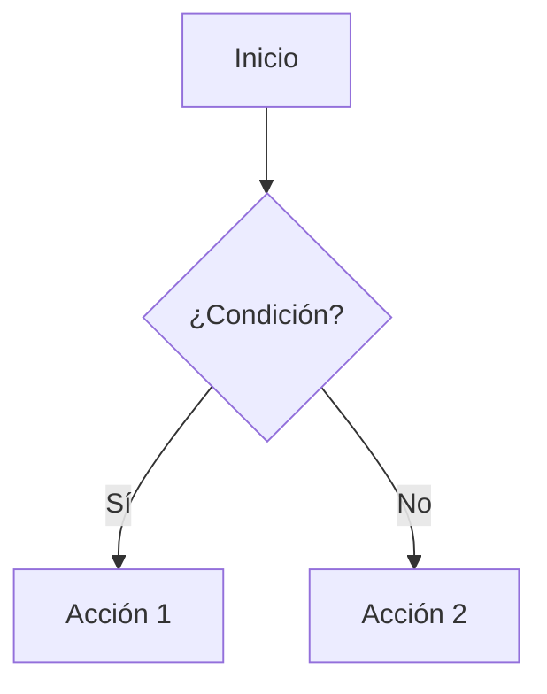

# Manual de Markdown

## 1. ¿Qué es Markdown?

**Markdown** es un lenguaje de marcado ligero creado para escribir texto con formato de forma sencilla y legible, incluso antes de ser convertido a HTML. Su idea principal es que el documento fuente se pueda leer tal cual, sin etiquetas que ensucien el contenido.

Características principales:

- Es **texto plano**: se puede abrir con cualquier editor.
- Es **portable**: no depende de un programa concreto.
- Es **convertible**: se transforma a HTML, PDF, EPUB, presentaciones, etc.
- Es **legible**: el código fuente se entiende sin necesidad de procesarlo.

Ejemplo de un documento Markdown:

````markdown
# Mi primer documento

Este es un párrafo con **texto en negrita** y *texto en cursiva*.

- Un elemento de lista
- Otro elemento

```python
print("Hola, mundo")
```
````

El resultado es un documento con título, énfasis, una lista y un bloque de código resaltado, sin haber escrito ni una sola etiqueta HTML.

### ¿Para qué se usa?

- Documentación técnica (README, wikis, manuales).
- Blogs y sitios web estáticos.
- Notas personales (Obsidian, Joplin, Logseq).
- Apuntes y trabajos académicos.
- Mensajes en GitHub, GitLab, foros y chats.
- Presentaciones (Marp, Reveal.js).
- Libros y documentación con herramientas como Pandoc o VitePress.

---

## 2. Historia y variantes

Markdown fue creado en **2004** por **John Gruber**, con la ayuda de **Aaron Swartz**, con el objetivo de que el texto fuese fácil de escribir y de leer. En 2014 surgió **CommonMark**, una especificación estricta para evitar las diferencias entre implementaciones.

Variantes más conocidas:

| Variante | Descripción |
|----------|-------------|
| **CommonMark** | Especificación estricta y de referencia del lenguaje. |
| **GitHub Flavored Markdown (GFM)** | Añade tablas, listas de tareas, tachado y autenlaces. Es la más extendida. |
| **Markdown Extra** | Añade tablas, notas al pie, listas de definición y más. |
| **MDX** | Markdown con componentes JSX, usado en React y VitePress. |
| **MultiMarkdown** | Orientado a documentos académicos y exportación. |

Este manual sigue, en su mayor parte, **CommonMark** junto con las extensiones habituales de **GFM**.

---

## 3. Sintaxis básica

### 3.1 Encabezados

Los encabezados se crean con el símbolo `#` al principio de la línea. El número de `#` indica el nivel (de 1 a 6):

```markdown
# Título de nivel 1
## Título de nivel 2
### Título de nivel 3
#### Título de nivel 4
##### Título de nivel 5
###### Título de nivel 6
```

También se admite el estilo "subrayado" para los niveles 1 y 2:

```markdown
Título de nivel 1
=================

Título de nivel 2
-----------------
```

> **Regla práctica:** usa un solo `#` por documento (el título principal) y organiza el resto de forma jerárquica. No saltes niveles (de `##` a `####`, por ejemplo).

### 3.2 Párrafos

Un párrafo es simplemente una o varias líneas de texto separadas por **una línea en blanco**:

```markdown
Este es el primer párrafo.
Puede ocupar varias líneas sin problema.

Este es el segundo párrafo.
```

Si no dejas una línea en blanco, las líneas se unen en un mismo párrafo:

```markdown
Esta línea
y esta otra
forman un único párrafo.
```

### 3.3 Saltos de línea

Para forzar un salto de línea dentro de un mismo párrafo se añaden **dos espacios** al final de la línea, o bien una barra invertida `\`:

```markdown
Primera línea  
Segunda línea forzada

Otra línea\
y esta también.
```

### 3.4 Énfasis: negrita, cursiva y tachado

```markdown
*texto en cursiva*
_texto en cursiva_

**texto en negrita**
__texto en negrita__

***texto en negrita y cursiva***
___texto en negrita y cursiva___

~~texto tachado~~
```

Resultado:

*texto en cursiva* · **texto en negrita** · ***negrita y cursiva*** · ~~texto tachado~~

> **Convención:** usa `*` para cursiva y `**` para negrita, y evita mezclar `*` y `_` en la misma palabra. Los guiones bajos dentro de identificadores (`mi_variable`) no se interpretan como énfasis si están rodeados de caracteres alfanuméricos.

### 3.5 Escapar caracteres especiales

Si quieres mostrar un carácter que Markdown interpretaría como sintaxis, antepón una barra invertida `\`:

```markdown
\*esto no es cursiva\*
\# esto no es un encabezado
1\. esto no es una lista
```

Caracteres que se pueden escapar: `\` `` ` `` `*` `_` `{}` `[]` `()` `#` `+` `-` `.` `!` `|` `>`.

### 3.6 Comentarios

Markdown no tiene comentarios propios, pero se pueden usar comentarios HTML, que no se muestran al renderizar:

```markdown
<!-- Este comentario no aparecerá en el documento final -->
```

---

## 4. Listas

### 4.1 Listas desordenadas

Se crean con `-`, `*` o `+` al inicio de la línea:

```markdown
- Manzana
- Plátano
- Naranja

* Alternativa con asterisco
* Otro elemento

+ Alternativa con más
+ Otro elemento
```

Se pueden anidar añadiendo **dos o cuatro espacios** de sangría:

```markdown
- Frutas
  - Manzana
  - Plátano
    - Plátano de Canarias
- Verduras
  - Lechuga
```

### 4.2 Listas ordenadas

Se usa un número seguido de un punto. Markdown renumera automáticamente:

```markdown
1. Primer paso
2. Segundo paso
3. Tercer paso
```

También funciona aunque todos los números sean iguales:

```markdown
1. Primer paso
1. Segundo paso
1. Tercer paso
```

### 4.3 Listas de tareas (GFM)

```markdown
- [x] Tarea completada
- [x] Otra tarea completada
- [ ] Tarea pendiente
- [ ] Otra tarea pendiente
```

Resultado:

- [x] Tarea completada
- [ ] Tarea pendiente

### 4.4 Listas de definiciones (Markdown Extra)

No forman parte del estándar, pero muchas implementaciones las admiten:

```markdown
Término
: Definición del término.

Otro término
: Otra definición.
```

### 4.5 Párrafos dentro de listas

Para incluir varios párrafos en un elemento de lista, sangra el texto con cuatro espacios o una tabulación:

```markdown
1. Primer elemento.

   Este es un segundo párrafo del mismo elemento.

2. Segundo elemento.
```

---

## 5. Enlaces

### 5.1 Enlaces en línea

La sintaxis es `[texto visible](URL "título opcional")`:

```markdown
[Documentación de Markdown](https://commonmark.org)

[GitHub](https://github.com "Ir a GitHub")
```

### 5.2 Enlaces automáticos

Si la URL va entre `< >`, se convierte en enlace:

```markdown
<https://www.ejemplo.com>
<correo@ejemplo.com>
```

GitHub Flavored Markdown también convierte automáticamente URLs sueltas:

```markdown
Visita https://www.ejemplo.com para más información.
```

### 5.3 Enlaces de referencia

Útiles cuando la misma URL se repite o para mantener el texto limpio:

```markdown
Consulta la [documentación oficial][docs] y la [guía de inicio][guia].

[docs]: https://commonmark.org "CommonMark"
[guia]: https://www.markdownguide.org "Markdown Guide"
```

### 5.4 Enlaces relativos

Sirven para enlazar a otros archivos del mismo proyecto:

```markdown
[Manual de Python](../python/03_manual_python.md)
[Volver al índice](./index.md)
[Sección de un documento](#encabezados)
```

> En VitePress, los enlaces relativos a archivos `.md` se transforman automáticamente en rutas del sitio.

### 5.5 Enlaces a una sección (anclas)

Cualquier encabezado genera un ancla automática a partir de su texto, en minúsculas y con guiones en lugar de espacios:

```markdown
[Ir a la sección de tablas](#tablas)
```

También se puede definir un ancla manual con HTML:

```markdown
<a id="mi-ancla"></a>
```

### 5.6 Enlaces con título y atributos

En HTML puro:

```html
<a href="https://ejemplo.com" target="_blank" rel="noopener">Abrir en pestaña nueva</a>
```

En la mayoría de implementaciones se puede añadir un título entre comillas:

```markdown
[Ejemplo](https://ejemplo.com "Título que aparece al pasar el ratón")
```

### 5.7 Enlaces a archivos descargables

```markdown
[Descargar el PDF](./documentos/manual.pdf)
[Descargar la hoja de cálculo](./datos/notas.xlsx)
```

---

## 6. Imágenes

### 6.1 Sintaxis básica

La sintaxis es muy parecida a la de los enlaces, pero con un signo de exclamación delante:

```markdown

```

- **Texto alternativo**: se muestra si la imagen no carga y lo leen los lectores de pantalla.
- **Ruta**: puede ser relativa o absoluta.

Con título opcional:

```markdown

```

### 6.2 Imágenes locales

Si la imagen está en la misma carpeta que el documento:

```markdown

```

En una subcarpeta:

```markdown

```

En una carpeta superior:

```markdown

```

### 6.3 Imágenes en VitePress

En VitePress las imágenes deben colocarse preferentemente en la carpeta `public/` del proyecto o junto al documento:

```markdown
<!-- Imagen en public/img/logo.png -->


<!-- Imagen junto al documento -->

```

Las rutas que empiezan por `/` son absolutas respecto a la raíz del sitio.

### 6.4 Imágenes externas

```markdown

```

> **Consejo:** no enlaces imágenes de terceros que puedan desaparecer; descárgalas y guárdalas en el proyecto.

### 6.5 Imágenes de referencia

```markdown
![Logotipo][logo]

[logo]: img/logo.png "Logotipo"
```

### 6.6 Controlar el tamaño con HTML

Markdown puro no permite cambiar el tamaño de una imagen. Se puede usar HTML:

```html


```

En VitePress también se pueden aplicar clases:

```html

```

### 6.7 Imagen con enlace

Se anida la imagen dentro de un enlace:

```markdown
[](https://ejemplo.com)
```

### 6.8 Figuras con pie de foto

Markdown no tiene una sintaxis de figura, pero se puede simular con HTML:

```html
<figure>
  
  <figcaption>Figura 1. Diagrama de flujo del proceso.</figcaption>
</figure>
```

### 6.9 Formatos recomendados

| Formato | Uso recomendado |
|---------|-----------------|
| **PNG** | Capturas, diagramas, imágenes con transparencia. |
| **JPEG** | Fotografías. |
| **SVG** | Logotipos, iconos y diagramas vectoriales. |
| **WebP** | Imágenes web con buena compresión. |
| **GIF / WebP animado** | Animaciones cortas. |

### 6.10 Buenas prácticas con imágenes

- Escribe siempre un **texto alternativo descriptivo**.
- Optimiza el peso antes de subirlas.
- Usa nombres de archivo en minúsculas, sin espacios ni tildes.
- Mantén las imágenes en una carpeta `img/` o `assets/`.
- No uses imágenes para representar texto.

---

## 7. Bloques de código

### 7.1 Código en línea

Se encierra entre comillas invertidas (backticks):

```markdown
Ejecuta el comando `ls -la` para listar los archivos.
```

Resultado: ejecuta el comando `ls -la`.

Si el texto contiene backticks, se usan dos o más:

```markdown
Usa `` `code` `` para mostrar un fragmento entre backticks.
```

### 7.2 Bloques de código

Se delimitan con tres backticks al principio y al final:

````markdown
```
Esto es un bloque de código.
No se aplica formato Markdown aquí.
```
````

### 7.3 Bloques con resaltado de sintaxis

Se indica el lenguaje después de los backticks de apertura:

````markdown
```python
def saludar(nombre):
    print(f"Hola, {nombre}")

saludar("Mundo")
```
````

Resultado:

```python
def saludar(nombre):
    print(f"Hola, {nombre}")

saludar("Mundo")
```

Lenguajes habituales:

| Lenguaje | Identificador |
|----------|---------------|
| Python | `python` |
| Java | `java` |
| JavaScript | `javascript` o `js` |
| TypeScript | `typescript` o `ts` |
| HTML | `html` |
| CSS | `css` |
| SQL | `sql` |
| Bash / Shell | `bash`, `sh`, `shell` |
| JSON | `json` |
| YAML | `yaml` |
| XML | `xml` |
| Markdown | `markdown` o `md` |
| C | `c` |
| C++ | `cpp` |
| Julia | `julia` |
| R | `r` |
| Diff | `diff` |
| Texto plano | `text` o `plaintext` |

### 7.4 Bloque dentro de otro bloque

Si necesitas mostrar un bloque de código que a su vez contiene tres backticks, usa **cuatro backticks** para el exterior:

`````markdown
````markdown
```python
print("Hola")
```
````
`````

### 7.5 Código con líneas resaltadas (VitePress)

VitePress permite resaltar líneas concretas con comentarios especiales:

````markdown
```python{2,4}
def sumar(a, b):
    resultado = a + b
    return resultado

print(sumar(2, 3))
```
````

También se pueden marcar líneas con `// [!code highlight]`, `// [!code ++]` o `// [!code --]`:

````markdown
```javascript
const a = 1 // [!code highlight]
const b = 2
const c = 3 // [!code --]
const d = 4 // [!code ++]
```
````

### 7.6 Diff en bloques de código

````markdown
```diff
- línea eliminada
+ línea añadida
  línea sin cambios
```
````

### 7.7 Buenas prácticas con código

- Indica siempre el lenguaje para obtener resaltado.
- No pongas líneas excesivamente largas; rompe el código.
- Añade comentarios solo cuando aporten información.
- Verifica que el ejemplo funciona antes de publicarlo.

---

## 8. Tablas

Las tablas de GFM se construyen con barras verticales y una línea separadora:

```markdown
| Columna 1 | Columna 2 | Columna 3 |
|-----------|-----------|-----------|
| Dato 1    | Dato 2    | Dato 3    |
| Dato 4    | Dato 5    | Dato 6    |
```

Resultado:

| Columna 1 | Columna 2 | Columna 3 |
|-----------|-----------|-----------|
| Dato 1    | Dato 2    | Dato 3    |
| Dato 4    | Dato 5    | Dato 6    |

### 8.1 Alineación

Se usan dos puntos en la línea separadora:

```markdown
| Izquierda | Centro | Derecha |
|:----------|:------:|--------:|
| Texto     | Texto  | Texto   |
| Más       | Más    | Más     |
```

Resultado:

| Izquierda | Centro | Derecha |
|:----------|:------:|--------:|
| Texto     | Texto  | Texto   |

### 8.2 Formato dentro de celdas

Se puede aplicar énfasis, código y enlaces dentro de las celdas:

```markdown
| Comando | Descripción |
|---------|-------------|
| `ls`    | Lista archivos |
| `cd`    | Cambia de directorio |
| `**rm**`| Elimina archivos |
```

> No se pueden insertar bloques de código multilínea ni listas dentro de una celda de tabla estándar. Para eso se usa HTML.

### 8.3 Tablas con barras literales

Para mostrar una barra vertical dentro de una celda, se escapa con `\|`:

```markdown
| Operador | Significado |
|----------|-------------|
| `\|\|`   | OR lógico   |
```

---

## 9. Citas y separadores

### 9.1 Citas

Se usa el símbolo `>` al inicio de la línea:

```markdown
> Esto es una cita.
> Puede ocupar varias líneas.
```

Resultado:

> Esto es una cita.
> Puede ocupar varias líneas.

Las citas se pueden anidar:

```markdown
> Cita de primer nivel.
>
> > Cita anidada de segundo nivel.
```

Dentro de una cita se puede usar cualquier otro elemento:

```markdown
> ## Título dentro de una cita
>
> - Elemento de lista
> - Otro elemento
>
> ```python
> print("Hola")
> ```
```

### 9.2 Separadores horizontales

Se crean con tres o más guiones, asteriscos o guiones bajos en una línea:

```markdown
---

***

___
```

Los tres producen una línea horizontal:

---

---

## 10. Elementos HTML

Markdown permite incrustar HTML directamente. Es útil para funcionalidades que el lenguaje no cubre.

### 10.1 Saltos y líneas

```html
<br>
<hr>
```

### 10.2 Texto con formato especial

```html
<mark>Texto resaltado</mark>
<sup>superíndice</sup>
<sub>subíndice</sub>
<kbd>Ctrl</kbd> + <kbd>C</kbd>
<abbr title="HyperText Markup Language">HTML</abbr>
<small>Texto pequeño</small>
```

Resultado: <mark>Texto resaltado</mark>, H<sub>2</sub>O, x<sup>2</sup>, <kbd>Ctrl</kbd> + <kbd>C</kbd>, <abbr title="HyperText Markup Language">HTML</abbr>.

### 10.3 Detalles desplegables

````html
<details>
  <summary>Haz clic para ver más</summary>

  Contenido oculto que se muestra al desplegar.

  ```python
  print("También admite código")
  ```
</details>
````

Resultado:

<details>
  <summary>Haz clic para ver más</summary>

  Contenido oculto que se muestra al desplegar.

  ```python
  print("También admite código")
  ```
</details>

### 10.4 Comentarios

```html
<!-- Este texto no se muestra -->
```

### 10.5 Advertencias

```markdown
> [!NOTE]
> Información útil.
```

> [!NOTE]
> Información útil.

(Véase la sección de VitePress para más tipos de avisos.)

---

## 11. Sintaxis extendida

Estas extensiones no forman parte del núcleo de Markdown, pero son muy habituales.

### 11.1 Notas al pie

```markdown
Este texto tiene una nota al pie.[^1]

[^1]: Contenido de la nota al pie.
```

Resultado:

Este texto tiene una nota al pie.[^1]

[^1]: Contenido de la nota al pie.

### 11.2 Listas de tareas

Ya vistas en la sección de listas:

```markdown
- [x] Hecho
- [ ] Pendiente
```

### 11.3 Tachado

```markdown
~~texto eliminado~~
```

### 11.4 Emoji

GitHub admite códigos de emoji:

```markdown
:smile: :rocket: :warning:
```

También se pueden pegar directamente los caracteres.

### 11.5 Resaltado de texto

Según la implementación:

```markdown
==texto resaltado==
```

O con HTML: `<mark>texto resaltado</mark>`.

### 11.6 Fórmulas matemáticas

Con MathJax o KaTeX (VitePress lo soporta con `markdown.math`):

```markdown
En línea: $E = mc^2$

En bloque:

$$
\int_a^b f(x)\,dx
$$
```

En línea: $E = mc^2$

En bloque:

$$
\int_a^b f(x)\,dx
$$

### 11.7 Diagramas Mermaid

````markdown

````


### 11.8 Definiciones de abreviaturas

En Markdown Extra:

```markdown
La especificación HTML es mantenida por el W3C.

*[HTML]: HyperText Markup Language
*[W3C]: World Wide Web Consortium
```

### 11.9 Índices y tablas de contenidos

Muchas herramientas generan el índice automáticamente a partir de los encabezados. En VitePress puedes usar la barra lateral o crear una lista manual de enlaces:

```markdown
- [Introducción](#introduccion)
- [Desarrollo](#desarrollo)
- [Conclusiones](#conclusiones)
```

---

## 12. Extensiones de VitePress

VitePress añade funcionalidades propias sobre Markdown. Son las que se usan en este sitio.

### 12.1 Frontmatter

Al inicio del archivo, entre líneas `---`, se define metainformación:

```markdown
---
title: Manual de Markdown
description: Guía completa de Markdown
outline: deep
lastUpdated: true
---

# Manual de Markdown
```

Opciones habituales:

| Opción | Descripción |
|--------|-------------|
| `title` | Título de la página. |
| `description` | Descripción para SEO. |
| `outline` | Nivel del índice lateral (`deep` muestra más niveles). |
| `lastUpdated` | Muestra la fecha de última modificación. |
| `sidebar` | Fuerza la barra lateral (`false` la oculta). |
| `editLink` | Enlace para editar la página. |
| `prev` / `next` | Enlaces de navegación. |
| `layout` | Plantilla (`doc`, `home`, `page`). |

### 12.2 Contenedores personalizados

Los *containers* resaltan información importante. Los tipos disponibles por defecto son `info`, `tip`, `warning`, `danger` y `details`:

```markdown
::: info
Este es un bloque informativo.
:::

::: tip
Este es un consejo útil.
:::

::: warning
Esto es una advertencia.
:::

::: danger
Esto es una advertencia crítica.
:::

::: details Haz clic para ver más
Contenido desplegable.
:::
```

Resultado:

::: info
Este es un bloque informativo.
:::

::: tip
Este es un consejo útil.
:::

::: warning
Esto es una advertencia.
:::

::: danger
Esto es una advertencia crítica.
:::

::: details Haz clic para ver más
Contenido desplegable.
:::

Se puede indicar un título personalizado:

```markdown
::: tip Para recordar
El título del bloque se puede personalizar.
:::
```

### 12.3 Enlaces y texto enriquecido

VitePress permite usar componentes de Vue y etiquetas HTML dentro de Markdown. Por ejemplo:

```html
<span class="texto-destacado">Texto con estilo personalizado</span>
```

### 12.4 Bloques de código con título

Se puede añadir un título al bloque de código:

````markdown
```python{filename="hola.py"}
print("Hola")
```
````

### 12.5 Grupos de código

````markdown
::: code-group

```bash [npm]
npm install
```

```bash [pnpm]
pnpm install
```

:::
````

### 12.6 Badges

VitePress incluye componentes como `Badge`:

```markdown
### Título <Badge type="tip" text="Nuevo" />
```

### 12.7 Enlaces a cabeceras con anclas personalizadas

```markdown
## Mi sección {#ancla-personalizada}
```

Permite que `[enlace](#ancla-personalizada)` funcione aunque el texto del encabezado cambie.

---

## 13. Buenas prácticas

### 13.1 Estructura del documento

- Un solo `#` por documento.
- Jerarquía de encabezados coherente.
- Introducción breve y objetivo claro.
- Secciones de tamaño razonable.
- Índice al principio en documentos largos.

### 13.2 Escritura

- Frases cortas y directas.
- Párrafos de 3 a 6 líneas.
- Vocabulario consistente.
- Evita abreviaturas ambiguas.
- Usa listas para enumeraciones y pasos.
- Usa tablas para comparar datos.

### 13.3 Enlaces e imágenes

- Comprueba que los enlaces funcionan.
- Usa rutas relativas dentro del proyecto.
- Escribe texto alternativo en todas las imágenes.
- Nombra los archivos en minúsculas y sin espacios.
- Optimiza el tamaño de las imágenes.

### 13.4 Código

- Indica siempre el lenguaje.
- Ejemplos completos y ejecutables.
- Evita líneas mayores de 80-100 caracteres.
- No incluyas credenciales ni datos personales.

### 13.5 Accesibilidad

- Texto alternativo descriptivo en imágenes.
- No uses solo el color para transmitir información.
- Encabezados jerárquicos y descriptivos.
- Enlaces con texto significativo ("consulta la guía", no "haz clic aquí").
- Tablas con encabezados claros.

### 13.6 Compatibilidad

- No abuses de HTML incrustado.
- Usa sintaxis estándar siempre que sea posible.
- Comprueba la vista previa en el destino final.
- Evita extensiones que la plataforma no soporte.

### 13.7 Estilo y formato

- Deja una línea en blanco antes y después de listas, tablas y bloques de código.
- No mezcles `*` y `_` innecesariamente.
- Usa comillas invertidas para nombres de archivos, comandos y variables.
- Sé consistente en el uso de mayúsculas y puntuación.

---

## 14. Herramientas

### 14.1 Editores

| Editor | Plataforma | Notas |
|--------|-----------|-------|
| **VS Code** | Windows, macOS, Linux | Extensión Markdown All in One. |
| **Obsidian** | Windows, macOS, Linux, móvil | Notas con enlaces internos. |
| **Typora** | Windows, macOS, Linux | Edición WYSIWYG. |
| **Zettlr** | Windows, macOS, Linux | Orientado a investigación. |
| **Joplin** | Multiplataforma | Notas sincronizadas. |
| **Logseq** | Multiplataforma | Notas tipo grafo. |

### 14.2 Conversión

| Herramienta | Función |
|-------------|---------|
| **Pandoc** | Conversión entre decenas de formatos. |
| **markdown-it** | Renderizador JavaScript. |
| **marked** | Renderizador JavaScript rápido. |
| **Python-Markdown** | Renderizador en Python. |
| **CommonMark.js** | Implementación de referencia en JS. |

Ejemplos con Pandoc:

```bash
pandoc manual.md -o manual.pdf
pandoc manual.md -o manual.html --standalone
pandoc manual.md -o manual.docx
```

### 14.3 Validación y linting

```bash
npx markdownlint manual.md
npx markdownlint-cli2 "**/*.md"
```

### 14.4 Previsualización rápida

- VS Code: `Ctrl+Shift+V` (o `Cmd+Shift+V` en macOS).
- GitHub: pestaña *Preview* al editar.
- VitePress: `npx vitepress dev`.

---

## 15. Chuleta rápida

| Elemento | Sintaxis |
|----------|----------|
| Encabezado 1 | `# Título` |
| Encabezado 2 | `## Título` |
| Encabezado 3 | `### Título` |
| Negrita | `**texto**` |
| Cursiva | `*texto*` |
| Negrita y cursiva | `***texto***` |
| Tachado | `~~texto~~` |
| Código en línea | `` `código` `` |
| Bloque de código | ` ```python ... ``` ` |
| Enlace | `[texto](url)` |
| Enlace con título | `[texto](url "título")` |
| Enlace de referencia | `[texto][ref]` + `[ref]: url` |
| Imagen | `` |
| Imagen con enlace | `[](url)` |
| Lista desordenada | `- elemento` |
| Lista ordenada | `1. elemento` |
| Lista de tareas | `- [x] hecho` |
| Cita | `> texto` |
| Separador | `---` |
| Tabla | `\| a \| b \|` con línea `\|---\|---\|` |
| Salto de línea | dos espacios al final |
| Escapar carácter | `\*` |
| Nota al pie | `texto[^1]` + `[^1]: nota` |
| Comentario HTML | `<!-- comentario -->` |
| Fórmula en línea | `$x^2$` |
| Fórmula en bloque | `$$ ... $$` |
| Diagrama | ` ```mermaid ... ``` ` |
| Contenedor VitePress | `::: tip ... :::` |
| Ancla personalizada | `## Título {#ancla}` |

---

## Ejemplo completo

A continuación se muestra un documento que combina los elementos más habituales:

````markdown
---
title: Guía de instalación
description: Cómo instalar y configurar la aplicación
---

# Guía de instalación

## Requisitos previos

- Sistema operativo Linux, macOS o Windows.
- **Python 3.10** o superior.
- 2 GB de memoria RAM.

> [!NOTE]
> La instalación tarda aproximadamente cinco minutos.

## Instalación

1. Descarga el paquete desde la [página oficial](https://ejemplo.com).
2. Descomprime el archivo:

   ```bash
   tar -xzf aplicacion.tar.gz
   ```

3. Ejecuta el instalador:

   ```bash
   cd aplicacion
   ./install.sh
   ```

## Configuración

| Parámetro | Valor por defecto | Descripción |
|-----------|-------------------|-------------|
| `puerto`  | `8080`            | Puerto de escucha |
| `host`    | `localhost`       | Dirección del servidor |
| `debug`   | `false`           | Modo de depuración |

## Captura


## Verificación

Comprueba que el servicio responde:

```bash
curl http://localhost:8080/health
```

Si todo funciona, verás:

```json
{
  "status": "ok",
  "version": "1.0.0"
}
```

## Problemas frecuentes

::: warning
Si el puerto está ocupado, cambia el valor de `puerto` en el archivo de configuración.
:::

<details>
  <summary>Ver solución detallada</summary>

  Ejecuta `lsof -i :8080` para identificar el proceso que usa el puerto y deténlo antes de volver a iniciar la aplicación.

</details>

---

*Última actualización: octubre de 2026.*
````

---

## Referencias

- [CommonMark Spec](https://spec.commonmark.org)
- [GitHub Flavored Markdown](https://github.github.com/gfm/)
- [Markdown Guide](https://www.markdownguide.org)
- [Documentación de VitePress](https://vitepress.dev)
- [Pandoc](https://pandoc.org)
